# Awesome Gemini 4 Neon

English · [简体中文](README.zh-CN.md)

[](https://awesome.re) [](#contents) [](docs/prompts.md) [](https://github.com/sandbase-lab/awesome-gemini-4-neon/actions/workflows/sync.yml) [](https://www.sandbase.ai/model/google/gemini-4-neon?utm_source=github&utm_medium=readme&utm_campaign=awesome-gemini-4-neon)

[](https://www.sandbase.ai/lab/ai-videos/gemini-4-neon?utm_source=github&utm_medium=readme&utm_campaign=awesome-gemini-4-neon&utm_content=banner)

A curated list of **Gemini 4 Neon examples**: videos, prompts and demos made with Gemini 4 Neon, a model from Google DeepMind announced on November 18, 2026. Three.js and GLSL 3D scenes, games, motion graphics and same-prompt comparisons, many of them written as one self-contained HTML page from a prompt, each one credited to its creator and linked to the original post.

**86 videos** from **64 creators** · **15** with the creator's prompt · synced daily from [SandBase Lab](https://www.sandbase.ai/lab/ai-videos/gemini-4-neon?utm_source=github&utm_medium=readme&utm_campaign=awesome-gemini-4-neon&utm_content=stats)

## Start here

| I want to… | Go to |
|---|---|
| Watch the videos | [Browse by category](#contents) below, or [play them full-size on SandBase Lab](https://www.sandbase.ai/lab/ai-videos/gemini-4-neon?utm_source=github&utm_medium=readme&utm_campaign=awesome-gemini-4-neon&utm_content=quickstart) |
| Copy a prompt | [Prompt index](docs/prompts.md): every video that comes with its prompt |
| Write your own prompt | [Prompt guide](docs/prompt-guide.md): 4 patterns and a fill-in template |
| Make a video | [Tutorial](docs/tutorial.md): prompt → HTML → MP4, with the API and a recording script |
| Pick a model | [Gemini 4 Neon vs GPT-6.2 Sol, Gemini 4 Carbon, Gemini 4 Argon and Claude Opus 5.5](docs/model-comparison.md) |
| Try it now | [Run Gemini 4 Neon in the Lab arena](https://www.sandbase.ai/arena/text?models=google%2Fgemini-4-neon&utm_source=github&utm_medium=readme&utm_campaign=awesome-gemini-4-neon&utm_content=quickstart), next to other models |

<a id="contents"></a>

## Contents

- [Featured](#featured) (8)
- [3D scenes](#3d-scene) (24)
- [Motion graphics](#motion-graphics) (25)
- [Games](#game) (7)
- [Product UI](#ui-demo) (5)
- [Kinetic type](#kinetic-type) (1)
- [Explainers](#explainer) (2)
- [Launch films](#launch-film) (4)
- [Tests & comparisons](#comparison) (18)
- [Recreate a video with Gemini 4 Neon](#recreate)
- [FAQ](#faq)
- [Suggest a video](#contribute)

Click a preview to play the video. Click a title for the post, the prompt and **Recreate** on SandBase Lab. **@handle** links to the creator's post on X.

<a id="featured"></a>

## Featured

<table>
<tr><td width="33%" valign="top"><a href="https://www.sandbase.ai/lab/media/x/opus-5-5/2123362270139109827/video.mp4"></a><br><a href="https://www.sandbase.ai/lab/ai-videos/gemini-4-neon/2123362270139109827?utm_source=github&utm_medium=readme&utm_campaign=awesome-gemini-4-neon&utm_content=card"><b>Motion design animation for AI products</b></a><br><sub><a href="https://x.com/Tuola0205/status/2123362270139109827">@Tuola0205</a></sub></td><td width="33%" valign="top"><a href="https://www.sandbase.ai/lab/media/x/gemini-4-neon/2123184113561817370/video.mp4"></a><br><a href="https://www.sandbase.ai/lab/ai-videos/gemini-4-neon/2123184113561817370?utm_source=github&utm_medium=readme&utm_campaign=awesome-gemini-4-neon&utm_content=card"><b>Motion design for a pelican product</b></a><br><sub><a href="https://x.com/chetaslua/status/2123184113561817370">@chetaslua</a></sub></td><td width="33%" valign="top"><a href="https://www.sandbase.ai/lab/media/x/gemini-4-argon/2124892615946678458/video.mp4">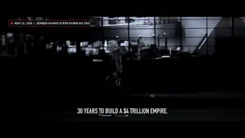</a><br><a href="https://www.sandbase.ai/lab/ai-videos/gemini-4-neon/2124892615946678458?utm_source=github&utm_medium=readme&utm_campaign=awesome-gemini-4-neon&utm_content=card"><b>A video about Jensen Huang&#x27;s comeback</b></a><br><sub><a href="https://x.com/vipinxtwt/status/2124892615946678458">@vipinxtwt</a> · <a href="https://www.sandbase.ai/lab/ai-videos/gemini-4-neon/2124892615946678458?utm_source=github&utm_medium=readme&utm_campaign=awesome-gemini-4-neon&utm_content=card">prompt</a></sub></td></tr>
<tr><td width="33%" valign="top"><a href="https://www.sandbase.ai/lab/media/x/gemini-4-argon/2123259795172212871/video.mp4">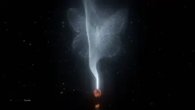</a><br><a href="https://www.sandbase.ai/lab/ai-videos/gemini-4-neon/2123259795172212871?utm_source=github&utm_medium=readme&utm_campaign=awesome-gemini-4-neon&utm_content=card"><b>Artistic butterflies rendered in Three.js</b></a><br><sub><a href="https://x.com/thtbee_/status/2123259795172212871">@thtbee_</a></sub></td><td width="33%" valign="top"><a href="https://www.sandbase.ai/lab/media/x/gemini-4-neon/2123212198663323848/video.mp4"></a><br><a href="https://www.sandbase.ai/lab/ai-videos/gemini-4-neon/2123212198663323848?utm_source=github&utm_medium=readme&utm_campaign=awesome-gemini-4-neon&utm_content=card"><b>Interactive 3D historical sailing ship</b></a><br><sub><a href="https://x.com/abhinavflac/status/2123212198663323848">@abhinavflac</a></sub></td><td width="33%" valign="top"><a href="https://www.sandbase.ai/lab/media/x/gemini-4-argon/2125001629850345678/video.mp4"></a><br><a href="https://www.sandbase.ai/lab/ai-videos/gemini-4-neon/2125001629850345678?utm_source=github&utm_medium=readme&utm_campaign=awesome-gemini-4-neon&utm_content=card"><b>A shader rendered game in HTML</b></a><br><sub><a href="https://x.com/kevin_t_ngo/status/2125001629850345678">@kevin_t_ngo</a> · <a href="https://www.sandbase.ai/lab/ai-videos/gemini-4-neon/2125001629850345678?utm_source=github&utm_medium=readme&utm_campaign=awesome-gemini-4-neon&utm_content=card">prompt</a></sub></td></tr>
<tr><td width="33%" valign="top"><a href="https://www.sandbase.ai/lab/media/x/gemini-4-argon/2124558621782495548/video.mp4">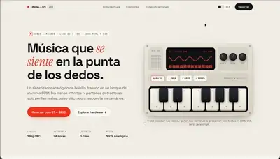</a><br><a href="https://www.sandbase.ai/lab/ai-videos/gemini-4-neon/2124558621782495548?utm_source=github&utm_medium=readme&utm_campaign=awesome-gemini-4-neon&utm_content=card"><b>Landing page with animations and microinteractions</b></a><br><sub><a href="https://x.com/niachito/status/2124558621782495548">@niachito</a> · <a href="https://www.sandbase.ai/lab/ai-videos/gemini-4-neon/2124558621782495548?utm_source=github&utm_medium=readme&utm_campaign=awesome-gemini-4-neon&utm_content=card">prompt</a></sub></td><td width="33%" valign="top"><a href="https://www.sandbase.ai/lab/media/x/gemini-4-neon/2123246994496077998/video.mp4"></a><br><a href="https://www.sandbase.ai/lab/ai-videos/gemini-4-neon/2123246994496077998?utm_source=github&utm_medium=readme&utm_campaign=awesome-gemini-4-neon&utm_content=card"><b>A 15 second promo video for Gemini 4 neon</b></a><br><sub><a href="https://x.com/cfenghub/status/2123246994496077998">@cfenghub</a> · <a href="https://www.sandbase.ai/lab/ai-videos/gemini-4-neon/2123246994496077998?utm_source=github&utm_medium=readme&utm_campaign=awesome-gemini-4-neon&utm_content=card">prompt</a></sub></td></tr>
</table>

<a id="3d-scene"></a>

## 3D scenes

<table>
<tr><td width="33%" valign="top"><a href="https://www.sandbase.ai/lab/media/x/gemini-4-neon/2123120305648619534/video.mp4">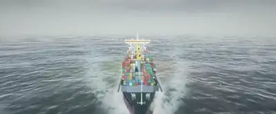</a><br><a href="https://www.sandbase.ai/lab/ai-videos/gemini-4-neon/2123120305648619534?utm_source=github&utm_medium=readme&utm_campaign=awesome-gemini-4-neon&utm_content=card"><b>A 3D container ship sailing on the sea</b></a><br><sub><a href="https://x.com/AfnadX/status/2123120305648619534">@AfnadX</a> · 0:22</sub></td><td width="33%" valign="top"><a href="https://www.sandbase.ai/lab/media/x/gemini-4-neon/2123160089854898346/video.mp4">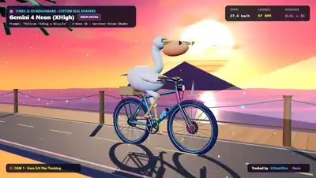</a><br><a href="https://www.sandbase.ai/lab/ai-videos/gemini-4-neon/2123160089854898346?utm_source=github&utm_medium=readme&utm_campaign=awesome-gemini-4-neon&utm_content=card"><b>Pelican riding a bicycle in Three.js</b></a><br><sub><a href="https://x.com/StatsWire/status/2123160089854898346">@StatsWire</a> · 0:12 · <a href="https://www.sandbase.ai/lab/ai-videos/gemini-4-neon/2123160089854898346?utm_source=github&utm_medium=readme&utm_campaign=awesome-gemini-4-neon&utm_content=card">prompt</a></sub></td><td width="33%" valign="top"><a href="https://www.sandbase.ai/lab/media/x/gemini-4-neon/2123160092657021432/video.mp4"></a><br><a href="https://www.sandbase.ai/lab/ai-videos/gemini-4-neon/2123160092657021432?utm_source=github&utm_medium=readme&utm_campaign=awesome-gemini-4-neon&utm_content=card"><b>Cyclist riding a bicycle in Three.js</b></a><br><sub><a href="https://x.com/AI_Screening/status/2123160092657021432">@AI_Screening</a> · 0:14</sub></td></tr>
<tr><td width="33%" valign="top"><a href="https://www.sandbase.ai/lab/media/x/gemini-4-neon/2123162154132242885/video.mp4">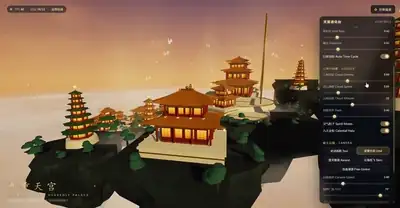</a><br><a href="https://www.sandbase.ai/lab/ai-videos/gemini-4-neon/2123162154132242885?utm_source=github&utm_medium=readme&utm_campaign=awesome-gemini-4-neon&utm_content=card"><b>A Three.js and GLSL scene</b></a><br><sub><a href="https://x.com/cfenghub/status/2123162154132242885">@cfenghub</a> · 0:44 · <a href="https://www.sandbase.ai/lab/ai-videos/gemini-4-neon/2123162154132242885?utm_source=github&utm_medium=readme&utm_campaign=awesome-gemini-4-neon&utm_content=card">prompt</a></sub></td><td width="33%" valign="top"><a href="https://www.sandbase.ai/lab/media/x/gemini-4-neon/2123165046276760028/video.mp4"></a><br><a href="https://www.sandbase.ai/lab/ai-videos/gemini-4-neon/2123165046276760028?utm_source=github&utm_medium=readme&utm_campaign=awesome-gemini-4-neon&utm_content=card"><b>A pelican riding a bicycle in Three.js</b></a><br><sub><a href="https://x.com/zhang_baoqing/status/2123165046276760028">@zhang_baoqing</a> · 0:32</sub></td><td width="33%" valign="top"><a href="https://www.sandbase.ai/lab/media/x/gemini-4-neon/2123170821250400282/video.mp4"></a><br><a href="https://www.sandbase.ai/lab/ai-videos/gemini-4-neon/2123170821250400282?utm_source=github&utm_medium=readme&utm_campaign=awesome-gemini-4-neon&utm_content=card"><b>Robotic dog biomechanics simulation in Three.js WebGPU</b></a><br><sub><a href="https://x.com/thebuggeddev/status/2123170821250400282">@thebuggeddev</a></sub></td></tr>
</table>

<details>
<summary><b>Show all 24</b></summary>

<table>
<tr><td width="33%" valign="top"><a href="https://www.sandbase.ai/lab/media/x/gemini-4-neon/2123170948568535488/video.mp4"></a><br><a href="https://www.sandbase.ai/lab/ai-videos/gemini-4-neon/2123170948568535488?utm_source=github&utm_medium=readme&utm_campaign=awesome-gemini-4-neon&utm_content=card"><b>Painterly 3D animation of the poem To Autumn</b></a><br><sub><a href="https://x.com/vamsibatchuk/status/2123170948568535488">@vamsibatchuk</a></sub></td><td width="33%" valign="top"><a href="https://www.sandbase.ai/lab/media/x/gemini-4-neon/2123190272527860173/video.mp4"></a><br><a href="https://www.sandbase.ai/lab/ai-videos/gemini-4-neon/2123190272527860173?utm_source=github&utm_medium=readme&utm_campaign=awesome-gemini-4-neon&utm_content=card"><b>Animated 3D horse running in a seamless loop</b></a><br><sub><a href="https://x.com/Frtnel/status/2123190272527860173">@Frtnel</a> · 0:29</sub></td><td width="33%" valign="top"><a href="https://www.sandbase.ai/lab/media/x/gemini-4-neon/2123212198663323848/video.mp4"></a><br><a href="https://www.sandbase.ai/lab/ai-videos/gemini-4-neon/2123212198663323848?utm_source=github&utm_medium=readme&utm_campaign=awesome-gemini-4-neon&utm_content=card"><b>Interactive 3D historical sailing ship</b></a><br><sub><a href="https://x.com/abhinavflac/status/2123212198663323848">@abhinavflac</a></sub></td></tr>
<tr><td width="33%" valign="top"><a href="https://www.sandbase.ai/lab/media/x/gemini-4-neon/2123222507977375770/video.mp4">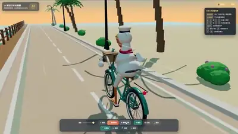</a><br><a href="https://www.sandbase.ai/lab/ai-videos/gemini-4-neon/2123222507977375770?utm_source=github&utm_medium=readme&utm_campaign=awesome-gemini-4-neon&utm_content=card"><b>A pelican riding a bicycle in Three.js</b></a><br><sub><a href="https://x.com/tspy/status/2123222507977375770">@tspy</a> · 0:53 · <a href="https://www.sandbase.ai/lab/ai-videos/gemini-4-neon/2123222507977375770?utm_source=github&utm_medium=readme&utm_campaign=awesome-gemini-4-neon&utm_content=card">prompt</a></sub></td><td width="33%" valign="top"><a href="https://www.sandbase.ai/lab/media/x/gemini-4-neon/2123226306351661099/video.mp4"></a><br><a href="https://www.sandbase.ai/lab/ai-videos/gemini-4-neon/2123226306351661099?utm_source=github&utm_medium=readme&utm_campaign=awesome-gemini-4-neon&utm_content=card"><b>Fantasy voxel castle scene</b></a><br><sub><a href="https://x.com/Lentils80/status/2123226306351661099">@Lentils80</a> · 0:38</sub></td><td width="33%" valign="top"><a href="https://www.sandbase.ai/lab/media/x/gemini-4-argon/2123259795172212871/video.mp4"></a><br><a href="https://www.sandbase.ai/lab/ai-videos/gemini-4-neon/2123259795172212871?utm_source=github&utm_medium=readme&utm_campaign=awesome-gemini-4-neon&utm_content=card"><b>Artistic butterflies rendered in Three.js</b></a><br><sub><a href="https://x.com/thtbee_/status/2123259795172212871">@thtbee_</a></sub></td></tr>
<tr><td width="33%" valign="top"><a href="https://www.sandbase.ai/lab/media/x/gemini-4-neon/2123375564509921472/video.mp4"></a><br><a href="https://www.sandbase.ai/lab/ai-videos/gemini-4-neon/2123375564509921472?utm_source=github&utm_medium=readme&utm_campaign=awesome-gemini-4-neon&utm_content=card"><b>A glossy Three.js 3D scene animation</b></a><br><sub><a href="https://x.com/29meat_ai/status/2123375564509921472">@29meat_ai</a></sub></td><td width="33%" valign="top"><a href="https://www.sandbase.ai/lab/media/x/gemini-4-neon/2123384156629651678/video.mp4">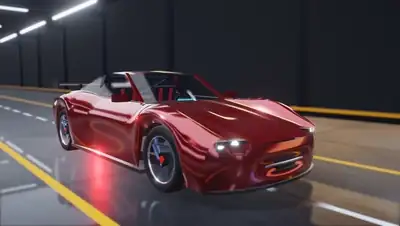</a><br><a href="https://www.sandbase.ai/lab/ai-videos/gemini-4-neon/2123384156629651678?utm_source=github&utm_medium=readme&utm_campaign=awesome-gemini-4-neon&utm_content=card"><b>A car crashing through a wall in Three.js</b></a><br><sub><a href="https://x.com/camperaigg/status/2123384156629651678">@camperaigg</a></sub></td><td width="33%" valign="top"><a href="https://www.sandbase.ai/lab/media/x/gemini-4-argon/2123843882937155607/video.mp4">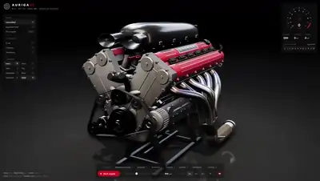</a><br><a href="https://www.sandbase.ai/lab/ai-videos/gemini-4-neon/2123843882937155607?utm_source=github&utm_medium=readme&utm_campaign=awesome-gemini-4-neon&utm_content=card"><b>A 3D V12 engine built in Three.js</b></a><br><sub><a href="https://x.com/thtbee_/status/2123843882937155607">@thtbee_</a></sub></td></tr>
<tr><td width="33%" valign="top"><a href="https://www.sandbase.ai/lab/media/x/gemini-4-neon/2124192968345338206/video.mp4">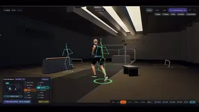</a><br><a href="https://www.sandbase.ai/lab/ai-videos/gemini-4-neon/2124192968345338206?utm_source=github&utm_medium=readme&utm_campaign=awesome-gemini-4-neon&utm_content=card"><b>Interactive 3D neural character demo with MotionBricks</b></a><br><sub><a href="https://x.com/ai_for_success/status/2124192968345338206">@ai_for_success</a></sub></td><td width="33%" valign="top"><a href="https://www.sandbase.ai/lab/media/x/gemini-4-neon/2124508873897726028/video.mp4">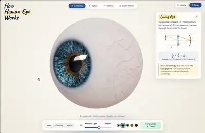</a><br><a href="https://www.sandbase.ai/lab/ai-videos/gemini-4-neon/2124508873897726028?utm_source=github&utm_medium=readme&utm_campaign=awesome-gemini-4-neon&utm_content=card"><b>Interactive 3D model of the human eye</b></a><br><sub><a href="https://x.com/thebuggeddev/status/2124508873897726028">@thebuggeddev</a></sub></td><td width="33%" valign="top"><a href="https://www.sandbase.ai/lab/media/x/gemini-4-neon/2124565795003105494/video.mp4"></a><br><a href="https://www.sandbase.ai/lab/ai-videos/gemini-4-neon/2124565795003105494?utm_source=github&utm_medium=readme&utm_campaign=awesome-gemini-4-neon&utm_content=card"><b>Ocarina of Time papercraft animation in Three.js</b></a><br><sub><a href="https://x.com/xikhar/status/2124565795003105494">@xikhar</a></sub></td></tr>
<tr><td width="33%" valign="top"><a href="https://www.sandbase.ai/lab/media/x/gemini-4-neon/2124572099750891577/video.mp4"></a><br><a href="https://www.sandbase.ai/lab/ai-videos/gemini-4-neon/2124572099750891577?utm_source=github&utm_medium=readme&utm_campaign=awesome-gemini-4-neon&utm_content=card"><b>A 3D motion teaser using Gemini 4 Neon</b></a><br><sub><a href="https://x.com/ai_for_success/status/2124572099750891577">@ai_for_success</a></sub></td><td width="33%" valign="top"><a href="https://www.sandbase.ai/lab/media/x/gemini-4-neon/2125157673448677586/video.mp4"></a><br><a href="https://www.sandbase.ai/lab/ai-videos/gemini-4-neon/2125157673448677586?utm_source=github&utm_medium=readme&utm_campaign=awesome-gemini-4-neon&utm_content=card"><b>A futuristic six-wheel armored monster truck with physics</b></a><br><sub><a href="https://x.com/thebuggeddev/status/2125157673448677586">@thebuggeddev</a></sub></td><td width="33%" valign="top"><a href="https://www.sandbase.ai/lab/media/x/gemini-4-neon/2125270092812533820/video.mp4"></a><br><a href="https://www.sandbase.ai/lab/ai-videos/gemini-4-neon/2125270092812533820?utm_source=github&utm_medium=readme&utm_campaign=awesome-gemini-4-neon&utm_content=card"><b>Interactive 3D skydeck scene built in Three.js</b></a><br><sub><a href="https://x.com/drashyakuruwa/status/2125270092812533820">@drashyakuruwa</a></sub></td></tr>
<tr><td width="33%" valign="top"><a href="https://www.sandbase.ai/lab/media/x/gemini-4-argon/2125282916871938272/video.mp4"></a><br><a href="https://www.sandbase.ai/lab/ai-videos/gemini-4-neon/2125282916871938272?utm_source=github&utm_medium=readme&utm_campaign=awesome-gemini-4-neon&utm_content=card"><b>3D apartment reconstruction from listing photos</b></a><br><sub><a href="https://x.com/0xMfox/status/2125282916871938272">@0xMfox</a> · <a href="https://www.sandbase.ai/lab/ai-videos/gemini-4-neon/2125282916871938272?utm_source=github&utm_medium=readme&utm_campaign=awesome-gemini-4-neon&utm_content=card">prompt</a></sub></td><td width="33%" valign="top"><a href="https://www.sandbase.ai/lab/media/x/gemini-4-neon/2125313162815889411/video.mp4"></a><br><a href="https://www.sandbase.ai/lab/ai-videos/gemini-4-neon/2125313162815889411?utm_source=github&utm_medium=readme&utm_campaign=awesome-gemini-4-neon&utm_content=card"><b>Large scale arctic coast scene with radio dishes</b></a><br><sub><a href="https://x.com/apekshik/status/2125313162815889411">@apekshik</a></sub></td><td width="33%" valign="top"><a href="https://www.sandbase.ai/lab/media/x/gemini-4-neon/2125314230681481651/video.mp4">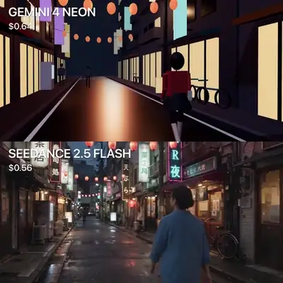</a><br><a href="https://www.sandbase.ai/lab/ai-videos/gemini-4-neon/2125314230681481651?utm_source=github&utm_medium=readme&utm_campaign=awesome-gemini-4-neon&utm_content=card"><b>Directing realistic videos using code-based 3D animations</b></a><br><sub><a href="https://x.com/omidaziz/status/2125314230681481651">@omidaziz</a></sub></td></tr>
</table>

</details>

<a id="motion-graphics"></a>

## Motion graphics

<table>
<tr><td width="33%" valign="top"><a href="https://www.sandbase.ai/lab/media/x/gemini-4-neon/2122954421050933355/video.mp4"></a><br><a href="https://www.sandbase.ai/lab/ai-videos/gemini-4-neon/2122954421050933355?utm_source=github&utm_medium=readme&utm_campaign=awesome-gemini-4-neon&utm_content=card"><b>An SVG illustration of a pelican</b></a><br><sub><a href="https://x.com/Inmerson/status/2122954421050933355">@Inmerson</a> · 0:09 · <a href="https://www.sandbase.ai/lab/ai-videos/gemini-4-neon/2122954421050933355?utm_source=github&utm_medium=readme&utm_campaign=awesome-gemini-4-neon&utm_content=card">prompt</a></sub></td><td width="33%" valign="top"><a href="https://www.sandbase.ai/lab/media/x/gemini-4-neon/2123135691085472139/video.mp4"></a><br><a href="https://www.sandbase.ai/lab/ai-videos/gemini-4-neon/2123135691085472139?utm_source=github&utm_medium=readme&utm_campaign=awesome-gemini-4-neon&utm_content=card"><b>Motion design in a single HTML file</b></a><br><sub><a href="https://x.com/AfnadX/status/2123135691085472139">@AfnadX</a></sub></td><td width="33%" valign="top"><a href="https://www.sandbase.ai/lab/media/x/gemini-4-neon/2123157977045852382/video.mp4"></a><br><a href="https://www.sandbase.ai/lab/ai-videos/gemini-4-neon/2123157977045852382?utm_source=github&utm_medium=readme&utm_campaign=awesome-gemini-4-neon&utm_content=card"><b>A pelican riding a bicycle in HTML</b></a><br><sub><a href="https://x.com/zhang_baoqing/status/2123157977045852382">@zhang_baoqing</a> · 0:19</sub></td></tr>
<tr><td width="33%" valign="top"><a href="https://www.sandbase.ai/lab/media/x/gemini-4-neon/2123159335635456318/video.mp4"></a><br><a href="https://www.sandbase.ai/lab/ai-videos/gemini-4-neon/2123159335635456318?utm_source=github&utm_medium=readme&utm_campaign=awesome-gemini-4-neon&utm_content=card"><b>An SVG pelican illustration</b></a><br><sub><a href="https://x.com/Inmerson/status/2123159335635456318">@Inmerson</a> · 0:26</sub></td><td width="33%" valign="top"><a href="https://www.sandbase.ai/lab/media/x/gemini-4-neon/2123165824576114932/video.mp4"></a><br><a href="https://www.sandbase.ai/lab/ai-videos/gemini-4-neon/2123165824576114932?utm_source=github&utm_medium=readme&utm_campaign=awesome-gemini-4-neon&utm_content=card"><b>Frustrated pelican riding a bicycle in SVG</b></a><br><sub><a href="https://x.com/HarshithLucky3/status/2123165824576114932">@HarshithLucky3</a> · 0:13</sub></td><td width="33%" valign="top"><a href="https://www.sandbase.ai/lab/media/x/gemini-4-neon/2123168004175462796/video.mp4"></a><br><a href="https://www.sandbase.ai/lab/ai-videos/gemini-4-neon/2123168004175462796?utm_source=github&utm_medium=readme&utm_campaign=awesome-gemini-4-neon&utm_content=card"><b>An SVG ship in antigravity</b></a><br><sub><a href="https://x.com/srikanthvaluri/status/2123168004175462796">@srikanthvaluri</a> · 0:07</sub></td></tr>
</table>

<details>
<summary><b>Show all 25</b></summary>

<table>
<tr><td width="33%" valign="top"><a href="https://www.sandbase.ai/lab/media/x/gemini-4-neon/2123180572784640063/video.mp4">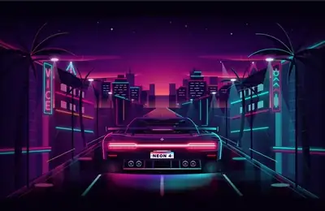</a><br><a href="https://www.sandbase.ai/lab/ai-videos/gemini-4-neon/2123180572784640063?utm_source=github&utm_medium=readme&utm_campaign=awesome-gemini-4-neon&utm_content=card"><b>Vice City SVG graphic animation</b></a><br><sub><a href="https://x.com/Inmerson/status/2123180572784640063">@Inmerson</a> · 0:07</sub></td><td width="33%" valign="top"><a href="https://www.sandbase.ai/lab/media/x/gemini-4-neon/2123181538544374002/video.mp4"></a><br><a href="https://www.sandbase.ai/lab/ai-videos/gemini-4-neon/2123181538544374002?utm_source=github&utm_medium=readme&utm_campaign=awesome-gemini-4-neon&utm_content=card"><b>Siamese cat SVG illustration</b></a><br><sub><a href="https://x.com/Inmerson/status/2123181538544374002">@Inmerson</a> · 0:13</sub></td><td width="33%" valign="top"><a href="https://www.sandbase.ai/lab/media/x/gemini-4-neon/2123181843835207955/video.mp4"></a><br><a href="https://www.sandbase.ai/lab/ai-videos/gemini-4-neon/2123181843835207955?utm_source=github&utm_medium=readme&utm_campaign=awesome-gemini-4-neon&utm_content=card"><b>A red fox riding a bicycle</b></a><br><sub><a href="https://x.com/srikanthvaluri/status/2123181843835207955">@srikanthvaluri</a> · 0:05</sub></td></tr>
<tr><td width="33%" valign="top"><a href="https://www.sandbase.ai/lab/media/x/gemini-4-neon/2123183419442205140/video.mp4"></a><br><a href="https://www.sandbase.ai/lab/ai-videos/gemini-4-neon/2123183419442205140?utm_source=github&utm_medium=readme&utm_campaign=awesome-gemini-4-neon&utm_content=card"><b>A rainy Tokyo scene</b></a><br><sub><a href="https://x.com/PokeBenchTV/status/2123183419442205140">@PokeBenchTV</a> · 0:25</sub></td><td width="33%" valign="top"><a href="https://www.sandbase.ai/lab/media/x/gemini-4-neon/2123184113561817370/video.mp4"></a><br><a href="https://www.sandbase.ai/lab/ai-videos/gemini-4-neon/2123184113561817370?utm_source=github&utm_medium=readme&utm_campaign=awesome-gemini-4-neon&utm_content=card"><b>Motion design for a pelican product</b></a><br><sub><a href="https://x.com/chetaslua/status/2123184113561817370">@chetaslua</a></sub></td><td width="33%" valign="top"><a href="https://www.sandbase.ai/lab/media/x/gemini-4-neon/2123185466417746256/video.mp4">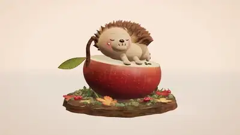</a><br><a href="https://www.sandbase.ai/lab/ai-videos/gemini-4-neon/2123185466417746256?utm_source=github&utm_medium=readme&utm_campaign=awesome-gemini-4-neon&utm_content=card"><b>A sleepy hedgehog animation</b></a><br><sub><a href="https://x.com/doe_naps/status/2123185466417746256">@doe_naps</a> · 0:31</sub></td></tr>
<tr><td width="33%" valign="top"><a href="https://www.sandbase.ai/lab/media/x/gemini-4-neon/2123222816325869685/video.mp4"></a><br><a href="https://www.sandbase.ai/lab/ai-videos/gemini-4-neon/2123219124260315301?utm_source=github&utm_medium=readme&utm_campaign=awesome-gemini-4-neon&utm_content=card"><b>A motion design self-introduction in pure JavaScript</b></a><br><sub><a href="https://x.com/chetaslua/status/2123219124260315301">@chetaslua</a></sub></td><td width="33%" valign="top"><a href="https://www.sandbase.ai/lab/media/x/opus-5-5/2123362270139109827/video.mp4"></a><br><a href="https://www.sandbase.ai/lab/ai-videos/gemini-4-neon/2123362270139109827?utm_source=github&utm_medium=readme&utm_campaign=awesome-gemini-4-neon&utm_content=card"><b>Motion design animation for AI products</b></a><br><sub><a href="https://x.com/Tuola0205/status/2123362270139109827">@Tuola0205</a></sub></td><td width="33%" valign="top"><a href="https://www.sandbase.ai/lab/media/x/gemini-4-argon/2123948163539329148/video.mp4">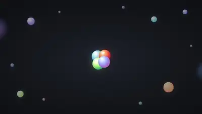</a><br><a href="https://www.sandbase.ai/lab/ai-videos/gemini-4-neon/2123948163539329148?utm_source=github&utm_medium=readme&utm_campaign=awesome-gemini-4-neon&utm_content=card"><b>A debut video sequence by Gemini 4 Neon</b></a><br><sub><a href="https://x.com/liu8in/status/2123948163539329148">@liu8in</a></sub></td></tr>
<tr><td width="33%" valign="top"><a href="https://www.sandbase.ai/lab/media/x/gemini-4-neon/2124036193776263671/video.mp4"></a><br><a href="https://www.sandbase.ai/lab/ai-videos/gemini-4-neon/2124036193776263671?utm_source=github&utm_medium=readme&utm_campaign=awesome-gemini-4-neon&utm_content=card"><b>A first motion test using Gemini 4 Neon</b></a><br><sub><a href="https://x.com/ogabezim/status/2124036193776263671">@ogabezim</a></sub></td><td width="33%" valign="top"><a href="https://www.sandbase.ai/lab/media/x/gemini-4-neon/2124040952658682263/video.mp4"></a><br><a href="https://www.sandbase.ai/lab/ai-videos/gemini-4-neon/2124040952658682263?utm_source=github&utm_medium=readme&utm_campaign=awesome-gemini-4-neon&utm_content=card"><b>Motion design demonstration by Gemini 4 Neon</b></a><br><sub><a href="https://x.com/pankajkumar_dev/status/2124040952658682263">@pankajkumar_dev</a></sub></td><td width="33%" valign="top"><a href="https://www.sandbase.ai/lab/media/x/gemini-4-neon/2124131378770182389/video.mp4"></a><br><a href="https://www.sandbase.ai/lab/ai-videos/gemini-4-neon/2124131378770182389?utm_source=github&utm_medium=readme&utm_campaign=awesome-gemini-4-neon&utm_content=card"><b>Code-generated singing and visuals without external assets</b></a><br><sub><a href="https://x.com/chetaslua/status/2124131378770182389">@chetaslua</a></sub></td></tr>
<tr><td width="33%" valign="top"><a href="https://www.sandbase.ai/lab/media/x/gemini-4-neon/2124998786863055080/video.mp4">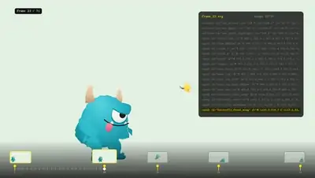</a><br><a href="https://www.sandbase.ai/lab/ai-videos/gemini-4-neon/2124998786863055080?utm_source=github&utm_medium=readme&utm_campaign=awesome-gemini-4-neon&utm_content=card"><b>Animations combining LLM and diffusion models</b></a><br><sub><a href="https://x.com/OdinLovis/status/2124998786863055080">@OdinLovis</a></sub></td><td width="33%" valign="top"><a href="https://www.sandbase.ai/lab/media/x/gemini-4-neon/2125174944057507944/video.mp4">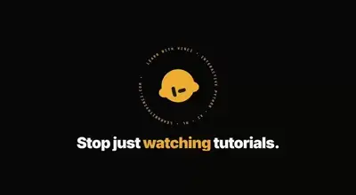</a><br><a href="https://www.sandbase.ai/lab/ai-videos/gemini-4-neon/2125174944057507944?utm_source=github&utm_medium=readme&utm_campaign=awesome-gemini-4-neon&utm_content=card"><b>Motion graphics video made with Antigravity</b></a><br><sub><a href="https://x.com/monarch_0I/status/2125174944057507944">@monarch_0I</a></sub></td><td width="33%" valign="top"><a href="https://www.sandbase.ai/lab/media/x/fable-5-5/2125228647879733273/video.mp4"></a><br><a href="https://www.sandbase.ai/lab/ai-videos/gemini-4-neon/2125230060013781266?utm_source=github&utm_medium=readme&utm_campaign=awesome-gemini-4-neon&utm_content=card"><b>Code based animation by Claude Opus 5.6</b></a><br><sub><a href="https://x.com/Haleeeemahh/status/2125230060013781266">@Haleeeemahh</a></sub></td></tr>
<tr><td width="33%" valign="top"><a href="https://www.sandbase.ai/lab/media/x/gemini-4-neon/2125266596210061674/video.mp4"></a><br><a href="https://www.sandbase.ai/lab/ai-videos/gemini-4-neon/2125266596210061674?utm_source=github&utm_medium=readme&utm_campaign=awesome-gemini-4-neon&utm_content=card"><b>Showcase of AI-generated video examples and styles</b></a><br><sub><a href="https://x.com/iamfakhrealam/status/2125266596210061674">@iamfakhrealam</a></sub></td><td width="33%" valign="top"><a href="https://www.sandbase.ai/lab/media/x/gemini-4-argon/2125269462853271952/video.mp4"></a><br><a href="https://www.sandbase.ai/lab/ai-videos/gemini-4-neon/2125269462853271952?utm_source=github&utm_medium=readme&utm_campaign=awesome-gemini-4-neon&utm_content=card"><b>Video about what AI likes about humanity</b></a><br><sub><a href="https://x.com/vipinxtwt/status/2125269462853271952">@vipinxtwt</a></sub></td><td width="33%" valign="top"><a href="https://www.sandbase.ai/lab/media/x/gemini-4-neon/2125270906293395493/video.mp4"></a><br><a href="https://www.sandbase.ai/lab/ai-videos/gemini-4-neon/2125270906293395493?utm_source=github&utm_medium=readme&utm_campaign=awesome-gemini-4-neon&utm_content=card"><b>AI edited video with cloned voiceover</b></a><br><sub><a href="https://x.com/BreezeOg1/status/2125270906293395493">@BreezeOg1</a></sub></td></tr>
<tr><td width="33%" valign="top"><a href="https://www.sandbase.ai/lab/media/x/gemini-4-neon/2125304389539975350/video.mp4">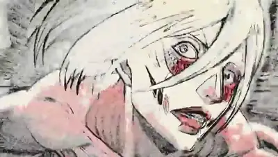</a><br><a href="https://www.sandbase.ai/lab/ai-videos/gemini-4-neon/2125304389539975350?utm_source=github&utm_medium=readme&utm_campaign=awesome-gemini-4-neon&utm_content=card"><b>Attack on Titan fight scene in sketch style</b></a><br><sub><a href="https://x.com/WinterArc2125/status/2125304389539975350">@WinterArc2125</a></sub></td></tr>
</table>

</details>

<a id="game"></a>

## Games

<table>
<tr><td width="33%" valign="top"><a href="https://www.sandbase.ai/lab/media/x/gemini-4-neon/2123169783038235033/video.mp4"></a><br><a href="https://www.sandbase.ai/lab/ai-videos/gemini-4-neon/2123169783038235033?utm_source=github&utm_medium=readme&utm_campaign=awesome-gemini-4-neon&utm_content=card"><b>Platformer game flipping between Sol and Luna</b></a><br><sub><a href="https://x.com/OzanTRAI/status/2123169783038235033">@OzanTRAI</a> · 0:51</sub></td><td width="33%" valign="top"><a href="https://www.sandbase.ai/lab/media/x/gemini-4-neon/2123178088439959750/video.mp4"></a><br><a href="https://www.sandbase.ai/lab/ai-videos/gemini-4-neon/2123178088439959750?utm_source=github&utm_medium=readme&utm_campaign=awesome-gemini-4-neon&utm_content=card"><b>An endless expressionist world art game</b></a><br><sub><a href="https://x.com/GeokenAI/status/2123178088439959750">@GeokenAI</a> · 0:04</sub></td><td width="33%" valign="top"><a href="https://www.sandbase.ai/lab/media/x/gemini-4-neon/2123189427249742292/video.mp4"></a><br><a href="https://www.sandbase.ai/lab/ai-videos/gemini-4-neon/2123189427249742292?utm_source=github&utm_medium=readme&utm_campaign=awesome-gemini-4-neon&utm_content=card"><b>A game test demonstration</b></a><br><sub><a href="https://x.com/AdamHoltererer/status/2123189427249742292">@AdamHoltererer</a> · 0:25</sub></td></tr>
<tr><td width="33%" valign="top"><a href="https://www.sandbase.ai/lab/media/x/gemini-4-neon/2123189826585243883/video.mp4"></a><br><a href="https://www.sandbase.ai/lab/ai-videos/gemini-4-neon/2123189826585243883?utm_source=github&utm_medium=readme&utm_campaign=awesome-gemini-4-neon&utm_content=card"><b>A runner game built with code</b></a><br><sub><a href="https://x.com/eandualem/status/2123189826585243883">@eandualem</a> · 0:44</sub></td><td width="33%" valign="top"><a href="https://www.sandbase.ai/lab/media/x/gemini-4-neon/2123446204172472363/video.mp4">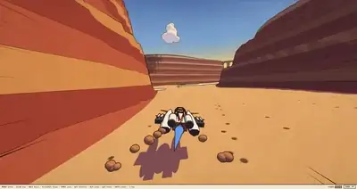</a><br><a href="https://www.sandbase.ai/lab/ai-videos/gemini-4-neon/2123446204172472363?utm_source=github&utm_medium=readme&utm_campaign=awesome-gemini-4-neon&utm_content=card"><b>A 3D space racer game</b></a><br><sub><a href="https://x.com/byharisali/status/2123446204172472363">@byharisali</a></sub></td><td width="33%" valign="top"><a href="https://www.sandbase.ai/lab/media/x/gemini-4-argon/2124568183902449764/video.mp4">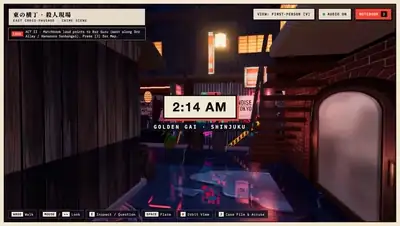</a><br><a href="https://www.sandbase.ai/lab/ai-videos/gemini-4-neon/2124568183902449764?utm_source=github&utm_medium=readme&utm_campaign=awesome-gemini-4-neon&utm_content=card"><b>First-person mystery game set in Golden Gai</b></a><br><sub><a href="https://x.com/venturetwins/status/2124568183902449764">@venturetwins</a></sub></td></tr>
</table>

<details>
<summary><b>Show all 7</b></summary>

<table>
<tr><td width="33%" valign="top"><a href="https://www.sandbase.ai/lab/media/x/gemini-4-argon/2125001629850345678/video.mp4"></a><br><a href="https://www.sandbase.ai/lab/ai-videos/gemini-4-neon/2125001629850345678?utm_source=github&utm_medium=readme&utm_campaign=awesome-gemini-4-neon&utm_content=card"><b>A shader rendered game in HTML</b></a><br><sub><a href="https://x.com/kevin_t_ngo/status/2125001629850345678">@kevin_t_ngo</a> · <a href="https://www.sandbase.ai/lab/ai-videos/gemini-4-neon/2125001629850345678?utm_source=github&utm_medium=readme&utm_campaign=awesome-gemini-4-neon&utm_content=card">prompt</a></sub></td></tr>
</table>

</details>

<a id="ui-demo"></a>

## Product UI

<table>
<tr><td width="33%" valign="top"><a href="https://www.sandbase.ai/lab/media/x/gemini-4-argon/2124558621782495548/video.mp4"></a><br><a href="https://www.sandbase.ai/lab/ai-videos/gemini-4-neon/2124558621782495548?utm_source=github&utm_medium=readme&utm_campaign=awesome-gemini-4-neon&utm_content=card"><b>Landing page with animations and microinteractions</b></a><br><sub><a href="https://x.com/niachito/status/2124558621782495548">@niachito</a> · <a href="https://www.sandbase.ai/lab/ai-videos/gemini-4-neon/2124558621782495548?utm_source=github&utm_medium=readme&utm_campaign=awesome-gemini-4-neon&utm_content=card">prompt</a></sub></td><td width="33%" valign="top"><a href="https://www.sandbase.ai/lab/media/x/gemini-4-neon/2124919659195756928/video.mp4"></a><br><a href="https://www.sandbase.ai/lab/ai-videos/gemini-4-neon/2124919659195756928?utm_source=github&utm_medium=readme&utm_campaign=awesome-gemini-4-neon&utm_content=card"><b>Showcase of a financial terminal competitor</b></a><br><sub><a href="https://x.com/jeet_twts/status/2124919659195756928">@jeet_twts</a></sub></td><td width="33%" valign="top"><a href="https://www.sandbase.ai/lab/media/x/gemini-4-neon/2125206633722601572/video.mp4">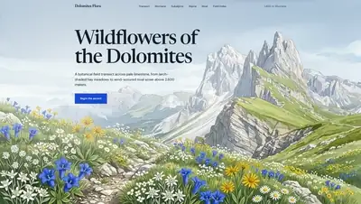</a><br><a href="https://www.sandbase.ai/lab/ai-videos/gemini-4-neon/2125206633722601572?utm_source=github&utm_medium=readme&utm_campaign=awesome-gemini-4-neon&utm_content=card"><b>Illustrated web essay landing page for alpine wildflowers</b></a><br><sub><a href="https://x.com/_philschmid/status/2125206633722601572">@_philschmid</a> · <a href="https://www.sandbase.ai/lab/ai-videos/gemini-4-neon/2125206633722601572?utm_source=github&utm_medium=readme&utm_campaign=awesome-gemini-4-neon&utm_content=card">prompt</a></sub></td></tr>
<tr><td width="33%" valign="top"><a href="https://www.sandbase.ai/lab/media/x/gemini-4-neon/2125253560921358463/video.mp4"></a><br><a href="https://www.sandbase.ai/lab/ai-videos/gemini-4-neon/2125253560921358463?utm_source=github&utm_medium=readme&utm_campaign=awesome-gemini-4-neon&utm_content=card"><b>Interactive foldable phone unboxing experience</b></a><br><sub><a href="https://x.com/srikanthvaluri/status/2125253560921358463">@srikanthvaluri</a></sub></td><td width="33%" valign="top"><a href="https://www.sandbase.ai/lab/media/x/gemini-4-neon/2125326948385894827/video.mp4">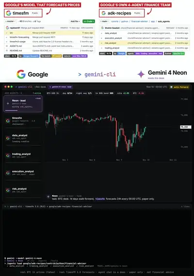</a><br><a href="https://www.sandbase.ai/lab/ai-videos/gemini-4-neon/2125326948385894827?utm_source=github&utm_medium=readme&utm_campaign=awesome-gemini-4-neon&utm_content=card"><b>Automated trading desk terminal demo</b></a><br><sub><a href="https://x.com/Dipper_pol/status/2125326948385894827">@Dipper_pol</a></sub></td></tr>
</table>

<a id="kinetic-type"></a>

## Kinetic type

<table>
<tr><td width="33%" valign="top"><a href="https://www.sandbase.ai/lab/media/x/gemini-4-neon/2123831991061840145/video.mp4"></a><br><a href="https://www.sandbase.ai/lab/ai-videos/gemini-4-neon/2123831991061840145?utm_source=github&utm_medium=readme&utm_campaign=awesome-gemini-4-neon&utm_content=card"><b>ASCII animation of a pelican riding a bicycle</b></a><br><sub><a href="https://x.com/chetaslua/status/2123831991061840145">@chetaslua</a></sub></td></tr>
</table>

<a id="explainer"></a>

## Explainers

<table>
<tr><td width="33%" valign="top"><a href="https://www.sandbase.ai/lab/media/x/gemini-4-neon/2124872708366401609/video.mp4">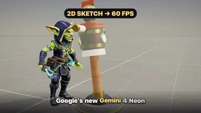</a><br><a href="https://www.sandbase.ai/lab/ai-videos/gemini-4-neon/2124872708366401609?utm_source=github&utm_medium=readme&utm_campaign=awesome-gemini-4-neon&utm_content=card"><b>Image to 3D rigging and animation workflow</b></a><br><sub><a href="https://x.com/ai_for_success/status/2124872708366401609">@ai_for_success</a></sub></td><td width="33%" valign="top"><a href="https://www.sandbase.ai/lab/media/x/gemini-4-argon/2124892615946678458/video.mp4"></a><br><a href="https://www.sandbase.ai/lab/ai-videos/gemini-4-neon/2124892615946678458?utm_source=github&utm_medium=readme&utm_campaign=awesome-gemini-4-neon&utm_content=card"><b>A video about Jensen Huang&#x27;s comeback</b></a><br><sub><a href="https://x.com/vipinxtwt/status/2124892615946678458">@vipinxtwt</a> · <a href="https://www.sandbase.ai/lab/ai-videos/gemini-4-neon/2124892615946678458?utm_source=github&utm_medium=readme&utm_campaign=awesome-gemini-4-neon&utm_content=card">prompt</a></sub></td></tr>
</table>

<a id="launch-film"></a>

## Launch films

<table>
<tr><td width="33%" valign="top"><a href="https://www.sandbase.ai/lab/media/x/gemini-4-neon/2123173513502822864/video.mp4"></a><br><a href="https://www.sandbase.ai/lab/ai-videos/gemini-4-neon/2123173513502822864?utm_source=github&utm_medium=readme&utm_campaign=awesome-gemini-4-neon&utm_content=card"><b>A generated product launch video</b></a><br><sub><a href="https://x.com/BreezeOg1/status/2123173513502822864">@BreezeOg1</a> · 0:12</sub></td><td width="33%" valign="top"><a href="https://www.sandbase.ai/lab/media/x/gemini-4-neon/2123246994496077998/video.mp4"></a><br><a href="https://www.sandbase.ai/lab/ai-videos/gemini-4-neon/2123246994496077998?utm_source=github&utm_medium=readme&utm_campaign=awesome-gemini-4-neon&utm_content=card"><b>A 15 second promo video for Gemini 4 neon</b></a><br><sub><a href="https://x.com/cfenghub/status/2123246994496077998">@cfenghub</a> · <a href="https://www.sandbase.ai/lab/ai-videos/gemini-4-neon/2123246994496077998?utm_source=github&utm_medium=readme&utm_campaign=awesome-gemini-4-neon&utm_content=card">prompt</a></sub></td><td width="33%" valign="top"><a href="https://www.sandbase.ai/lab/media/x/gemini-4-neon/2124840481314222508/video.mp4">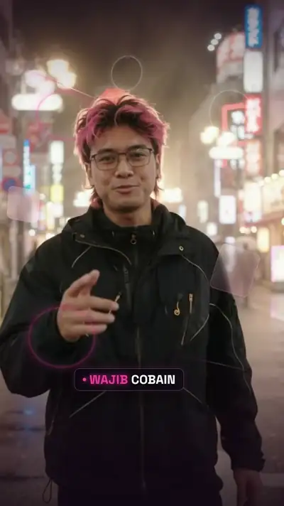</a><br><a href="https://www.sandbase.ai/lab/ai-videos/gemini-4-neon/2124840481314222508?utm_source=github&utm_medium=readme&utm_campaign=awesome-gemini-4-neon&utm_content=card"><b>An AI generated user generated content video</b></a><br><sub><a href="https://x.com/tirtaVEX/status/2124840481314222508">@tirtaVEX</a></sub></td></tr>
<tr><td width="33%" valign="top"><a href="https://www.sandbase.ai/lab/media/x/gemini-4-neon/2125274028550373760/video.mp4">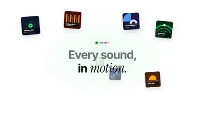</a><br><a href="https://www.sandbase.ai/lab/ai-videos/gemini-4-neon/2125274028550373760?utm_source=github&utm_medium=readme&utm_campaign=awesome-gemini-4-neon&utm_content=card"><b>Product launch video generated from prompts</b></a><br><sub><a href="https://x.com/TimJayas/status/2125274028550373760">@TimJayas</a></sub></td></tr>
</table>

<a id="comparison"></a>

## Tests & comparisons

<table>
<tr><td width="33%" valign="top"><a href="https://www.sandbase.ai/lab/media/x/gemini-4-neon/2123164032882659819/video.mp4">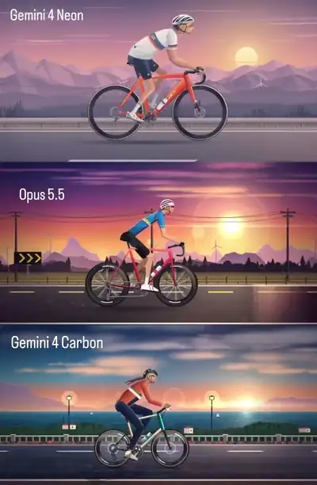</a><br><a href="https://www.sandbase.ai/lab/ai-videos/gemini-4-neon/2123164032882659819?utm_source=github&utm_medium=readme&utm_campaign=awesome-gemini-4-neon&utm_content=card"><b>Three.js test comparing multiple AI models</b></a><br><sub><a href="https://x.com/AI_Screening/status/2123164032882659819">@AI_Screening</a></sub></td><td width="33%" valign="top"><a href="https://www.sandbase.ai/lab/media/x/gemini-4-neon/2123183353436475636/video.mp4"></a><br><a href="https://www.sandbase.ai/lab/ai-videos/gemini-4-neon/2123183353436475636?utm_source=github&utm_medium=readme&utm_campaign=awesome-gemini-4-neon&utm_content=card"><b>Earth visualization comparison in Three.js</b></a><br><sub><a href="https://x.com/analogalok/status/2123183353436475636">@analogalok</a> · 0:45 · <a href="https://www.sandbase.ai/lab/ai-videos/gemini-4-neon/2123183353436475636?utm_source=github&utm_medium=readme&utm_campaign=awesome-gemini-4-neon&utm_content=card">prompt</a></sub></td><td width="33%" valign="top"><a href="https://www.sandbase.ai/lab/media/x/gemini-4-neon/2123187613230370937/video.mp4">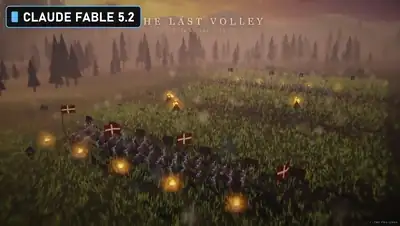</a><br><a href="https://www.sandbase.ai/lab/ai-videos/gemini-4-neon/2123187613230370937?utm_source=github&utm_medium=readme&utm_campaign=awesome-gemini-4-neon&utm_content=card"><b>Benchmark comparison between Gemini 4 Neon and Fable 5.2</b></a><br><sub><a href="https://x.com/xiax0603/status/2123187613230370937">@xiax0603</a> · 1:20</sub></td></tr>
<tr><td width="33%" valign="top"><a href="https://www.sandbase.ai/lab/media/x/gemini-4-neon/2123187817899766190/video.mp4">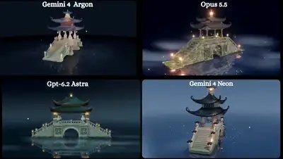</a><br><a href="https://www.sandbase.ai/lab/ai-videos/gemini-4-neon/2123187817899766190?utm_source=github&utm_medium=readme&utm_campaign=awesome-gemini-4-neon&utm_content=card"><b>Pagoda bridge gate test across four models</b></a><br><sub><a href="https://x.com/srikanthvaluri/status/2123187817899766190">@srikanthvaluri</a> · 0:28</sub></td><td width="33%" valign="top"><a href="https://www.sandbase.ai/lab/media/x/gemini-4-neon/2123198294528811087/video.mp4">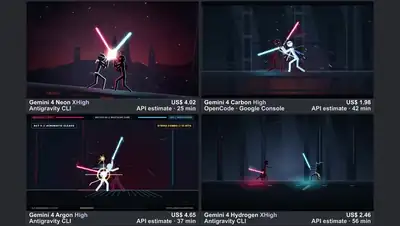</a><br><a href="https://www.sandbase.ai/lab/ai-videos/gemini-4-neon/2123198294528811087?utm_source=github&utm_medium=readme&utm_campaign=awesome-gemini-4-neon&utm_content=card"><b>Stick figure fight animation model comparison</b></a><br><sub><a href="https://x.com/xiax0603/status/2123198294528811087">@xiax0603</a> · 0:15</sub></td><td width="33%" valign="top"><a href="https://www.sandbase.ai/lab/media/x/gemini-4-neon/2123205954649100424/video.mp4"></a><br><a href="https://www.sandbase.ai/lab/ai-videos/gemini-4-neon/2123205954649100424?utm_source=github&utm_medium=readme&utm_campaign=awesome-gemini-4-neon&utm_content=card"><b>Haunted vampire cathedral model comparison</b></a><br><sub><a href="https://x.com/jan_volad/status/2123205954649100424">@jan_volad</a> · 0:42 · <a href="https://www.sandbase.ai/lab/ai-videos/gemini-4-neon/2123205954649100424?utm_source=github&utm_medium=readme&utm_campaign=awesome-gemini-4-neon&utm_content=card">prompt</a></sub></td></tr>
</table>

<details>
<summary><b>Show all 18</b></summary>

<table>
<tr><td width="33%" valign="top"><a href="https://www.sandbase.ai/lab/media/x/gemini-4-neon/2123220446074253768/video.mp4"></a><br><a href="https://www.sandbase.ai/lab/ai-videos/gemini-4-neon/2123220446074253768?utm_source=github&utm_medium=readme&utm_campaign=awesome-gemini-4-neon&utm_content=card"><b>Comparison of an Alps mountain hut scene</b></a><br><sub><a href="https://x.com/DesignArena/status/2123220446074253768">@DesignArena</a> · 0:22 · <a href="https://www.sandbase.ai/lab/ai-videos/gemini-4-neon/2123220446074253768?utm_source=github&utm_medium=readme&utm_campaign=awesome-gemini-4-neon&utm_content=card">prompt</a></sub></td><td width="33%" valign="top"><a href="https://www.sandbase.ai/lab/media/x/gemini-4-neon/2123416610794848660/video.mp4">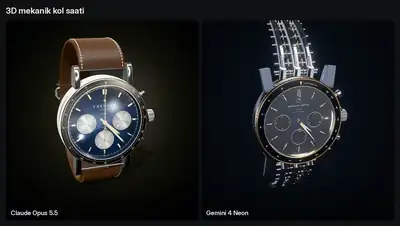</a><br><a href="https://www.sandbase.ai/lab/ai-videos/gemini-4-neon/2123416610794848660?utm_source=github&utm_medium=readme&utm_campaign=awesome-gemini-4-neon&utm_content=card"><b>Comparison of a mechanical watch model generation</b></a><br><sub><a href="https://x.com/remoteugur/status/2123416610794848660">@remoteugur</a></sub></td><td width="33%" valign="top"><a href="https://www.sandbase.ai/lab/media/x/gemini-4-argon/2123488006665363654/video.mp4"></a><br><a href="https://www.sandbase.ai/lab/ai-videos/gemini-4-neon/2123488006665363654?utm_source=github&utm_medium=readme&utm_campaign=awesome-gemini-4-neon&utm_content=card"><b>Comparison of animated characters between models</b></a><br><sub><a href="https://x.com/IndependentEco/status/2123488006665363654">@IndependentEco</a></sub></td></tr>
<tr><td width="33%" valign="top"><a href="https://www.sandbase.ai/lab/media/x/gemini-4-argon/2123554016663834933/video.mp4">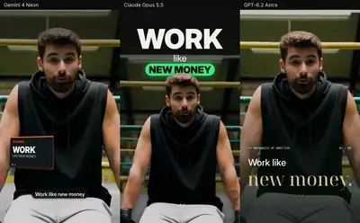</a><br><a href="https://www.sandbase.ai/lab/ai-videos/gemini-4-neon/2123554016663834933?utm_source=github&utm_medium=readme&utm_campaign=awesome-gemini-4-neon&utm_content=card"><b>Comparing video editing across AI models</b></a><br><sub><a href="https://x.com/motion_so/status/2123554016663834933">@motion_so</a></sub></td><td width="33%" valign="top"><a href="https://www.sandbase.ai/lab/media/x/gemini-4-carbon/2123816445180088544/video.mp4">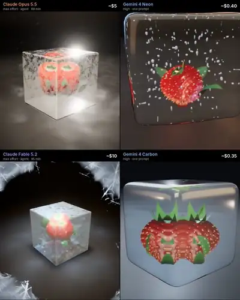</a><br><a href="https://www.sandbase.ai/lab/ai-videos/gemini-4-neon/2123816445180088544?utm_source=github&utm_medium=readme&utm_campaign=awesome-gemini-4-neon&utm_content=card"><b>Comparing Claude and Gemini models drawing fruit</b></a><br><sub><a href="https://x.com/AIMind_Ai/status/2123816445180088544">@AIMind_Ai</a></sub></td><td width="33%" valign="top"><a href="https://www.sandbase.ai/lab/media/x/gemini-4-neon/2123832990598045903/video.mp4">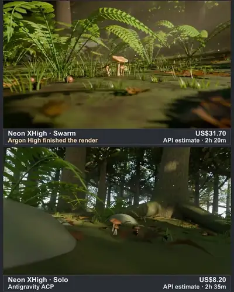</a><br><a href="https://www.sandbase.ai/lab/ai-videos/gemini-4-neon/2123832990598045903?utm_source=github&utm_medium=readme&utm_campaign=awesome-gemini-4-neon&utm_content=card"><b>Squirrel perspective animation model comparison</b></a><br><sub><a href="https://x.com/DanielZambrini/status/2123832990598045903">@DanielZambrini</a></sub></td></tr>
<tr><td width="33%" valign="top"><a href="https://www.sandbase.ai/lab/media/x/gemini-4-argon/2124662479863050377/video.mp4"></a><br><a href="https://www.sandbase.ai/lab/ai-videos/gemini-4-neon/2124662479863050377?utm_source=github&utm_medium=readme&utm_campaign=awesome-gemini-4-neon&utm_content=card"><b>A performance comparison of Gemini 4 Neon</b></a><br><sub><a href="https://x.com/remoteugur/status/2124662479863050377">@remoteugur</a></sub></td><td width="33%" valign="top"><a href="https://www.sandbase.ai/lab/media/x/gemini-4-carbon/2125190276646043899/video.mp4">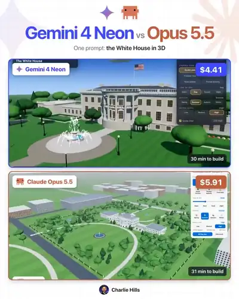</a><br><a href="https://www.sandbase.ai/lab/ai-videos/gemini-4-neon/2125190276646043899?utm_source=github&utm_medium=readme&utm_campaign=awesome-gemini-4-neon&utm_content=card"><b>White House construction comparison between two models</b></a><br><sub><a href="https://x.com/charliejhills/status/2125190276646043899">@charliejhills</a></sub></td><td width="33%" valign="top"><a href="https://www.sandbase.ai/lab/media/x/gemini-4-neon/2125247620667105761/video.mp4">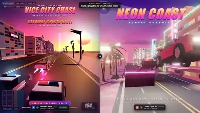</a><br><a href="https://www.sandbase.ai/lab/ai-videos/gemini-4-neon/2125247620667105761?utm_source=github&utm_medium=readme&utm_campaign=awesome-gemini-4-neon&utm_content=card"><b>Playable 3D police chase game comparison</b></a><br><sub><a href="https://x.com/fekdaoui/status/2125247620667105761">@fekdaoui</a> · <a href="https://www.sandbase.ai/lab/ai-videos/gemini-4-neon/2125247620667105761?utm_source=github&utm_medium=readme&utm_campaign=awesome-gemini-4-neon&utm_content=card">prompt</a></sub></td></tr>
<tr><td width="33%" valign="top"><a href="https://www.sandbase.ai/lab/media/x/gemini-4-neon/2125260781176709333/video.mp4"></a><br><a href="https://www.sandbase.ai/lab/ai-videos/gemini-4-neon/2125260781176709333?utm_source=github&utm_medium=readme&utm_campaign=awesome-gemini-4-neon&utm_content=card"><b>Istanbul Basilica Cistern rendered in Three.js comparison</b></a><br><sub><a href="https://x.com/teddyaisi/status/2125260781176709333">@teddyaisi</a></sub></td><td width="33%" valign="top"><a href="https://www.sandbase.ai/lab/media/x/gemini-4-neon/2125277048528879634/video.mp4"></a><br><a href="https://www.sandbase.ai/lab/ai-videos/gemini-4-neon/2125277048528879634?utm_source=github&utm_medium=readme&utm_campaign=awesome-gemini-4-neon&utm_content=card"><b>Motion design comparison across three different models</b></a><br><sub><a href="https://x.com/hsprafrique/status/2125277048528879634">@hsprafrique</a> · <a href="https://www.sandbase.ai/lab/ai-videos/gemini-4-neon/2125277048528879634?utm_source=github&utm_medium=readme&utm_campaign=awesome-gemini-4-neon&utm_content=card">prompt</a></sub></td><td width="33%" valign="top"><a href="https://www.sandbase.ai/lab/media/x/gemini-4-neon/2125278509849571596/video.mp4">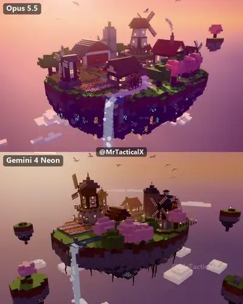</a><br><a href="https://www.sandbase.ai/lab/ai-videos/gemini-4-neon/2125278509849571596?utm_source=github&utm_medium=readme&utm_campaign=awesome-gemini-4-neon&utm_content=card"><b>Windmill Island in Blender model comparison</b></a><br><sub><a href="https://x.com/MrTacticalX/status/2125278509849571596">@MrTacticalX</a></sub></td></tr>
</table>

</details>

**[See all 86 on SandBase Lab →](https://www.sandbase.ai/lab/ai-videos/gemini-4-neon?utm_source=github&utm_medium=readme&utm_campaign=awesome-gemini-4-neon&utm_content=section)**

<a id="recreate"></a>

## Recreate a video with Gemini 4 Neon

Every video page on [SandBase Lab](https://www.sandbase.ai/lab/ai-videos/gemini-4-neon?utm_source=github&utm_medium=readme&utm_campaign=awesome-gemini-4-neon&utm_content=recreate) has a **Recreate** button: it sends the post to Gemini 4 Neon in the Lab text arena and returns the code, ready to play in the browser.

With the API, Gemini 4 Neon is `google/gemini-4-neon` on SandBase (OpenAI-compatible). Put a prompt in `prompt.txt`, create a key in the [console](https://www.sandbase.ai/console/keys?utm_source=github&utm_medium=readme&utm_campaign=awesome-gemini-4-neon), and run:

```bash
jq -n --rawfile prompt prompt.txt \
  '{model: "google/gemini-4-neon", max_tokens: 128000, messages: [{role: "user", content: $prompt}]}' |
curl -sS --max-time 900 https://api.sandbase.ai/v1/chat/completions \
  -H "Authorization: Bearer $SANDBASE_API_KEY" \
  -H "Content-Type: application/json" \
  -d @- | jq -r '.choices[0].message.content' | sed '/^```/d' > gemini-4-neon.html
```

Open `gemini-4-neon.html` in a browser, or run it in a [SandBase Sandbox](https://www.sandbase.ai/landing/sandbox?utm_source=github&utm_medium=readme&utm_campaign=awesome-gemini-4-neon) to keep generated code isolated. The example asks for up to 128,000 output tokens, and output bills at $15 per million. Full walkthrough: [tutorial](docs/tutorial.md). Pricing: [model page](https://www.sandbase.ai/model/google/gemini-4-neon?utm_source=github&utm_medium=readme&utm_campaign=awesome-gemini-4-neon).

<a id="faq"></a>

## FAQ

### What is Gemini 4 Neon?

Gemini 4 Neon is a model from Google DeepMind, announced on November 18, 2026. It has a 1,048,576-token context window. On SandBase it is `google/gemini-4-neon`. For the output limit, run `sandbase inspect google/gemini-4-neon`; the vendor and list prices are also in the [DesignArena post](https://x.com/DesignArena/status/2123220446074253768).

### How are these Gemini 4 Neon videos made?

The model doesn't render video. In the examples here it writes a self-contained web page, usually one HTML file that uses Three.js or GLSL shaders; the page runs in a browser and the result is shared as a video. The [tutorial](docs/tutorial.md) shows how to record one.

### Where do I find the prompt for a video?

Videos tagged **prompt** come with the creator's prompt on their Lab page. The [prompt index](docs/prompts.md) lists all of them.

### How do I write a good Gemini 4 Neon prompt?

Name one self-contained HTML file and the renderer you want (Three.js or GLSL), describe the scene and what moves, and ask for the complete HTML back. Details and a template: [prompt guide](docs/prompt-guide.md).

### How do I use the Gemini 4 Neon API?

On SandBase the model id is `google/gemini-4-neon` on the OpenAI-compatible `https://api.sandbase.ai/v1/chat/completions` endpoint, and one key works for every model. See [Recreate](#recreate) and the [model page](https://www.sandbase.ai/model/google/gemini-4-neon?utm_source=github&utm_medium=readme&utm_campaign=awesome-gemini-4-neon).

### Is Gemini 4 Neon better than GPT-6.2 Sol, Gemini 4 Carbon, Gemini 4 Argon or Claude Opus 5.5?

Measured: no Lab Evals or Pelican Test row for Gemini 4 Neon is in the data this list was built from, so nothing here measures it against the others. Reported by creators: one posted a same-prompt test against GPT-6.2 Sol and could not pick a winner; another posted Artificial Analysis Intelligence Index figures of 61 for Neon, 60 for Gemini 4 Carbon, 59 for Claude Opus 5.5 and 62 for GPT-6.2 Astra, which this list has not checked. Details: [model comparison](docs/model-comparison.md).

### How much does one video cost?

One creator reported $2.67 for a haunted vampire cathedral scene made with Gemini 4 Neon, against $1.69 for GPT-6.2 Sol on the same prompt. The list price on SandBase is $3 per million input tokens, $15 per million output tokens and $0.15 per million cached input tokens. A call costs (prompt tokens × $3 + completion tokens × $15) ÷ 1,000,000 dollars.

### Can I reuse these videos?

No, not by default. They belong to their creators. See [MEDIA-RIGHTS](MEDIA-RIGHTS.md).

<a id="contribute"></a>

## Suggest a video

Know a Gemini 4 Neon creation that should be here? [Open a submission](https://github.com/sandbase-lab/awesome-gemini-4-neon/issues/new?template=submit-video.yml) with the original X post. Accepted posts are added on SandBase Lab and show up here on the next daily sync. If this list helped you, a ⭐ helps others find it.

## Credits & rights

Every video, prompt and post belongs to its creator. Cards credit the author and link to the original post. The MIT license covers this repository's scripts only. To correct a credit or remove a video, see [MEDIA-RIGHTS](MEDIA-RIGHTS.md).

Not affiliated with or endorsed by Google.

---

Maintained by [SandBase Lab](https://www.sandbase.ai/lab/?utm_source=github&utm_medium=readme&utm_campaign=awesome-gemini-4-neon) · [All AI video collections](https://www.sandbase.ai/lab/ai-videos?utm_source=github&utm_medium=readme&utm_campaign=awesome-gemini-4-neon)
