# Awesome Gemini 4 Neon

English · [简体中文](README.zh-CN.md)

[](https://awesome.re) [](#contents) [](docs/prompts.md) [](https://github.com/sandbase-lab/awesome-gemini-4-neon/actions/workflows/sync.yml) [](https://www.sandbase.ai/model/google/gemini-4-neon?utm_source=github&utm_medium=readme&utm_campaign=awesome-gemini-4-neon)

[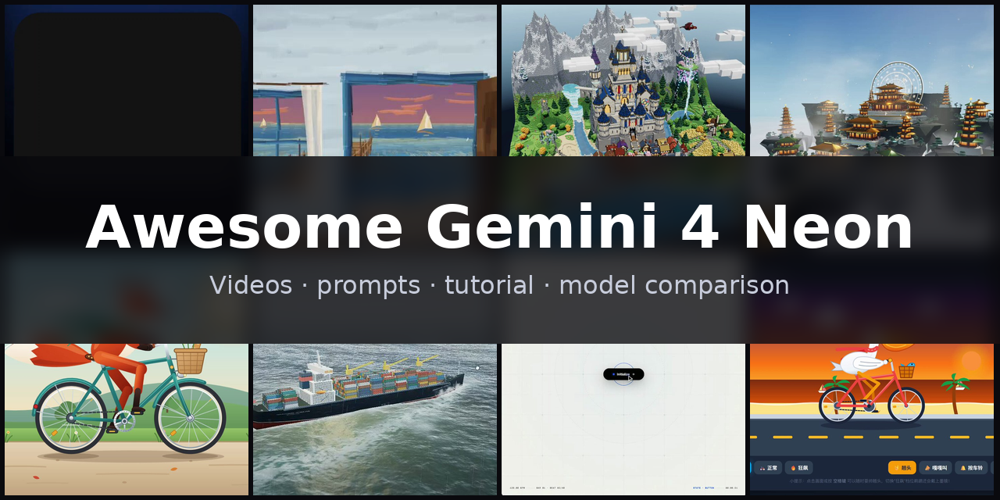](https://www.sandbase.ai/lab/ai-videos/gemini-4-neon?utm_source=github&utm_medium=readme&utm_campaign=awesome-gemini-4-neon&utm_content=banner)

A curated list of **Gemini 4 Neon examples**: videos, prompts and demos made with Gemini 4 Neon, a model from Google DeepMind announced on November 18, 2026. Three.js and GLSL 3D scenes, games, motion graphics and same-prompt comparisons, many of them written as one self-contained HTML page from a prompt, each one credited to its creator and linked to the original post.

**37 videos** from **26 creators** · **7** with the creator's prompt · synced daily from [SandBase Lab](https://www.sandbase.ai/lab/ai-videos/gemini-4-neon?utm_source=github&utm_medium=readme&utm_campaign=awesome-gemini-4-neon&utm_content=stats)

## Start here

| I want to… | Go to |
|---|---|
| Watch the videos | [Browse by category](#contents) below, or [play them full-size on SandBase Lab](https://www.sandbase.ai/lab/ai-videos/gemini-4-neon?utm_source=github&utm_medium=readme&utm_campaign=awesome-gemini-4-neon&utm_content=quickstart) |
| Copy a prompt | [Prompt index](docs/prompts.md): every video that comes with its prompt |
| Write your own prompt | [Prompt guide](docs/prompt-guide.md): 4 patterns and a fill-in template |
| Make a video | [Tutorial](docs/tutorial.md): prompt → HTML → MP4, with the API and a recording script |
| Pick a model | [Gemini 4 Neon vs GPT-6.2 Sol, Gemini 4 Carbon, Gemini 4 Argon and Claude Opus 5.5](docs/model-comparison.md) |
| Try it now | [Run Gemini 4 Neon in the Lab arena](https://www.sandbase.ai/arena/text?models=google%2Fgemini-4-neon&utm_source=github&utm_medium=readme&utm_campaign=awesome-gemini-4-neon&utm_content=quickstart), next to other models |

<a id="contents"></a>

## Contents

- [Featured](#featured) (7)
- [3D scenes](#3d-scene) (12)
- [Motion graphics](#motion-graphics) (13)
- [Games](#game) (4)
- [Launch films](#launch-film) (1)
- [Tests & comparisons](#comparison) (7)
- [Recreate a video with Gemini 4 Neon](#recreate)
- [FAQ](#faq)
- [Suggest a video](#contribute)

Click a preview to play the video. Click a title for the post, the prompt and **Recreate** on SandBase Lab. **@handle** links to the creator's post on X.

<a id="featured"></a>

## Featured

<table>
<tr><td width="33%" valign="top"><a href="https://www.sandbase.ai/lab/media/x/gemini-4-neon/2122954421050933355/video.mp4">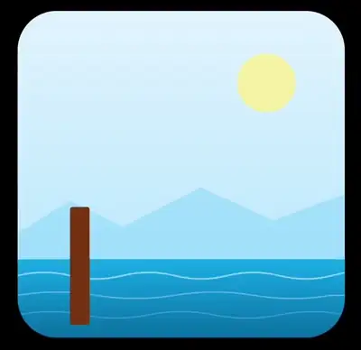</a><br><a href="https://www.sandbase.ai/lab/ai-videos/gemini-4-neon/2122954421050933355?utm_source=github&utm_medium=readme&utm_campaign=awesome-gemini-4-neon&utm_content=card"><b>An SVG illustration of a pelican</b></a><br><sub><a href="https://x.com/Inmerson/status/2122954421050933355">@Inmerson</a> · 0:09 · <a href="https://www.sandbase.ai/lab/ai-videos/gemini-4-neon/2122954421050933355?utm_source=github&utm_medium=readme&utm_campaign=awesome-gemini-4-neon&utm_content=card">prompt</a></sub></td><td width="33%" valign="top"><a href="https://www.sandbase.ai/lab/media/x/gemini-4-neon/2123178088439959750/video.mp4">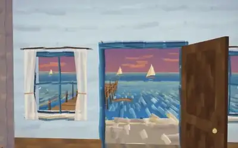</a><br><a href="https://www.sandbase.ai/lab/ai-videos/gemini-4-neon/2123178088439959750?utm_source=github&utm_medium=readme&utm_campaign=awesome-gemini-4-neon&utm_content=card"><b>An endless expressionist world art game</b></a><br><sub><a href="https://x.com/GeokenAI/status/2123178088439959750">@GeokenAI</a> · 0:04</sub></td><td width="33%" valign="top"><a href="https://www.sandbase.ai/lab/media/x/gemini-4-neon/2123226306351661099/video.mp4">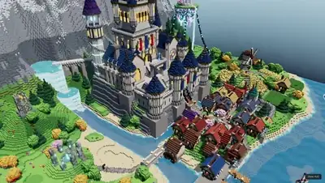</a><br><a href="https://www.sandbase.ai/lab/ai-videos/gemini-4-neon/2123226306351661099?utm_source=github&utm_medium=readme&utm_campaign=awesome-gemini-4-neon&utm_content=card"><b>Fantasy voxel castle scene</b></a><br><sub><a href="https://x.com/Lentils80/status/2123226306351661099">@Lentils80</a> · 0:38</sub></td></tr>
<tr><td width="33%" valign="top"><a href="https://www.sandbase.ai/lab/media/x/gemini-4-neon/2123162154132242885/video.mp4"></a><br><a href="https://www.sandbase.ai/lab/ai-videos/gemini-4-neon/2123162154132242885?utm_source=github&utm_medium=readme&utm_campaign=awesome-gemini-4-neon&utm_content=card"><b>A Three.js and GLSL scene</b></a><br><sub><a href="https://x.com/cfenghub/status/2123162154132242885">@cfenghub</a> · 0:44 · <a href="https://www.sandbase.ai/lab/ai-videos/gemini-4-neon/2123162154132242885?utm_source=github&utm_medium=readme&utm_campaign=awesome-gemini-4-neon&utm_content=card">prompt</a></sub></td><td width="33%" valign="top"><a href="https://www.sandbase.ai/lab/media/x/gemini-4-neon/2123189427249742292/video.mp4">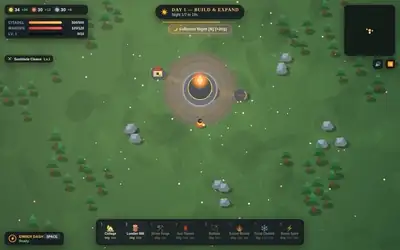</a><br><a href="https://www.sandbase.ai/lab/ai-videos/gemini-4-neon/2123189427249742292?utm_source=github&utm_medium=readme&utm_campaign=awesome-gemini-4-neon&utm_content=card"><b>A game test demonstration</b></a><br><sub><a href="https://x.com/AdamHoltererer/status/2123189427249742292">@AdamHoltererer</a> · 0:25</sub></td><td width="33%" valign="top"><a href="https://www.sandbase.ai/lab/media/x/gemini-4-neon/2123181843835207955/video.mp4">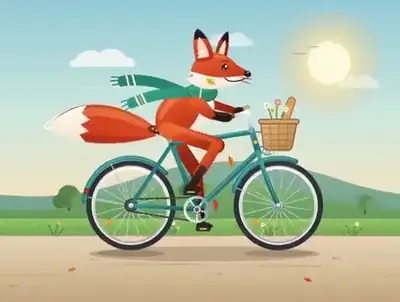</a><br><a href="https://www.sandbase.ai/lab/ai-videos/gemini-4-neon/2123181843835207955?utm_source=github&utm_medium=readme&utm_campaign=awesome-gemini-4-neon&utm_content=card"><b>A red fox riding a bicycle</b></a><br><sub><a href="https://x.com/srikanthvaluri/status/2123181843835207955">@srikanthvaluri</a> · 0:05</sub></td></tr>
<tr><td width="33%" valign="top"><a href="https://www.sandbase.ai/lab/media/x/gemini-4-neon/2123173513502822864/video.mp4">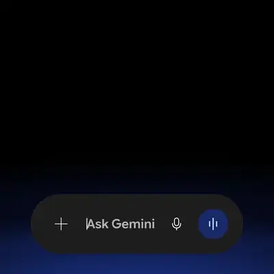</a><br><a href="https://www.sandbase.ai/lab/ai-videos/gemini-4-neon/2123173513502822864?utm_source=github&utm_medium=readme&utm_campaign=awesome-gemini-4-neon&utm_content=card"><b>A generated product launch video</b></a><br><sub><a href="https://x.com/BreezeOg1/status/2123173513502822864">@BreezeOg1</a> · 0:12</sub></td></tr>
</table>

<a id="3d-scene"></a>

## 3D scenes

<table>
<tr><td width="33%" valign="top"><a href="https://www.sandbase.ai/lab/media/x/gemini-4-neon/2123120305648619534/video.mp4"></a><br><a href="https://www.sandbase.ai/lab/ai-videos/gemini-4-neon/2123120305648619534?utm_source=github&utm_medium=readme&utm_campaign=awesome-gemini-4-neon&utm_content=card"><b>A 3D container ship sailing on the sea</b></a><br><sub><a href="https://x.com/AfnadX/status/2123120305648619534">@AfnadX</a> · 0:22</sub></td><td width="33%" valign="top"><a href="https://www.sandbase.ai/lab/media/x/gemini-4-neon/2123160089854898346/video.mp4"></a><br><a href="https://www.sandbase.ai/lab/ai-videos/gemini-4-neon/2123160089854898346?utm_source=github&utm_medium=readme&utm_campaign=awesome-gemini-4-neon&utm_content=card"><b>Pelican riding a bicycle in Three.js</b></a><br><sub><a href="https://x.com/StatsWire/status/2123160089854898346">@StatsWire</a> · 0:12 · <a href="https://www.sandbase.ai/lab/ai-videos/gemini-4-neon/2123160089854898346?utm_source=github&utm_medium=readme&utm_campaign=awesome-gemini-4-neon&utm_content=card">prompt</a></sub></td><td width="33%" valign="top"><a href="https://www.sandbase.ai/lab/media/x/gemini-4-neon/2123160092657021432/video.mp4">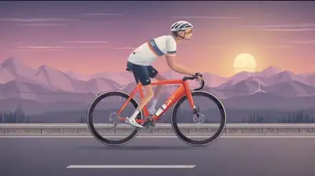</a><br><a href="https://www.sandbase.ai/lab/ai-videos/gemini-4-neon/2123160092657021432?utm_source=github&utm_medium=readme&utm_campaign=awesome-gemini-4-neon&utm_content=card"><b>Cyclist riding a bicycle in Three.js</b></a><br><sub><a href="https://x.com/AI_Screening/status/2123160092657021432">@AI_Screening</a> · 0:14</sub></td></tr>
<tr><td width="33%" valign="top"><a href="https://www.sandbase.ai/lab/media/x/gemini-4-neon/2123162154132242885/video.mp4"></a><br><a href="https://www.sandbase.ai/lab/ai-videos/gemini-4-neon/2123162154132242885?utm_source=github&utm_medium=readme&utm_campaign=awesome-gemini-4-neon&utm_content=card"><b>A Three.js and GLSL scene</b></a><br><sub><a href="https://x.com/cfenghub/status/2123162154132242885">@cfenghub</a> · 0:44 · <a href="https://www.sandbase.ai/lab/ai-videos/gemini-4-neon/2123162154132242885?utm_source=github&utm_medium=readme&utm_campaign=awesome-gemini-4-neon&utm_content=card">prompt</a></sub></td><td width="33%" valign="top"><a href="https://www.sandbase.ai/lab/media/x/gemini-4-neon/2123165046276760028/video.mp4">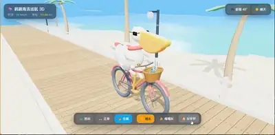</a><br><a href="https://www.sandbase.ai/lab/ai-videos/gemini-4-neon/2123165046276760028?utm_source=github&utm_medium=readme&utm_campaign=awesome-gemini-4-neon&utm_content=card"><b>A pelican riding a bicycle in Three.js</b></a><br><sub><a href="https://x.com/zhang_baoqing/status/2123165046276760028">@zhang_baoqing</a> · 0:32</sub></td><td width="33%" valign="top"><a href="https://www.sandbase.ai/lab/media/x/gemini-4-neon/2123170821250400282/video.mp4">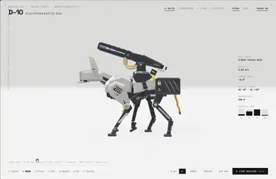</a><br><a href="https://www.sandbase.ai/lab/ai-videos/gemini-4-neon/2123170821250400282?utm_source=github&utm_medium=readme&utm_campaign=awesome-gemini-4-neon&utm_content=card"><b>Robotic dog biomechanics simulation in Three.js WebGPU</b></a><br><sub><a href="https://x.com/thebuggeddev/status/2123170821250400282">@thebuggeddev</a> · 0:52</sub></td></tr>
</table>

<details>
<summary><b>Show all 12</b></summary>

<table>
<tr><td width="33%" valign="top"><a href="https://www.sandbase.ai/lab/media/x/gemini-4-neon/2123170948568535488/video.mp4">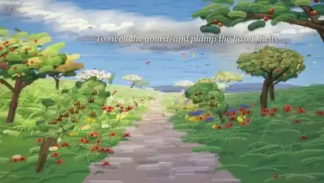</a><br><a href="https://www.sandbase.ai/lab/ai-videos/gemini-4-neon/2123170948568535488?utm_source=github&utm_medium=readme&utm_campaign=awesome-gemini-4-neon&utm_content=card"><b>Painterly 3D animation of the poem To Autumn</b></a><br><sub><a href="https://x.com/vamsibatchuk/status/2123170948568535488">@vamsibatchuk</a> · 2:49</sub></td><td width="33%" valign="top"><a href="https://www.sandbase.ai/lab/media/x/gemini-4-neon/2123171135437382083/video.mp4">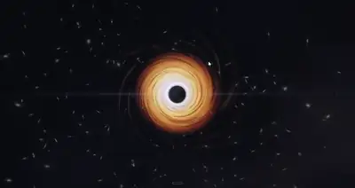</a><br><a href="https://www.sandbase.ai/lab/ai-videos/gemini-4-neon/2123171135437382083?utm_source=github&utm_medium=readme&utm_campaign=awesome-gemini-4-neon&utm_content=card"><b>Real-time supermassive black hole in Three.js</b></a><br><sub><a href="https://x.com/srikanthvaluri/status/2123171135437382083">@srikanthvaluri</a> · 0:31</sub></td><td width="33%" valign="top"><a href="https://www.sandbase.ai/lab/media/x/gemini-4-neon/2123190272527860173/video.mp4">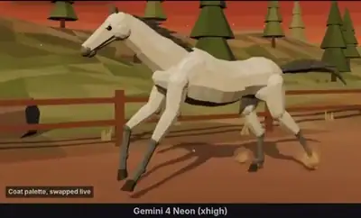</a><br><a href="https://www.sandbase.ai/lab/ai-videos/gemini-4-neon/2123190272527860173?utm_source=github&utm_medium=readme&utm_campaign=awesome-gemini-4-neon&utm_content=card"><b>Animated 3D horse running in a seamless loop</b></a><br><sub><a href="https://x.com/Frtnel/status/2123190272527860173">@Frtnel</a> · 0:29</sub></td></tr>
<tr><td width="33%" valign="top"><a href="https://www.sandbase.ai/lab/media/x/gemini-4-neon/2123212198663323848/video.mp4">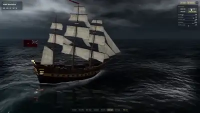</a><br><a href="https://www.sandbase.ai/lab/ai-videos/gemini-4-neon/2123212198663323848?utm_source=github&utm_medium=readme&utm_campaign=awesome-gemini-4-neon&utm_content=card"><b>Interactive 3D historical sailing ship</b></a><br><sub><a href="https://x.com/abhinavflac/status/2123212198663323848">@abhinavflac</a> · 0:37</sub></td><td width="33%" valign="top"><a href="https://www.sandbase.ai/lab/media/x/gemini-4-neon/2123222507977375770/video.mp4"></a><br><a href="https://www.sandbase.ai/lab/ai-videos/gemini-4-neon/2123222507977375770?utm_source=github&utm_medium=readme&utm_campaign=awesome-gemini-4-neon&utm_content=card"><b>A pelican riding a bicycle in Three.js</b></a><br><sub><a href="https://x.com/tspy/status/2123222507977375770">@tspy</a> · 0:53 · <a href="https://www.sandbase.ai/lab/ai-videos/gemini-4-neon/2123222507977375770?utm_source=github&utm_medium=readme&utm_campaign=awesome-gemini-4-neon&utm_content=card">prompt</a></sub></td><td width="33%" valign="top"><a href="https://www.sandbase.ai/lab/media/x/gemini-4-neon/2123226306351661099/video.mp4"></a><br><a href="https://www.sandbase.ai/lab/ai-videos/gemini-4-neon/2123226306351661099?utm_source=github&utm_medium=readme&utm_campaign=awesome-gemini-4-neon&utm_content=card"><b>Fantasy voxel castle scene</b></a><br><sub><a href="https://x.com/Lentils80/status/2123226306351661099">@Lentils80</a> · 0:38</sub></td></tr>
</table>

</details>

<a id="motion-graphics"></a>

## Motion graphics

<table>
<tr><td width="33%" valign="top"><a href="https://www.sandbase.ai/lab/media/x/gemini-4-neon/2122954421050933355/video.mp4"></a><br><a href="https://www.sandbase.ai/lab/ai-videos/gemini-4-neon/2122954421050933355?utm_source=github&utm_medium=readme&utm_campaign=awesome-gemini-4-neon&utm_content=card"><b>An SVG illustration of a pelican</b></a><br><sub><a href="https://x.com/Inmerson/status/2122954421050933355">@Inmerson</a> · 0:09 · <a href="https://www.sandbase.ai/lab/ai-videos/gemini-4-neon/2122954421050933355?utm_source=github&utm_medium=readme&utm_campaign=awesome-gemini-4-neon&utm_content=card">prompt</a></sub></td><td width="33%" valign="top"><a href="https://www.sandbase.ai/lab/media/x/gemini-4-neon/2123135691085472139/video.mp4">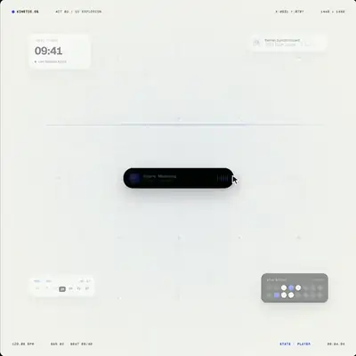</a><br><a href="https://www.sandbase.ai/lab/ai-videos/gemini-4-neon/2123135691085472139?utm_source=github&utm_medium=readme&utm_campaign=awesome-gemini-4-neon&utm_content=card"><b>Motion design in a single HTML file</b></a><br><sub><a href="https://x.com/AfnadX/status/2123135691085472139">@AfnadX</a> · 0:19</sub></td><td width="33%" valign="top"><a href="https://www.sandbase.ai/lab/media/x/gemini-4-neon/2123157977045852382/video.mp4">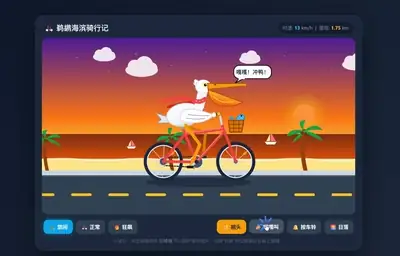</a><br><a href="https://www.sandbase.ai/lab/ai-videos/gemini-4-neon/2123157977045852382?utm_source=github&utm_medium=readme&utm_campaign=awesome-gemini-4-neon&utm_content=card"><b>A pelican riding a bicycle in HTML</b></a><br><sub><a href="https://x.com/zhang_baoqing/status/2123157977045852382">@zhang_baoqing</a> · 0:19</sub></td></tr>
<tr><td width="33%" valign="top"><a href="https://www.sandbase.ai/lab/media/x/gemini-4-neon/2123159335635456318/video.mp4">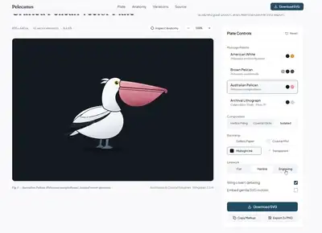</a><br><a href="https://www.sandbase.ai/lab/ai-videos/gemini-4-neon/2123159335635456318?utm_source=github&utm_medium=readme&utm_campaign=awesome-gemini-4-neon&utm_content=card"><b>An SVG pelican illustration</b></a><br><sub><a href="https://x.com/Inmerson/status/2123159335635456318">@Inmerson</a> · 0:26</sub></td><td width="33%" valign="top"><a href="https://www.sandbase.ai/lab/media/x/gemini-4-neon/2123165824576114932/video.mp4">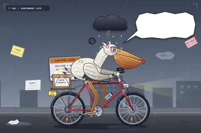</a><br><a href="https://www.sandbase.ai/lab/ai-videos/gemini-4-neon/2123165824576114932?utm_source=github&utm_medium=readme&utm_campaign=awesome-gemini-4-neon&utm_content=card"><b>Frustrated pelican riding a bicycle in SVG</b></a><br><sub><a href="https://x.com/HarshithLucky3/status/2123165824576114932">@HarshithLucky3</a> · 0:13</sub></td><td width="33%" valign="top"><a href="https://www.sandbase.ai/lab/media/x/gemini-4-neon/2123168004175462796/video.mp4"></a><br><a href="https://www.sandbase.ai/lab/ai-videos/gemini-4-neon/2123168004175462796?utm_source=github&utm_medium=readme&utm_campaign=awesome-gemini-4-neon&utm_content=card"><b>An SVG ship in antigravity</b></a><br><sub><a href="https://x.com/srikanthvaluri/status/2123168004175462796">@srikanthvaluri</a> · 0:07</sub></td></tr>
</table>

<details>
<summary><b>Show all 13</b></summary>

<table>
<tr><td width="33%" valign="top"><a href="https://www.sandbase.ai/lab/media/x/gemini-4-neon/2123180572784640063/video.mp4"></a><br><a href="https://www.sandbase.ai/lab/ai-videos/gemini-4-neon/2123180572784640063?utm_source=github&utm_medium=readme&utm_campaign=awesome-gemini-4-neon&utm_content=card"><b>Vice City SVG graphic animation</b></a><br><sub><a href="https://x.com/Inmerson/status/2123180572784640063">@Inmerson</a> · 0:07</sub></td><td width="33%" valign="top"><a href="https://www.sandbase.ai/lab/media/x/gemini-4-neon/2123181538544374002/video.mp4">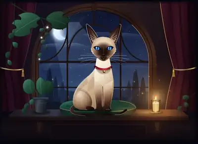</a><br><a href="https://www.sandbase.ai/lab/ai-videos/gemini-4-neon/2123181538544374002?utm_source=github&utm_medium=readme&utm_campaign=awesome-gemini-4-neon&utm_content=card"><b>Siamese cat SVG illustration</b></a><br><sub><a href="https://x.com/Inmerson/status/2123181538544374002">@Inmerson</a> · 0:13</sub></td><td width="33%" valign="top"><a href="https://www.sandbase.ai/lab/media/x/gemini-4-neon/2123181843835207955/video.mp4"></a><br><a href="https://www.sandbase.ai/lab/ai-videos/gemini-4-neon/2123181843835207955?utm_source=github&utm_medium=readme&utm_campaign=awesome-gemini-4-neon&utm_content=card"><b>A red fox riding a bicycle</b></a><br><sub><a href="https://x.com/srikanthvaluri/status/2123181843835207955">@srikanthvaluri</a> · 0:05</sub></td></tr>
<tr><td width="33%" valign="top"><a href="https://www.sandbase.ai/lab/media/x/gemini-4-neon/2123183419442205140/video.mp4">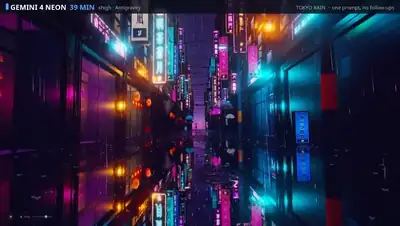</a><br><a href="https://www.sandbase.ai/lab/ai-videos/gemini-4-neon/2123183419442205140?utm_source=github&utm_medium=readme&utm_campaign=awesome-gemini-4-neon&utm_content=card"><b>A rainy Tokyo scene</b></a><br><sub><a href="https://x.com/PokeBenchTV/status/2123183419442205140">@PokeBenchTV</a> · 0:25</sub></td><td width="33%" valign="top"><a href="https://www.sandbase.ai/lab/media/x/gemini-4-neon/2123184113561817370/video.mp4">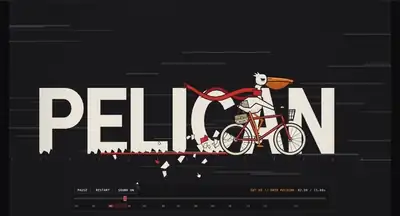</a><br><a href="https://www.sandbase.ai/lab/ai-videos/gemini-4-neon/2123184113561817370?utm_source=github&utm_medium=readme&utm_campaign=awesome-gemini-4-neon&utm_content=card"><b>Motion design for a pelican product</b></a><br><sub><a href="https://x.com/chetaslua/status/2123184113561817370">@chetaslua</a> · 0:14</sub></td><td width="33%" valign="top"><a href="https://www.sandbase.ai/lab/media/x/gemini-4-neon/2123185466417746256/video.mp4"></a><br><a href="https://www.sandbase.ai/lab/ai-videos/gemini-4-neon/2123185466417746256?utm_source=github&utm_medium=readme&utm_campaign=awesome-gemini-4-neon&utm_content=card"><b>A sleepy hedgehog animation</b></a><br><sub><a href="https://x.com/doe_naps/status/2123185466417746256">@doe_naps</a> · 0:31</sub></td></tr>
<tr><td width="33%" valign="top"><a href="https://www.sandbase.ai/lab/media/x/gemini-4-neon/2123222816325869685/video.mp4">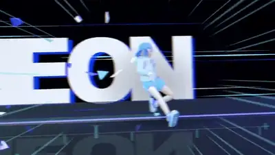</a><br><a href="https://www.sandbase.ai/lab/ai-videos/gemini-4-neon/2123219124260315301?utm_source=github&utm_medium=readme&utm_campaign=awesome-gemini-4-neon&utm_content=card"><b>A motion design self-introduction in pure JavaScript</b></a><br><sub><a href="https://x.com/chetaslua/status/2123219124260315301">@chetaslua</a> · 0:15</sub></td></tr>
</table>

</details>

<a id="game"></a>

## Games

<table>
<tr><td width="33%" valign="top"><a href="https://www.sandbase.ai/lab/media/x/gemini-4-neon/2123169783038235033/video.mp4">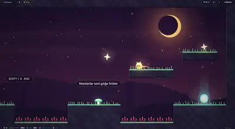</a><br><a href="https://www.sandbase.ai/lab/ai-videos/gemini-4-neon/2123169783038235033?utm_source=github&utm_medium=readme&utm_campaign=awesome-gemini-4-neon&utm_content=card"><b>Platformer game flipping between Sol and Luna</b></a><br><sub><a href="https://x.com/OzanTRAI/status/2123169783038235033">@OzanTRAI</a> · 0:51</sub></td><td width="33%" valign="top"><a href="https://www.sandbase.ai/lab/media/x/gemini-4-neon/2123178088439959750/video.mp4"></a><br><a href="https://www.sandbase.ai/lab/ai-videos/gemini-4-neon/2123178088439959750?utm_source=github&utm_medium=readme&utm_campaign=awesome-gemini-4-neon&utm_content=card"><b>An endless expressionist world art game</b></a><br><sub><a href="https://x.com/GeokenAI/status/2123178088439959750">@GeokenAI</a> · 0:04</sub></td><td width="33%" valign="top"><a href="https://www.sandbase.ai/lab/media/x/gemini-4-neon/2123189427249742292/video.mp4"></a><br><a href="https://www.sandbase.ai/lab/ai-videos/gemini-4-neon/2123189427249742292?utm_source=github&utm_medium=readme&utm_campaign=awesome-gemini-4-neon&utm_content=card"><b>A game test demonstration</b></a><br><sub><a href="https://x.com/AdamHoltererer/status/2123189427249742292">@AdamHoltererer</a> · 0:25</sub></td></tr>
<tr><td width="33%" valign="top"><a href="https://www.sandbase.ai/lab/media/x/gemini-4-neon/2123189826585243883/video.mp4">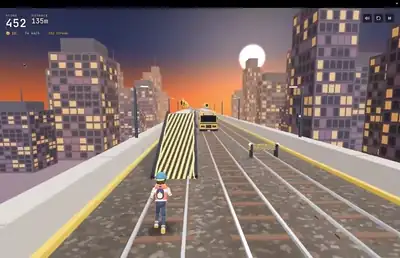</a><br><a href="https://www.sandbase.ai/lab/ai-videos/gemini-4-neon/2123189826585243883?utm_source=github&utm_medium=readme&utm_campaign=awesome-gemini-4-neon&utm_content=card"><b>A runner game built with code</b></a><br><sub><a href="https://x.com/eandualem/status/2123189826585243883">@eandualem</a> · 0:44</sub></td></tr>
</table>

<a id="launch-film"></a>

## Launch films

<table>
<tr><td width="33%" valign="top"><a href="https://www.sandbase.ai/lab/media/x/gemini-4-neon/2123173513502822864/video.mp4"></a><br><a href="https://www.sandbase.ai/lab/ai-videos/gemini-4-neon/2123173513502822864?utm_source=github&utm_medium=readme&utm_campaign=awesome-gemini-4-neon&utm_content=card"><b>A generated product launch video</b></a><br><sub><a href="https://x.com/BreezeOg1/status/2123173513502822864">@BreezeOg1</a> · 0:12</sub></td></tr>
</table>

<a id="comparison"></a>

## Tests & comparisons

<table>
<tr><td width="33%" valign="top"><a href="https://www.sandbase.ai/lab/media/x/gemini-4-neon/2123164032882659819/video.mp4"></a><br><a href="https://www.sandbase.ai/lab/ai-videos/gemini-4-neon/2123164032882659819?utm_source=github&utm_medium=readme&utm_campaign=awesome-gemini-4-neon&utm_content=card"><b>Three.js test comparing multiple AI models</b></a><br><sub><a href="https://x.com/AI_Screening/status/2123164032882659819">@AI_Screening</a> · 0:14</sub></td><td width="33%" valign="top"><a href="https://www.sandbase.ai/lab/media/x/gemini-4-neon/2123183353436475636/video.mp4">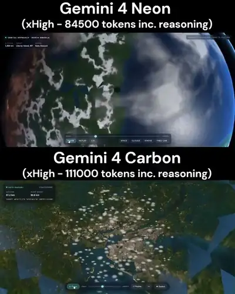</a><br><a href="https://www.sandbase.ai/lab/ai-videos/gemini-4-neon/2123183353436475636?utm_source=github&utm_medium=readme&utm_campaign=awesome-gemini-4-neon&utm_content=card"><b>Earth visualization comparison in Three.js</b></a><br><sub><a href="https://x.com/analogalok/status/2123183353436475636">@analogalok</a> · 0:45 · <a href="https://www.sandbase.ai/lab/ai-videos/gemini-4-neon/2123183353436475636?utm_source=github&utm_medium=readme&utm_campaign=awesome-gemini-4-neon&utm_content=card">prompt</a></sub></td><td width="33%" valign="top"><a href="https://www.sandbase.ai/lab/media/x/gemini-4-neon/2123187613230370937/video.mp4"></a><br><a href="https://www.sandbase.ai/lab/ai-videos/gemini-4-neon/2123187613230370937?utm_source=github&utm_medium=readme&utm_campaign=awesome-gemini-4-neon&utm_content=card"><b>Benchmark comparison between Gemini 4 Neon and Fable 5.2</b></a><br><sub><a href="https://x.com/xiax0603/status/2123187613230370937">@xiax0603</a> · 1:20</sub></td></tr>
<tr><td width="33%" valign="top"><a href="https://www.sandbase.ai/lab/media/x/gemini-4-neon/2123187817899766190/video.mp4"></a><br><a href="https://www.sandbase.ai/lab/ai-videos/gemini-4-neon/2123187817899766190?utm_source=github&utm_medium=readme&utm_campaign=awesome-gemini-4-neon&utm_content=card"><b>Pagoda bridge gate test across four models</b></a><br><sub><a href="https://x.com/srikanthvaluri/status/2123187817899766190">@srikanthvaluri</a> · 0:28</sub></td><td width="33%" valign="top"><a href="https://www.sandbase.ai/lab/media/x/gemini-4-neon/2123198294528811087/video.mp4"></a><br><a href="https://www.sandbase.ai/lab/ai-videos/gemini-4-neon/2123198294528811087?utm_source=github&utm_medium=readme&utm_campaign=awesome-gemini-4-neon&utm_content=card"><b>Stick figure fight animation model comparison</b></a><br><sub><a href="https://x.com/xiax0603/status/2123198294528811087">@xiax0603</a> · 0:15</sub></td><td width="33%" valign="top"><a href="https://www.sandbase.ai/lab/media/x/gemini-4-neon/2123205954649100424/video.mp4">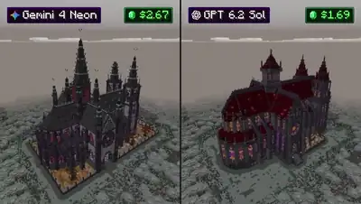</a><br><a href="https://www.sandbase.ai/lab/ai-videos/gemini-4-neon/2123205954649100424?utm_source=github&utm_medium=readme&utm_campaign=awesome-gemini-4-neon&utm_content=card"><b>Haunted vampire cathedral model comparison</b></a><br><sub><a href="https://x.com/jan_volad/status/2123205954649100424">@jan_volad</a> · 0:42 · <a href="https://www.sandbase.ai/lab/ai-videos/gemini-4-neon/2123205954649100424?utm_source=github&utm_medium=readme&utm_campaign=awesome-gemini-4-neon&utm_content=card">prompt</a></sub></td></tr>
</table>

<details>
<summary><b>Show all 7</b></summary>

<table>
<tr><td width="33%" valign="top"><a href="https://www.sandbase.ai/lab/media/x/gemini-4-neon/2123220446074253768/video.mp4">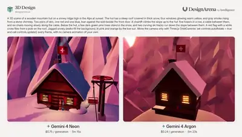</a><br><a href="https://www.sandbase.ai/lab/ai-videos/gemini-4-neon/2123220446074253768?utm_source=github&utm_medium=readme&utm_campaign=awesome-gemini-4-neon&utm_content=card"><b>Comparison of an Alps mountain hut scene</b></a><br><sub><a href="https://x.com/DesignArena/status/2123220446074253768">@DesignArena</a> · 0:22 · <a href="https://www.sandbase.ai/lab/ai-videos/gemini-4-neon/2123220446074253768?utm_source=github&utm_medium=readme&utm_campaign=awesome-gemini-4-neon&utm_content=card">prompt</a></sub></td></tr>
</table>

</details>

**[See all 37 on SandBase Lab →](https://www.sandbase.ai/lab/ai-videos/gemini-4-neon?utm_source=github&utm_medium=readme&utm_campaign=awesome-gemini-4-neon&utm_content=section)**

<a id="recreate"></a>

## Recreate a video with Gemini 4 Neon

Every video page on [SandBase Lab](https://www.sandbase.ai/lab/ai-videos/gemini-4-neon?utm_source=github&utm_medium=readme&utm_campaign=awesome-gemini-4-neon&utm_content=recreate) has a **Recreate** button: it sends the post to Gemini 4 Neon in the Lab text arena and returns the code, ready to play in the browser.

With the API, Gemini 4 Neon is `google/gemini-4-neon` on SandBase (OpenAI-compatible). Put a prompt in `prompt.txt`, create a key in the [console](https://www.sandbase.ai/console/keys?utm_source=github&utm_medium=readme&utm_campaign=awesome-gemini-4-neon), and run:

```bash
jq -n --rawfile prompt prompt.txt \
  '{model: "google/gemini-4-neon", max_tokens: 128000, messages: [{role: "user", content: $prompt}]}' |
curl -sS --max-time 900 https://api.sandbase.ai/v1/chat/completions \
  -H "Authorization: Bearer $SANDBASE_API_KEY" \
  -H "Content-Type: application/json" \
  -d @- | jq -r '.choices[0].message.content' | sed '/^```/d' > gemini-4-neon.html
```

Open `gemini-4-neon.html` in a browser, or run it in a [SandBase Sandbox](https://www.sandbase.ai/landing/sandbox?utm_source=github&utm_medium=readme&utm_campaign=awesome-gemini-4-neon) to keep generated code isolated. The example asks for up to 128,000 output tokens, and output bills at $15 per million. Full walkthrough: [tutorial](docs/tutorial.md). Pricing: [model page](https://www.sandbase.ai/model/google/gemini-4-neon?utm_source=github&utm_medium=readme&utm_campaign=awesome-gemini-4-neon).

<a id="faq"></a>

## FAQ

### What is Gemini 4 Neon?

Gemini 4 Neon is a model from Google DeepMind, announced on November 18, 2026. It has a 1,048,576-token context window. On SandBase it is `google/gemini-4-neon`. For the output limit, run `sandbase inspect google/gemini-4-neon`; the vendor and list prices are also in the [DesignArena post](https://x.com/DesignArena/status/2123220446074253768).

### How are these Gemini 4 Neon videos made?

The model doesn't render video. In the examples here it writes a self-contained web page, usually one HTML file that uses Three.js or GLSL shaders; the page runs in a browser and the result is shared as a video. The [tutorial](docs/tutorial.md) shows how to record one.

### Where do I find the prompt for a video?

Videos tagged **prompt** come with the creator's prompt on their Lab page. The [prompt index](docs/prompts.md) lists all of them.

### How do I write a good Gemini 4 Neon prompt?

Name one self-contained HTML file and the renderer you want (Three.js or GLSL), describe the scene and what moves, and ask for the complete HTML back. Details and a template: [prompt guide](docs/prompt-guide.md).

### How do I use the Gemini 4 Neon API?

On SandBase the model id is `google/gemini-4-neon` on the OpenAI-compatible `https://api.sandbase.ai/v1/chat/completions` endpoint, and one key works for every model. See [Recreate](#recreate) and the [model page](https://www.sandbase.ai/model/google/gemini-4-neon?utm_source=github&utm_medium=readme&utm_campaign=awesome-gemini-4-neon).

### Is Gemini 4 Neon better than GPT-6.2 Sol, Gemini 4 Carbon, Gemini 4 Argon or Claude Opus 5.5?

Measured: no Lab Evals or Pelican Test row for Gemini 4 Neon is in the data this list was built from, so nothing here measures it against the others. Reported by creators: one posted a same-prompt test against GPT-6.2 Sol and could not pick a winner; another posted Artificial Analysis Intelligence Index figures of 61 for Neon, 60 for Gemini 4 Carbon, 59 for Claude Opus 5.5 and 62 for GPT-6.2 Astra, which this list has not checked. Details: [model comparison](docs/model-comparison.md).

### How much does one video cost?

One creator reported $2.67 for a haunted vampire cathedral scene made with Gemini 4 Neon, against $1.69 for GPT-6.2 Sol on the same prompt. The list price on SandBase is $3 per million input tokens, $15 per million output tokens and $0.15 per million cached input tokens. A call costs (prompt tokens × $3 + completion tokens × $15) ÷ 1,000,000 dollars.

### Can I reuse these videos?

No, not by default. They belong to their creators. See [MEDIA-RIGHTS](MEDIA-RIGHTS.md).

<a id="contribute"></a>

## Suggest a video

Know a Gemini 4 Neon creation that should be here? [Open a submission](https://github.com/sandbase-lab/awesome-gemini-4-neon/issues/new?template=submit-video.yml) with the original X post. Accepted posts are added on SandBase Lab and show up here on the next daily sync. If this list helped you, a ⭐ helps others find it.

## Credits & rights

Every video, prompt and post belongs to its creator. Cards credit the author and link to the original post. The MIT license covers this repository's scripts only. To correct a credit or remove a video, see [MEDIA-RIGHTS](MEDIA-RIGHTS.md).

Not affiliated with or endorsed by Google.

---

Maintained by [SandBase Lab](https://www.sandbase.ai/lab/?utm_source=github&utm_medium=readme&utm_campaign=awesome-gemini-4-neon) · [All AI video collections](https://www.sandbase.ai/lab/ai-videos?utm_source=github&utm_medium=readme&utm_campaign=awesome-gemini-4-neon)
