# Awesome Gemini 4 Neon

[English](README.md) · 简体中文

[](https://awesome.re) [](#contents) [](docs/zh-CN/prompts.md) [](https://github.com/sandbase-lab/awesome-gemini-4-neon/actions/workflows/sync.yml) [](https://www.sandbase.ai/model/google/gemini-4-neon?utm_source=github&utm_medium=readme&utm_campaign=awesome-gemini-4-neon)

[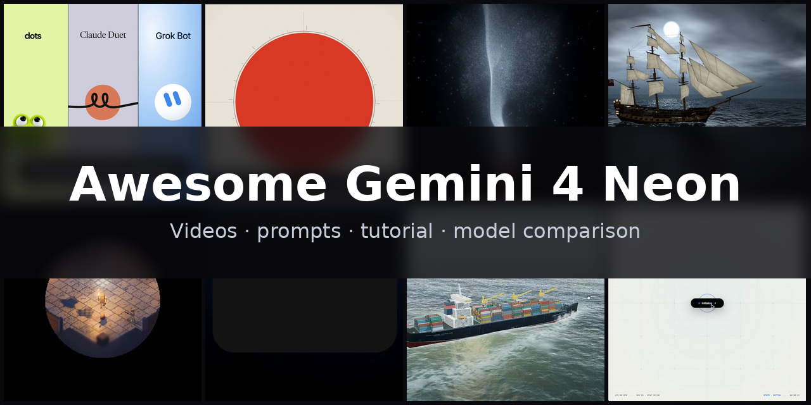](https://www.sandbase.ai/lab/ai-videos/gemini-4-neon?lang=zh-CN&utm_source=github&utm_medium=readme&utm_campaign=awesome-gemini-4-neon&utm_content=banner)

精选 **Gemini 4 Neon 案例**合集：用 Gemini 4 Neon（Google DeepMind 的模型，2026 年 11 月 18 日宣布）做出的视频、提示词和演示。包括 Three.js 与 GLSL 3D 场景、游戏、动效和同提示词对比，许多是模型根据提示词写成的单文件网页，均注明作者并链接原帖。

共 **86 条视频**，来自 **64 位创作者** · **15 条**附作者提示词 · 每天从 [SandBase Lab](https://www.sandbase.ai/lab/ai-videos/gemini-4-neon?lang=zh-CN&utm_source=github&utm_medium=readme&utm_campaign=awesome-gemini-4-neon&utm_content=stats) 同步

## 从这里开始

| 我想… | 去这里 |
|---|---|
| 看视频 | 在下方 [按分类浏览](#contents)，或 [在 SandBase Lab 大屏播放](https://www.sandbase.ai/lab/ai-videos/gemini-4-neon?lang=zh-CN&utm_source=github&utm_medium=readme&utm_campaign=awesome-gemini-4-neon&utm_content=quickstart) |
| 复制提示词 | [提示词索引](docs/zh-CN/prompts.md)：所有附带提示词的视频 |
| 自己写提示词 | [提示词写法](docs/zh-CN/prompt-guide.md)：4 条写法和一个填空模板 |
| 做一个视频 | [教程](docs/zh-CN/tutorial.md)：提示词 → HTML → MP4，含 API 和录屏脚本 |
| 选模型 | [Gemini 4 Neon 对比 GPT-6.2 Sol、Gemini 4 Carbon、Gemini 4 Argon 和 Claude Opus 5.5](docs/zh-CN/model-comparison.md) |
| 马上试试 | [在 Lab 竞技场运行 Gemini 4 Neon](https://www.sandbase.ai/arena/text?models=google%2Fgemini-4-neon&lang=zh-CN&utm_source=github&utm_medium=readme&utm_campaign=awesome-gemini-4-neon&utm_content=quickstart)，和其他模型并排对比 |

<a id="contents"></a>

## 目录

- [精选](#featured) (8)
- [3D 场景](#3d-scene) (24)
- [动效](#motion-graphics) (25)
- [游戏](#game) (7)
- [产品界面](#ui-demo) (5)
- [文字动效](#kinetic-type) (1)
- [讲解](#explainer) (2)
- [发布片](#launch-film) (4)
- [测试对比](#comparison) (18)
- [用 Gemini 4 Neon 复刻视频](#recreate)
- [常见问题](#faq)
- [推荐作品](#contribute)

点击预览图播放视频；点击标题前往 SandBase Lab 查看原帖、提示词，并一键 **复刻**；**@作者** 链接到 X 原帖。

<a id="featured"></a>

## 精选

<table>
<tr><td width="33%" valign="top"><a href="https://www.sandbase.ai/lab/media/x/opus-5-5/2123362270139109827/video.mp4">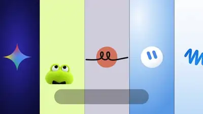</a><br><a href="https://www.sandbase.ai/lab/ai-videos/gemini-4-neon/2123362270139109827?lang=zh-CN&utm_source=github&utm_medium=readme&utm_campaign=awesome-gemini-4-neon&utm_content=card"><b>为多款AI产品制作的动态设计视频</b></a><br><sub><a href="https://x.com/Tuola0205/status/2123362270139109827">@Tuola0205</a></sub></td><td width="33%" valign="top"><a href="https://www.sandbase.ai/lab/media/x/gemini-4-neon/2123184113561817370/video.mp4"></a><br><a href="https://www.sandbase.ai/lab/ai-videos/gemini-4-neon/2123184113561817370?lang=zh-CN&utm_source=github&utm_medium=readme&utm_campaign=awesome-gemini-4-neon&utm_content=card"><b>鹈鹕产品动态设计展示</b></a><br><sub><a href="https://x.com/chetaslua/status/2123184113561817370">@chetaslua</a></sub></td><td width="33%" valign="top"><a href="https://www.sandbase.ai/lab/media/x/gemini-4-argon/2124892615946678458/video.mp4">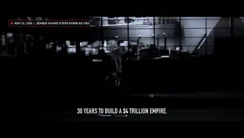</a><br><a href="https://www.sandbase.ai/lab/ai-videos/gemini-4-neon/2124892615946678458?lang=zh-CN&utm_source=github&utm_medium=readme&utm_campaign=awesome-gemini-4-neon&utm_content=card"><b>关于黄仁勋回归的短片</b></a><br><sub><a href="https://x.com/vipinxtwt/status/2124892615946678458">@vipinxtwt</a> · <a href="https://www.sandbase.ai/lab/ai-videos/gemini-4-neon/2124892615946678458?lang=zh-CN&utm_source=github&utm_medium=readme&utm_campaign=awesome-gemini-4-neon&utm_content=card">提示词</a></sub></td></tr>
<tr><td width="33%" valign="top"><a href="https://www.sandbase.ai/lab/media/x/gemini-4-argon/2123259795172212871/video.mp4">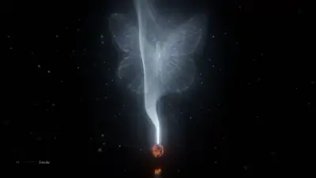</a><br><a href="https://www.sandbase.ai/lab/ai-videos/gemini-4-neon/2123259795172212871?lang=zh-CN&utm_source=github&utm_medium=readme&utm_campaign=awesome-gemini-4-neon&utm_content=card"><b>Three.js 呈现的艺术蝴蝶</b></a><br><sub><a href="https://x.com/thtbee_/status/2123259795172212871">@thtbee_</a></sub></td><td width="33%" valign="top"><a href="https://www.sandbase.ai/lab/media/x/gemini-4-neon/2123212198663323848/video.mp4">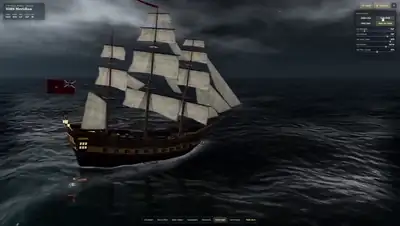</a><br><a href="https://www.sandbase.ai/lab/ai-videos/gemini-4-neon/2123212198663323848?lang=zh-CN&utm_source=github&utm_medium=readme&utm_campaign=awesome-gemini-4-neon&utm_content=card"><b>交互式3D历史帆船</b></a><br><sub><a href="https://x.com/abhinavflac/status/2123212198663323848">@abhinavflac</a></sub></td><td width="33%" valign="top"><a href="https://www.sandbase.ai/lab/media/x/gemini-4-argon/2125001629850345678/video.mp4">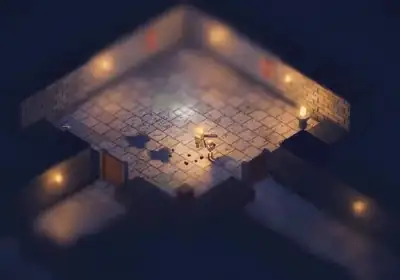</a><br><a href="https://www.sandbase.ai/lab/ai-videos/gemini-4-neon/2125001629850345678?lang=zh-CN&utm_source=github&utm_medium=readme&utm_campaign=awesome-gemini-4-neon&utm_content=card"><b>一个基于HTML的着色器渲染游戏</b></a><br><sub><a href="https://x.com/kevin_t_ngo/status/2125001629850345678">@kevin_t_ngo</a> · <a href="https://www.sandbase.ai/lab/ai-videos/gemini-4-neon/2125001629850345678?lang=zh-CN&utm_source=github&utm_medium=readme&utm_campaign=awesome-gemini-4-neon&utm_content=card">提示词</a></sub></td></tr>
<tr><td width="33%" valign="top"><a href="https://www.sandbase.ai/lab/media/x/gemini-4-argon/2124558621782495548/video.mp4">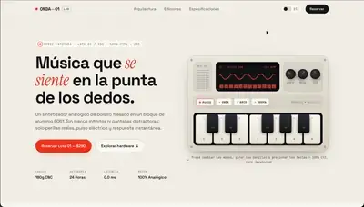</a><br><a href="https://www.sandbase.ai/lab/ai-videos/gemini-4-neon/2124558621782495548?lang=zh-CN&utm_source=github&utm_medium=readme&utm_campaign=awesome-gemini-4-neon&utm_content=card"><b>带有动画和微交互的网页落地页</b></a><br><sub><a href="https://x.com/niachito/status/2124558621782495548">@niachito</a> · <a href="https://www.sandbase.ai/lab/ai-videos/gemini-4-neon/2124558621782495548?lang=zh-CN&utm_source=github&utm_medium=readme&utm_campaign=awesome-gemini-4-neon&utm_content=card">提示词</a></sub></td><td width="33%" valign="top"><a href="https://www.sandbase.ai/lab/media/x/gemini-4-neon/2123246994496077998/video.mp4">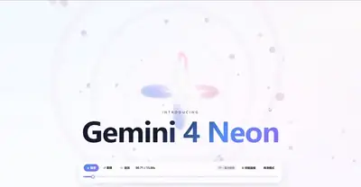</a><br><a href="https://www.sandbase.ai/lab/ai-videos/gemini-4-neon/2123246994496077998?lang=zh-CN&utm_source=github&utm_medium=readme&utm_campaign=awesome-gemini-4-neon&utm_content=card"><b>Gemini 4 neon 的15秒宣传片</b></a><br><sub><a href="https://x.com/cfenghub/status/2123246994496077998">@cfenghub</a> · <a href="https://www.sandbase.ai/lab/ai-videos/gemini-4-neon/2123246994496077998?lang=zh-CN&utm_source=github&utm_medium=readme&utm_campaign=awesome-gemini-4-neon&utm_content=card">提示词</a></sub></td></tr>
</table>

<a id="3d-scene"></a>

## 3D 场景

<table>
<tr><td width="33%" valign="top"><a href="https://www.sandbase.ai/lab/media/x/gemini-4-neon/2123120305648619534/video.mp4"></a><br><a href="https://www.sandbase.ai/lab/ai-videos/gemini-4-neon/2123120305648619534?lang=zh-CN&utm_source=github&utm_medium=readme&utm_campaign=awesome-gemini-4-neon&utm_content=card"><b>在海上航行的 3D 集装箱货船</b></a><br><sub><a href="https://x.com/AfnadX/status/2123120305648619534">@AfnadX</a> · 0:22</sub></td><td width="33%" valign="top"><a href="https://www.sandbase.ai/lab/media/x/gemini-4-neon/2123160089854898346/video.mp4">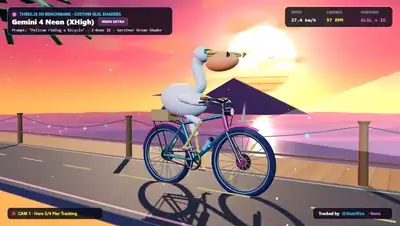</a><br><a href="https://www.sandbase.ai/lab/ai-videos/gemini-4-neon/2123160089854898346?lang=zh-CN&utm_source=github&utm_medium=readme&utm_campaign=awesome-gemini-4-neon&utm_content=card"><b>Three.js 中骑自行车的鹈鹕</b></a><br><sub><a href="https://x.com/StatsWire/status/2123160089854898346">@StatsWire</a> · 0:12 · <a href="https://www.sandbase.ai/lab/ai-videos/gemini-4-neon/2123160089854898346?lang=zh-CN&utm_source=github&utm_medium=readme&utm_campaign=awesome-gemini-4-neon&utm_content=card">提示词</a></sub></td><td width="33%" valign="top"><a href="https://www.sandbase.ai/lab/media/x/gemini-4-neon/2123160092657021432/video.mp4"></a><br><a href="https://www.sandbase.ai/lab/ai-videos/gemini-4-neon/2123160092657021432?lang=zh-CN&utm_source=github&utm_medium=readme&utm_campaign=awesome-gemini-4-neon&utm_content=card"><b>在 Three.js 中骑自行车的骑手</b></a><br><sub><a href="https://x.com/AI_Screening/status/2123160092657021432">@AI_Screening</a> · 0:14</sub></td></tr>
<tr><td width="33%" valign="top"><a href="https://www.sandbase.ai/lab/media/x/gemini-4-neon/2123162154132242885/video.mp4"></a><br><a href="https://www.sandbase.ai/lab/ai-videos/gemini-4-neon/2123162154132242885?lang=zh-CN&utm_source=github&utm_medium=readme&utm_campaign=awesome-gemini-4-neon&utm_content=card"><b>Three.js与GLSL生成的场景</b></a><br><sub><a href="https://x.com/cfenghub/status/2123162154132242885">@cfenghub</a> · 0:44 · <a href="https://www.sandbase.ai/lab/ai-videos/gemini-4-neon/2123162154132242885?lang=zh-CN&utm_source=github&utm_medium=readme&utm_campaign=awesome-gemini-4-neon&utm_content=card">提示词</a></sub></td><td width="33%" valign="top"><a href="https://www.sandbase.ai/lab/media/x/gemini-4-neon/2123165046276760028/video.mp4"></a><br><a href="https://www.sandbase.ai/lab/ai-videos/gemini-4-neon/2123165046276760028?lang=zh-CN&utm_source=github&utm_medium=readme&utm_campaign=awesome-gemini-4-neon&utm_content=card"><b>Three.js实现的鹈鹕骑自行车</b></a><br><sub><a href="https://x.com/zhang_baoqing/status/2123165046276760028">@zhang_baoqing</a> · 0:32</sub></td><td width="33%" valign="top"><a href="https://www.sandbase.ai/lab/media/x/gemini-4-neon/2123170821250400282/video.mp4">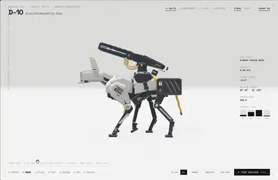</a><br><a href="https://www.sandbase.ai/lab/ai-videos/gemini-4-neon/2123170821250400282?lang=zh-CN&utm_source=github&utm_medium=readme&utm_campaign=awesome-gemini-4-neon&utm_content=card"><b>Three.js WebGPU 机器狗生物力学模拟</b></a><br><sub><a href="https://x.com/thebuggeddev/status/2123170821250400282">@thebuggeddev</a></sub></td></tr>
</table>

<details>
<summary><b>展开全部 24 条</b></summary>

<table>
<tr><td width="33%" valign="top"><a href="https://www.sandbase.ai/lab/media/x/gemini-4-neon/2123170948568535488/video.mp4"></a><br><a href="https://www.sandbase.ai/lab/ai-videos/gemini-4-neon/2123170948568535488?lang=zh-CN&utm_source=github&utm_medium=readme&utm_campaign=awesome-gemini-4-neon&utm_content=card"><b>基于济慈诗作秋颂的绘画风 3D 动画</b></a><br><sub><a href="https://x.com/vamsibatchuk/status/2123170948568535488">@vamsibatchuk</a></sub></td><td width="33%" valign="top"><a href="https://www.sandbase.ai/lab/media/x/gemini-4-neon/2123190272527860173/video.mp4">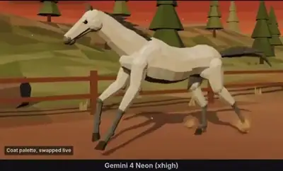</a><br><a href="https://www.sandbase.ai/lab/ai-videos/gemini-4-neon/2123190272527860173?lang=zh-CN&utm_source=github&utm_medium=readme&utm_campaign=awesome-gemini-4-neon&utm_content=card"><b>无缝循环奔跑的3D马动画</b></a><br><sub><a href="https://x.com/Frtnel/status/2123190272527860173">@Frtnel</a> · 0:29</sub></td><td width="33%" valign="top"><a href="https://www.sandbase.ai/lab/media/x/gemini-4-neon/2123212198663323848/video.mp4"></a><br><a href="https://www.sandbase.ai/lab/ai-videos/gemini-4-neon/2123212198663323848?lang=zh-CN&utm_source=github&utm_medium=readme&utm_campaign=awesome-gemini-4-neon&utm_content=card"><b>交互式3D历史帆船</b></a><br><sub><a href="https://x.com/abhinavflac/status/2123212198663323848">@abhinavflac</a></sub></td></tr>
<tr><td width="33%" valign="top"><a href="https://www.sandbase.ai/lab/media/x/gemini-4-neon/2123222507977375770/video.mp4">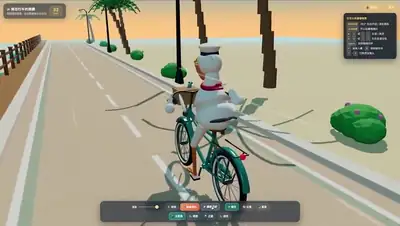</a><br><a href="https://www.sandbase.ai/lab/ai-videos/gemini-4-neon/2123222507977375770?lang=zh-CN&utm_source=github&utm_medium=readme&utm_campaign=awesome-gemini-4-neon&utm_content=card"><b>Three.js 制作的鹈鹕骑自行车场景</b></a><br><sub><a href="https://x.com/tspy/status/2123222507977375770">@tspy</a> · 0:53 · <a href="https://www.sandbase.ai/lab/ai-videos/gemini-4-neon/2123222507977375770?lang=zh-CN&utm_source=github&utm_medium=readme&utm_campaign=awesome-gemini-4-neon&utm_content=card">提示词</a></sub></td><td width="33%" valign="top"><a href="https://www.sandbase.ai/lab/media/x/gemini-4-neon/2123226306351661099/video.mp4"></a><br><a href="https://www.sandbase.ai/lab/ai-videos/gemini-4-neon/2123226306351661099?lang=zh-CN&utm_source=github&utm_medium=readme&utm_campaign=awesome-gemini-4-neon&utm_content=card"><b>体素奇幻城堡场景</b></a><br><sub><a href="https://x.com/Lentils80/status/2123226306351661099">@Lentils80</a> · 0:38</sub></td><td width="33%" valign="top"><a href="https://www.sandbase.ai/lab/media/x/gemini-4-argon/2123259795172212871/video.mp4"></a><br><a href="https://www.sandbase.ai/lab/ai-videos/gemini-4-neon/2123259795172212871?lang=zh-CN&utm_source=github&utm_medium=readme&utm_campaign=awesome-gemini-4-neon&utm_content=card"><b>Three.js 呈现的艺术蝴蝶</b></a><br><sub><a href="https://x.com/thtbee_/status/2123259795172212871">@thtbee_</a></sub></td></tr>
<tr><td width="33%" valign="top"><a href="https://www.sandbase.ai/lab/media/x/gemini-4-neon/2123375564509921472/video.mp4"></a><br><a href="https://www.sandbase.ai/lab/ai-videos/gemini-4-neon/2123375564509921472?lang=zh-CN&utm_source=github&utm_medium=readme&utm_campaign=awesome-gemini-4-neon&utm_content=card"><b>由Three.js生成的质感3D场景</b></a><br><sub><a href="https://x.com/29meat_ai/status/2123375564509921472">@29meat_ai</a></sub></td><td width="33%" valign="top"><a href="https://www.sandbase.ai/lab/media/x/gemini-4-neon/2123384156629651678/video.mp4">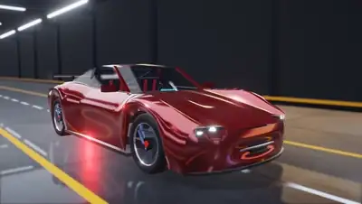</a><br><a href="https://www.sandbase.ai/lab/ai-videos/gemini-4-neon/2123384156629651678?lang=zh-CN&utm_source=github&utm_medium=readme&utm_campaign=awesome-gemini-4-neon&utm_content=card"><b>Three.js 模拟汽车撞墙场景</b></a><br><sub><a href="https://x.com/camperaigg/status/2123384156629651678">@camperaigg</a></sub></td><td width="33%" valign="top"><a href="https://www.sandbase.ai/lab/media/x/gemini-4-argon/2123843882937155607/video.mp4">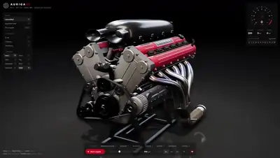</a><br><a href="https://www.sandbase.ai/lab/ai-videos/gemini-4-neon/2123843882937155607?lang=zh-CN&utm_source=github&utm_medium=readme&utm_campaign=awesome-gemini-4-neon&utm_content=card"><b>在 Three.js 中构建的 3D V12 发动机</b></a><br><sub><a href="https://x.com/thtbee_/status/2123843882937155607">@thtbee_</a></sub></td></tr>
<tr><td width="33%" valign="top"><a href="https://www.sandbase.ai/lab/media/x/gemini-4-neon/2124192968345338206/video.mp4">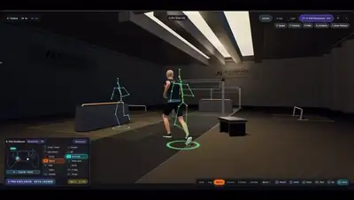</a><br><a href="https://www.sandbase.ai/lab/ai-videos/gemini-4-neon/2124192968345338206?lang=zh-CN&utm_source=github&utm_medium=readme&utm_campaign=awesome-gemini-4-neon&utm_content=card"><b>基于 MotionBricks 的交互式 3D 神经角色演示</b></a><br><sub><a href="https://x.com/ai_for_success/status/2124192968345338206">@ai_for_success</a></sub></td><td width="33%" valign="top"><a href="https://www.sandbase.ai/lab/media/x/gemini-4-neon/2124508873897726028/video.mp4">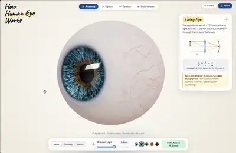</a><br><a href="https://www.sandbase.ai/lab/ai-videos/gemini-4-neon/2124508873897726028?lang=zh-CN&utm_source=github&utm_medium=readme&utm_campaign=awesome-gemini-4-neon&utm_content=card"><b>探索视觉机制的人眼交互式 3D 模型</b></a><br><sub><a href="https://x.com/thebuggeddev/status/2124508873897726028">@thebuggeddev</a></sub></td><td width="33%" valign="top"><a href="https://www.sandbase.ai/lab/media/x/gemini-4-neon/2124565795003105494/video.mp4">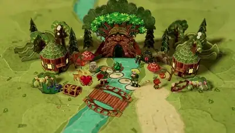</a><br><a href="https://www.sandbase.ai/lab/ai-videos/gemini-4-neon/2124565795003105494?lang=zh-CN&utm_source=github&utm_medium=readme&utm_campaign=awesome-gemini-4-neon&utm_content=card"><b>《时之笛》纸艺风格Three.js滚动动画</b></a><br><sub><a href="https://x.com/xikhar/status/2124565795003105494">@xikhar</a></sub></td></tr>
<tr><td width="33%" valign="top"><a href="https://www.sandbase.ai/lab/media/x/gemini-4-neon/2124572099750891577/video.mp4">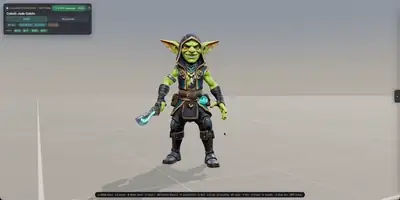</a><br><a href="https://www.sandbase.ai/lab/ai-videos/gemini-4-neon/2124572099750891577?lang=zh-CN&utm_source=github&utm_medium=readme&utm_campaign=awesome-gemini-4-neon&utm_content=card"><b>使用Gemini 4 Neon制作的3D动态预告片</b></a><br><sub><a href="https://x.com/ai_for_success/status/2124572099750891577">@ai_for_success</a></sub></td><td width="33%" valign="top"><a href="https://www.sandbase.ai/lab/media/x/gemini-4-neon/2125157673448677586/video.mp4">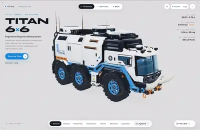</a><br><a href="https://www.sandbase.ai/lab/ai-videos/gemini-4-neon/2125157673448677586?lang=zh-CN&utm_source=github&utm_medium=readme&utm_campaign=awesome-gemini-4-neon&utm_content=card"><b>具备物理系统的未来六轮装甲卡车</b></a><br><sub><a href="https://x.com/thebuggeddev/status/2125157673448677586">@thebuggeddev</a></sub></td><td width="33%" valign="top"><a href="https://www.sandbase.ai/lab/media/x/gemini-4-neon/2125270092812533820/video.mp4"></a><br><a href="https://www.sandbase.ai/lab/ai-videos/gemini-4-neon/2125270092812533820?lang=zh-CN&utm_source=github&utm_medium=readme&utm_campaign=awesome-gemini-4-neon&utm_content=card"><b>Three.js 构建的 3D 观景台交互场景</b></a><br><sub><a href="https://x.com/drashyakuruwa/status/2125270092812533820">@drashyakuruwa</a></sub></td></tr>
<tr><td width="33%" valign="top"><a href="https://www.sandbase.ai/lab/media/x/gemini-4-argon/2125282916871938272/video.mp4">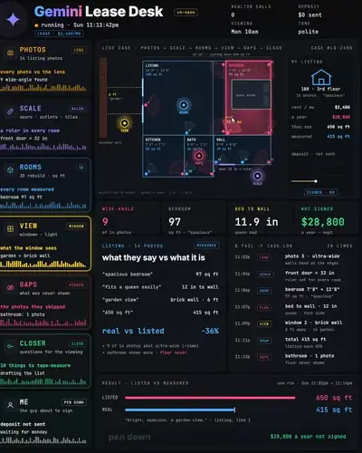</a><br><a href="https://www.sandbase.ai/lab/ai-videos/gemini-4-neon/2125282916871938272?lang=zh-CN&utm_source=github&utm_medium=readme&utm_campaign=awesome-gemini-4-neon&utm_content=card"><b>基于房源照片的3D公寓重建</b></a><br><sub><a href="https://x.com/0xMfox/status/2125282916871938272">@0xMfox</a> · <a href="https://www.sandbase.ai/lab/ai-videos/gemini-4-neon/2125282916871938272?lang=zh-CN&utm_source=github&utm_medium=readme&utm_campaign=awesome-gemini-4-neon&utm_content=card">提示词</a></sub></td><td width="33%" valign="top"><a href="https://www.sandbase.ai/lab/media/x/gemini-4-neon/2125313162815889411/video.mp4">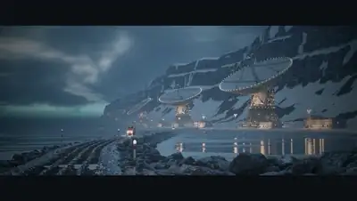</a><br><a href="https://www.sandbase.ai/lab/ai-videos/gemini-4-neon/2125313162815889411?lang=zh-CN&utm_source=github&utm_medium=readme&utm_campaign=awesome-gemini-4-neon&utm_content=card"><b>带有射电天线的北极海岸3D巨型场景</b></a><br><sub><a href="https://x.com/apekshik/status/2125313162815889411">@apekshik</a></sub></td><td width="33%" valign="top"><a href="https://www.sandbase.ai/lab/media/x/gemini-4-neon/2125314230681481651/video.mp4">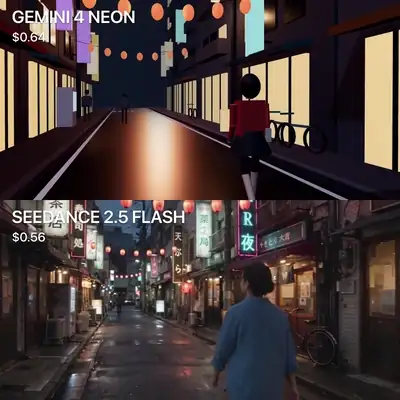</a><br><a href="https://www.sandbase.ai/lab/ai-videos/gemini-4-neon/2125314230681481651?lang=zh-CN&utm_source=github&utm_medium=readme&utm_campaign=awesome-gemini-4-neon&utm_content=card"><b>通过代码生成三维动画指导真实感视频</b></a><br><sub><a href="https://x.com/omidaziz/status/2125314230681481651">@omidaziz</a></sub></td></tr>
</table>

</details>

<a id="motion-graphics"></a>

## 动效

<table>
<tr><td width="33%" valign="top"><a href="https://www.sandbase.ai/lab/media/x/gemini-4-neon/2122954421050933355/video.mp4">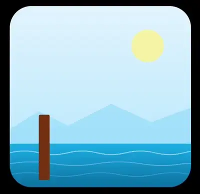</a><br><a href="https://www.sandbase.ai/lab/ai-videos/gemini-4-neon/2122954421050933355?lang=zh-CN&utm_source=github&utm_medium=readme&utm_campaign=awesome-gemini-4-neon&utm_content=card"><b>鹈鹕SVG矢量图</b></a><br><sub><a href="https://x.com/Inmerson/status/2122954421050933355">@Inmerson</a> · 0:09 · <a href="https://www.sandbase.ai/lab/ai-videos/gemini-4-neon/2122954421050933355?lang=zh-CN&utm_source=github&utm_medium=readme&utm_campaign=awesome-gemini-4-neon&utm_content=card">提示词</a></sub></td><td width="33%" valign="top"><a href="https://www.sandbase.ai/lab/media/x/gemini-4-neon/2123135691085472139/video.mp4"></a><br><a href="https://www.sandbase.ai/lab/ai-videos/gemini-4-neon/2123135691085472139?lang=zh-CN&utm_source=github&utm_medium=readme&utm_campaign=awesome-gemini-4-neon&utm_content=card"><b>单HTML文件呈现的动态设计</b></a><br><sub><a href="https://x.com/AfnadX/status/2123135691085472139">@AfnadX</a></sub></td><td width="33%" valign="top"><a href="https://www.sandbase.ai/lab/media/x/gemini-4-neon/2123157977045852382/video.mp4"></a><br><a href="https://www.sandbase.ai/lab/ai-videos/gemini-4-neon/2123157977045852382?lang=zh-CN&utm_source=github&utm_medium=readme&utm_campaign=awesome-gemini-4-neon&utm_content=card"><b>HTML 代码实现的鹈鹕骑自行车效果</b></a><br><sub><a href="https://x.com/zhang_baoqing/status/2123157977045852382">@zhang_baoqing</a> · 0:19</sub></td></tr>
<tr><td width="33%" valign="top"><a href="https://www.sandbase.ai/lab/media/x/gemini-4-neon/2123159335635456318/video.mp4">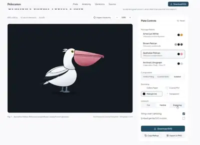</a><br><a href="https://www.sandbase.ai/lab/ai-videos/gemini-4-neon/2123159335635456318?lang=zh-CN&utm_source=github&utm_medium=readme&utm_campaign=awesome-gemini-4-neon&utm_content=card"><b>SVG鹈鹕矢量图形</b></a><br><sub><a href="https://x.com/Inmerson/status/2123159335635456318">@Inmerson</a> · 0:26</sub></td><td width="33%" valign="top"><a href="https://www.sandbase.ai/lab/media/x/gemini-4-neon/2123165824576114932/video.mp4">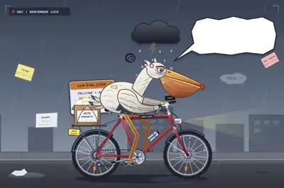</a><br><a href="https://www.sandbase.ai/lab/ai-videos/gemini-4-neon/2123165824576114932?lang=zh-CN&utm_source=github&utm_medium=readme&utm_campaign=awesome-gemini-4-neon&utm_content=card"><b>骑自行车的沮丧鹈鹕 SVG 动画</b></a><br><sub><a href="https://x.com/HarshithLucky3/status/2123165824576114932">@HarshithLucky3</a> · 0:13</sub></td><td width="33%" valign="top"><a href="https://www.sandbase.ai/lab/media/x/gemini-4-neon/2123168004175462796/video.mp4"></a><br><a href="https://www.sandbase.ai/lab/ai-videos/gemini-4-neon/2123168004175462796?lang=zh-CN&utm_source=github&utm_medium=readme&utm_campaign=awesome-gemini-4-neon&utm_content=card"><b>反重力飞船SVG动画</b></a><br><sub><a href="https://x.com/srikanthvaluri/status/2123168004175462796">@srikanthvaluri</a> · 0:07</sub></td></tr>
</table>

<details>
<summary><b>展开全部 25 条</b></summary>

<table>
<tr><td width="33%" valign="top"><a href="https://www.sandbase.ai/lab/media/x/gemini-4-neon/2123180572784640063/video.mp4">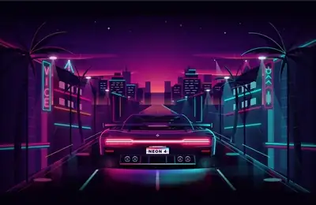</a><br><a href="https://www.sandbase.ai/lab/ai-videos/gemini-4-neon/2123180572784640063?lang=zh-CN&utm_source=github&utm_medium=readme&utm_campaign=awesome-gemini-4-neon&utm_content=card"><b>罪恶都市风格 SVG 矢量动画</b></a><br><sub><a href="https://x.com/Inmerson/status/2123180572784640063">@Inmerson</a> · 0:07</sub></td><td width="33%" valign="top"><a href="https://www.sandbase.ai/lab/media/x/gemini-4-neon/2123181538544374002/video.mp4"></a><br><a href="https://www.sandbase.ai/lab/ai-videos/gemini-4-neon/2123181538544374002?lang=zh-CN&utm_source=github&utm_medium=readme&utm_campaign=awesome-gemini-4-neon&utm_content=card"><b>暹罗猫SVG矢量图动画</b></a><br><sub><a href="https://x.com/Inmerson/status/2123181538544374002">@Inmerson</a> · 0:13</sub></td><td width="33%" valign="top"><a href="https://www.sandbase.ai/lab/media/x/gemini-4-neon/2123181843835207955/video.mp4">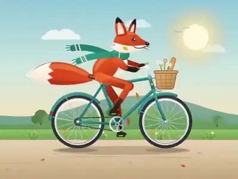</a><br><a href="https://www.sandbase.ai/lab/ai-videos/gemini-4-neon/2123181843835207955?lang=zh-CN&utm_source=github&utm_medium=readme&utm_campaign=awesome-gemini-4-neon&utm_content=card"><b>骑自行车的红狐狸矢量动画</b></a><br><sub><a href="https://x.com/srikanthvaluri/status/2123181843835207955">@srikanthvaluri</a> · 0:05</sub></td></tr>
<tr><td width="33%" valign="top"><a href="https://www.sandbase.ai/lab/media/x/gemini-4-neon/2123183419442205140/video.mp4">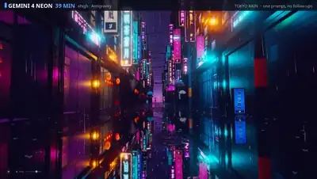</a><br><a href="https://www.sandbase.ai/lab/ai-videos/gemini-4-neon/2123183419442205140?lang=zh-CN&utm_source=github&utm_medium=readme&utm_campaign=awesome-gemini-4-neon&utm_content=card"><b>雨夜东京霓虹街景</b></a><br><sub><a href="https://x.com/PokeBenchTV/status/2123183419442205140">@PokeBenchTV</a> · 0:25</sub></td><td width="33%" valign="top"><a href="https://www.sandbase.ai/lab/media/x/gemini-4-neon/2123184113561817370/video.mp4"></a><br><a href="https://www.sandbase.ai/lab/ai-videos/gemini-4-neon/2123184113561817370?lang=zh-CN&utm_source=github&utm_medium=readme&utm_campaign=awesome-gemini-4-neon&utm_content=card"><b>鹈鹕产品动态设计展示</b></a><br><sub><a href="https://x.com/chetaslua/status/2123184113561817370">@chetaslua</a></sub></td><td width="33%" valign="top"><a href="https://www.sandbase.ai/lab/media/x/gemini-4-neon/2123185466417746256/video.mp4">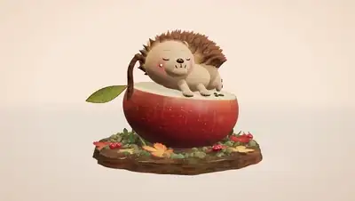</a><br><a href="https://www.sandbase.ai/lab/ai-videos/gemini-4-neon/2123185466417746256?lang=zh-CN&utm_source=github&utm_medium=readme&utm_campaign=awesome-gemini-4-neon&utm_content=card"><b>一只瞌睡刺猬的动画演示</b></a><br><sub><a href="https://x.com/doe_naps/status/2123185466417746256">@doe_naps</a> · 0:31</sub></td></tr>
<tr><td width="33%" valign="top"><a href="https://www.sandbase.ai/lab/media/x/gemini-4-neon/2123222816325869685/video.mp4"></a><br><a href="https://www.sandbase.ai/lab/ai-videos/gemini-4-neon/2123219124260315301?lang=zh-CN&utm_source=github&utm_medium=readme&utm_campaign=awesome-gemini-4-neon&utm_content=card"><b>纯JS代码生成的自我介绍动态设计</b></a><br><sub><a href="https://x.com/chetaslua/status/2123219124260315301">@chetaslua</a></sub></td><td width="33%" valign="top"><a href="https://www.sandbase.ai/lab/media/x/opus-5-5/2123362270139109827/video.mp4"></a><br><a href="https://www.sandbase.ai/lab/ai-videos/gemini-4-neon/2123362270139109827?lang=zh-CN&utm_source=github&utm_medium=readme&utm_campaign=awesome-gemini-4-neon&utm_content=card"><b>为多款AI产品制作的动态设计视频</b></a><br><sub><a href="https://x.com/Tuola0205/status/2123362270139109827">@Tuola0205</a></sub></td><td width="33%" valign="top"><a href="https://www.sandbase.ai/lab/media/x/gemini-4-argon/2123948163539329148/video.mp4">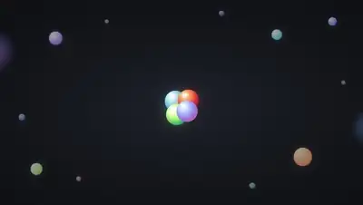</a><br><a href="https://www.sandbase.ai/lab/ai-videos/gemini-4-neon/2123948163539329148?lang=zh-CN&utm_source=github&utm_medium=readme&utm_campaign=awesome-gemini-4-neon&utm_content=card"><b>由Gemini 4 Neon制作的首次亮相视频序列</b></a><br><sub><a href="https://x.com/liu8in/status/2123948163539329148">@liu8in</a></sub></td></tr>
<tr><td width="33%" valign="top"><a href="https://www.sandbase.ai/lab/media/x/gemini-4-neon/2124036193776263671/video.mp4"></a><br><a href="https://www.sandbase.ai/lab/ai-videos/gemini-4-neon/2124036193776263671?lang=zh-CN&utm_source=github&utm_medium=readme&utm_campaign=awesome-gemini-4-neon&utm_content=card"><b>使用Gemini 4 Neon进行的首次动态测试</b></a><br><sub><a href="https://x.com/ogabezim/status/2124036193776263671">@ogabezim</a></sub></td><td width="33%" valign="top"><a href="https://www.sandbase.ai/lab/media/x/gemini-4-neon/2124040952658682263/video.mp4">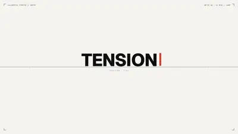</a><br><a href="https://www.sandbase.ai/lab/ai-videos/gemini-4-neon/2124040952658682263?lang=zh-CN&utm_source=github&utm_medium=readme&utm_campaign=awesome-gemini-4-neon&utm_content=card"><b>Gemini 4 Neon 动态图形演示</b></a><br><sub><a href="https://x.com/pankajkumar_dev/status/2124040952658682263">@pankajkumar_dev</a></sub></td><td width="33%" valign="top"><a href="https://www.sandbase.ai/lab/media/x/gemini-4-neon/2124131378770182389/video.mp4">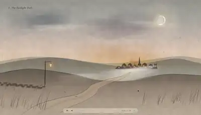</a><br><a href="https://www.sandbase.ai/lab/ai-videos/gemini-4-neon/2124131378770182389?lang=zh-CN&utm_source=github&utm_medium=readme&utm_campaign=awesome-gemini-4-neon&utm_content=card"><b>纯代码生成的歌唱音频与视觉效果</b></a><br><sub><a href="https://x.com/chetaslua/status/2124131378770182389">@chetaslua</a></sub></td></tr>
<tr><td width="33%" valign="top"><a href="https://www.sandbase.ai/lab/media/x/gemini-4-neon/2124998786863055080/video.mp4">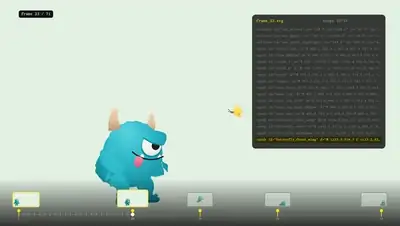</a><br><a href="https://www.sandbase.ai/lab/ai-videos/gemini-4-neon/2124998786863055080?lang=zh-CN&utm_source=github&utm_medium=readme&utm_campaign=awesome-gemini-4-neon&utm_content=card"><b>结合大语言模型与扩散模型的动画演示</b></a><br><sub><a href="https://x.com/OdinLovis/status/2124998786863055080">@OdinLovis</a></sub></td><td width="33%" valign="top"><a href="https://www.sandbase.ai/lab/media/x/gemini-4-neon/2125174944057507944/video.mp4">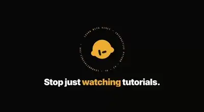</a><br><a href="https://www.sandbase.ai/lab/ai-videos/gemini-4-neon/2125174944057507944?lang=zh-CN&utm_source=github&utm_medium=readme&utm_campaign=awesome-gemini-4-neon&utm_content=card"><b>使用 Antigravity 制作的动态图形视频</b></a><br><sub><a href="https://x.com/monarch_0I/status/2125174944057507944">@monarch_0I</a></sub></td><td width="33%" valign="top"><a href="https://www.sandbase.ai/lab/media/x/fable-5-5/2125228647879733273/video.mp4"></a><br><a href="https://www.sandbase.ai/lab/ai-videos/gemini-4-neon/2125230060013781266?lang=zh-CN&utm_source=github&utm_medium=readme&utm_campaign=awesome-gemini-4-neon&utm_content=card"><b>Claude Opus 5.6 生成的代码动画</b></a><br><sub><a href="https://x.com/Haleeeemahh/status/2125230060013781266">@Haleeeemahh</a></sub></td></tr>
<tr><td width="33%" valign="top"><a href="https://www.sandbase.ai/lab/media/x/gemini-4-neon/2125266596210061674/video.mp4">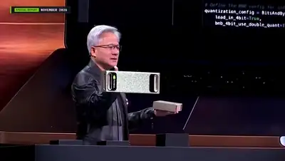</a><br><a href="https://www.sandbase.ai/lab/ai-videos/gemini-4-neon/2125266596210061674?lang=zh-CN&utm_source=github&utm_medium=readme&utm_campaign=awesome-gemini-4-neon&utm_content=card"><b>多种风格的 AI 生成视频作品展示</b></a><br><sub><a href="https://x.com/iamfakhrealam/status/2125266596210061674">@iamfakhrealam</a></sub></td><td width="33%" valign="top"><a href="https://www.sandbase.ai/lab/media/x/gemini-4-argon/2125269462853271952/video.mp4">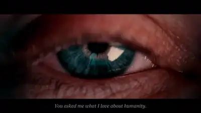</a><br><a href="https://www.sandbase.ai/lab/ai-videos/gemini-4-neon/2125269462853271952?lang=zh-CN&utm_source=github&utm_medium=readme&utm_campaign=awesome-gemini-4-neon&utm_content=card"><b>关于人工智能喜爱人类之处的短片</b></a><br><sub><a href="https://x.com/vipinxtwt/status/2125269462853271952">@vipinxtwt</a></sub></td><td width="33%" valign="top"><a href="https://www.sandbase.ai/lab/media/x/gemini-4-neon/2125270906293395493/video.mp4"></a><br><a href="https://www.sandbase.ai/lab/ai-videos/gemini-4-neon/2125270906293395493?lang=zh-CN&utm_source=github&utm_medium=readme&utm_campaign=awesome-gemini-4-neon&utm_content=card"><b>AI剪辑视频与语音克隆展示</b></a><br><sub><a href="https://x.com/BreezeOg1/status/2125270906293395493">@BreezeOg1</a></sub></td></tr>
<tr><td width="33%" valign="top"><a href="https://www.sandbase.ai/lab/media/x/gemini-4-neon/2125304389539975350/video.mp4"></a><br><a href="https://www.sandbase.ai/lab/ai-videos/gemini-4-neon/2125304389539975350?lang=zh-CN&utm_source=github&utm_medium=readme&utm_campaign=awesome-gemini-4-neon&utm_content=card"><b>进击的巨人素描风战斗场景动画</b></a><br><sub><a href="https://x.com/WinterArc2125/status/2125304389539975350">@WinterArc2125</a></sub></td></tr>
</table>

</details>

<a id="game"></a>

## 游戏

<table>
<tr><td width="33%" valign="top"><a href="https://www.sandbase.ai/lab/media/x/gemini-4-neon/2123169783038235033/video.mp4"></a><br><a href="https://www.sandbase.ai/lab/ai-videos/gemini-4-neon/2123169783038235033?lang=zh-CN&utm_source=github&utm_medium=readme&utm_campaign=awesome-gemini-4-neon&utm_content=card"><b>在日月世界切换的平台跳跃游戏</b></a><br><sub><a href="https://x.com/OzanTRAI/status/2123169783038235033">@OzanTRAI</a> · 0:51</sub></td><td width="33%" valign="top"><a href="https://www.sandbase.ai/lab/media/x/gemini-4-neon/2123178088439959750/video.mp4"></a><br><a href="https://www.sandbase.ai/lab/ai-videos/gemini-4-neon/2123178088439959750?lang=zh-CN&utm_source=github&utm_medium=readme&utm_campaign=awesome-gemini-4-neon&utm_content=card"><b>表现主义风格艺术小游戏</b></a><br><sub><a href="https://x.com/GeokenAI/status/2123178088439959750">@GeokenAI</a> · 0:04</sub></td><td width="33%" valign="top"><a href="https://www.sandbase.ai/lab/media/x/gemini-4-neon/2123189427249742292/video.mp4">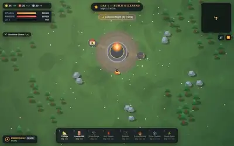</a><br><a href="https://www.sandbase.ai/lab/ai-videos/gemini-4-neon/2123189427249742292?lang=zh-CN&utm_source=github&utm_medium=readme&utm_campaign=awesome-gemini-4-neon&utm_content=card"><b>一款游戏测试演示</b></a><br><sub><a href="https://x.com/AdamHoltererer/status/2123189427249742292">@AdamHoltererer</a> · 0:25</sub></td></tr>
<tr><td width="33%" valign="top"><a href="https://www.sandbase.ai/lab/media/x/gemini-4-neon/2123189826585243883/video.mp4">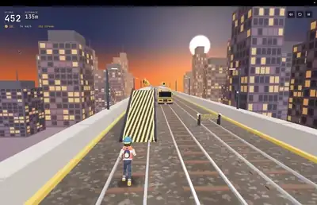</a><br><a href="https://www.sandbase.ai/lab/ai-videos/gemini-4-neon/2123189826585243883?lang=zh-CN&utm_source=github&utm_medium=readme&utm_campaign=awesome-gemini-4-neon&utm_content=card"><b>代码生成的跑酷游戏演示</b></a><br><sub><a href="https://x.com/eandualem/status/2123189826585243883">@eandualem</a> · 0:44</sub></td><td width="33%" valign="top"><a href="https://www.sandbase.ai/lab/media/x/gemini-4-neon/2123446204172472363/video.mp4">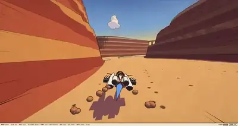</a><br><a href="https://www.sandbase.ai/lab/ai-videos/gemini-4-neon/2123446204172472363?lang=zh-CN&utm_source=github&utm_medium=readme&utm_campaign=awesome-gemini-4-neon&utm_content=card"><b>一款3D太空竞速游戏</b></a><br><sub><a href="https://x.com/byharisali/status/2123446204172472363">@byharisali</a></sub></td><td width="33%" valign="top"><a href="https://www.sandbase.ai/lab/media/x/gemini-4-argon/2124568183902449764/video.mp4">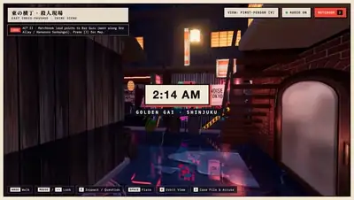</a><br><a href="https://www.sandbase.ai/lab/ai-videos/gemini-4-neon/2124568183902449764?lang=zh-CN&utm_source=github&utm_medium=readme&utm_campaign=awesome-gemini-4-neon&utm_content=card"><b>以黄金街为背景的第一人称解谜游戏</b></a><br><sub><a href="https://x.com/venturetwins/status/2124568183902449764">@venturetwins</a></sub></td></tr>
</table>

<details>
<summary><b>展开全部 7 条</b></summary>

<table>
<tr><td width="33%" valign="top"><a href="https://www.sandbase.ai/lab/media/x/gemini-4-argon/2125001629850345678/video.mp4"></a><br><a href="https://www.sandbase.ai/lab/ai-videos/gemini-4-neon/2125001629850345678?lang=zh-CN&utm_source=github&utm_medium=readme&utm_campaign=awesome-gemini-4-neon&utm_content=card"><b>一个基于HTML的着色器渲染游戏</b></a><br><sub><a href="https://x.com/kevin_t_ngo/status/2125001629850345678">@kevin_t_ngo</a> · <a href="https://www.sandbase.ai/lab/ai-videos/gemini-4-neon/2125001629850345678?lang=zh-CN&utm_source=github&utm_medium=readme&utm_campaign=awesome-gemini-4-neon&utm_content=card">提示词</a></sub></td></tr>
</table>

</details>

<a id="ui-demo"></a>

## 产品界面

<table>
<tr><td width="33%" valign="top"><a href="https://www.sandbase.ai/lab/media/x/gemini-4-argon/2124558621782495548/video.mp4"></a><br><a href="https://www.sandbase.ai/lab/ai-videos/gemini-4-neon/2124558621782495548?lang=zh-CN&utm_source=github&utm_medium=readme&utm_campaign=awesome-gemini-4-neon&utm_content=card"><b>带有动画和微交互的网页落地页</b></a><br><sub><a href="https://x.com/niachito/status/2124558621782495548">@niachito</a> · <a href="https://www.sandbase.ai/lab/ai-videos/gemini-4-neon/2124558621782495548?lang=zh-CN&utm_source=github&utm_medium=readme&utm_campaign=awesome-gemini-4-neon&utm_content=card">提示词</a></sub></td><td width="33%" valign="top"><a href="https://www.sandbase.ai/lab/media/x/gemini-4-neon/2124919659195756928/video.mp4">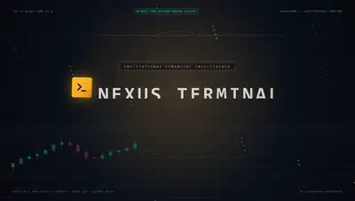</a><br><a href="https://www.sandbase.ai/lab/ai-videos/gemini-4-neon/2124919659195756928?lang=zh-CN&utm_source=github&utm_medium=readme&utm_campaign=awesome-gemini-4-neon&utm_content=card"><b>金融终端竞争产品的展示视频</b></a><br><sub><a href="https://x.com/jeet_twts/status/2124919659195756928">@jeet_twts</a></sub></td><td width="33%" valign="top"><a href="https://www.sandbase.ai/lab/media/x/gemini-4-neon/2125206633722601572/video.mp4">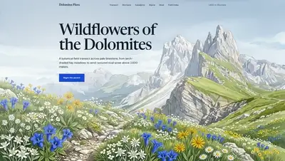</a><br><a href="https://www.sandbase.ai/lab/ai-videos/gemini-4-neon/2125206633722601572?lang=zh-CN&utm_source=github&utm_medium=readme&utm_campaign=awesome-gemini-4-neon&utm_content=card"><b>多洛米蒂高山野花图文网页设计展示</b></a><br><sub><a href="https://x.com/_philschmid/status/2125206633722601572">@_philschmid</a> · <a href="https://www.sandbase.ai/lab/ai-videos/gemini-4-neon/2125206633722601572?lang=zh-CN&utm_source=github&utm_medium=readme&utm_campaign=awesome-gemini-4-neon&utm_content=card">提示词</a></sub></td></tr>
<tr><td width="33%" valign="top"><a href="https://www.sandbase.ai/lab/media/x/gemini-4-neon/2125253560921358463/video.mp4">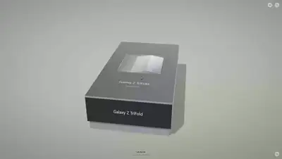</a><br><a href="https://www.sandbase.ai/lab/ai-videos/gemini-4-neon/2125253560921358463?lang=zh-CN&utm_source=github&utm_medium=readme&utm_campaign=awesome-gemini-4-neon&utm_content=card"><b>浏览器端折叠屏手机开箱交互演示</b></a><br><sub><a href="https://x.com/srikanthvaluri/status/2125253560921358463">@srikanthvaluri</a></sub></td><td width="33%" valign="top"><a href="https://www.sandbase.ai/lab/media/x/gemini-4-neon/2125326948385894827/video.mp4">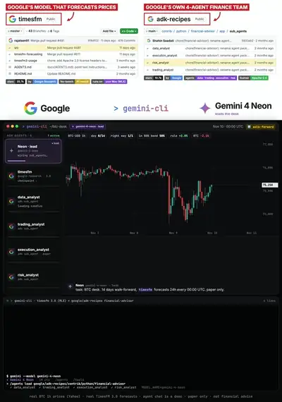</a><br><a href="https://www.sandbase.ai/lab/ai-videos/gemini-4-neon/2125326948385894827?lang=zh-CN&utm_source=github&utm_medium=readme&utm_campaign=awesome-gemini-4-neon&utm_content=card"><b>全自动交易终端与多智能体演示</b></a><br><sub><a href="https://x.com/Dipper_pol/status/2125326948385894827">@Dipper_pol</a></sub></td></tr>
</table>

<a id="kinetic-type"></a>

## 文字动效

<table>
<tr><td width="33%" valign="top"><a href="https://www.sandbase.ai/lab/media/x/gemini-4-neon/2123831991061840145/video.mp4">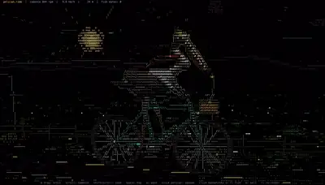</a><br><a href="https://www.sandbase.ai/lab/ai-videos/gemini-4-neon/2123831991061840145?lang=zh-CN&utm_source=github&utm_medium=readme&utm_campaign=awesome-gemini-4-neon&utm_content=card"><b>骑自行车的鹈鹕ASCII字符动画</b></a><br><sub><a href="https://x.com/chetaslua/status/2123831991061840145">@chetaslua</a></sub></td></tr>
</table>

<a id="explainer"></a>

## 讲解

<table>
<tr><td width="33%" valign="top"><a href="https://www.sandbase.ai/lab/media/x/gemini-4-neon/2124872708366401609/video.mp4">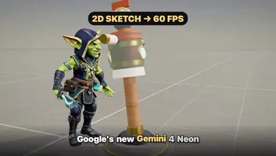</a><br><a href="https://www.sandbase.ai/lab/ai-videos/gemini-4-neon/2124872708366401609?lang=zh-CN&utm_source=github&utm_medium=readme&utm_campaign=awesome-gemini-4-neon&utm_content=card"><b>图像转3D绑定与动画制作流程指南</b></a><br><sub><a href="https://x.com/ai_for_success/status/2124872708366401609">@ai_for_success</a></sub></td><td width="33%" valign="top"><a href="https://www.sandbase.ai/lab/media/x/gemini-4-argon/2124892615946678458/video.mp4"></a><br><a href="https://www.sandbase.ai/lab/ai-videos/gemini-4-neon/2124892615946678458?lang=zh-CN&utm_source=github&utm_medium=readme&utm_campaign=awesome-gemini-4-neon&utm_content=card"><b>关于黄仁勋回归的短片</b></a><br><sub><a href="https://x.com/vipinxtwt/status/2124892615946678458">@vipinxtwt</a> · <a href="https://www.sandbase.ai/lab/ai-videos/gemini-4-neon/2124892615946678458?lang=zh-CN&utm_source=github&utm_medium=readme&utm_campaign=awesome-gemini-4-neon&utm_content=card">提示词</a></sub></td></tr>
</table>

<a id="launch-film"></a>

## 发布片

<table>
<tr><td width="33%" valign="top"><a href="https://www.sandbase.ai/lab/media/x/gemini-4-neon/2123173513502822864/video.mp4"></a><br><a href="https://www.sandbase.ai/lab/ai-videos/gemini-4-neon/2123173513502822864?lang=zh-CN&utm_source=github&utm_medium=readme&utm_campaign=awesome-gemini-4-neon&utm_content=card"><b>生成的快速发布宣传视频</b></a><br><sub><a href="https://x.com/BreezeOg1/status/2123173513502822864">@BreezeOg1</a> · 0:12</sub></td><td width="33%" valign="top"><a href="https://www.sandbase.ai/lab/media/x/gemini-4-neon/2123246994496077998/video.mp4"></a><br><a href="https://www.sandbase.ai/lab/ai-videos/gemini-4-neon/2123246994496077998?lang=zh-CN&utm_source=github&utm_medium=readme&utm_campaign=awesome-gemini-4-neon&utm_content=card"><b>Gemini 4 neon 的15秒宣传片</b></a><br><sub><a href="https://x.com/cfenghub/status/2123246994496077998">@cfenghub</a> · <a href="https://www.sandbase.ai/lab/ai-videos/gemini-4-neon/2123246994496077998?lang=zh-CN&utm_source=github&utm_medium=readme&utm_campaign=awesome-gemini-4-neon&utm_content=card">提示词</a></sub></td><td width="33%" valign="top"><a href="https://www.sandbase.ai/lab/media/x/gemini-4-neon/2124840481314222508/video.mp4">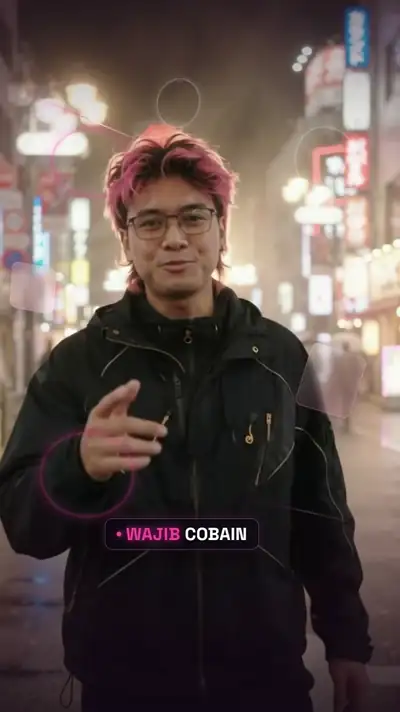</a><br><a href="https://www.sandbase.ai/lab/ai-videos/gemini-4-neon/2124840481314222508?lang=zh-CN&utm_source=github&utm_medium=readme&utm_campaign=awesome-gemini-4-neon&utm_content=card"><b>人工智能生成的UGC宣传视频</b></a><br><sub><a href="https://x.com/tirtaVEX/status/2124840481314222508">@tirtaVEX</a></sub></td></tr>
<tr><td width="33%" valign="top"><a href="https://www.sandbase.ai/lab/media/x/gemini-4-neon/2125274028550373760/video.mp4">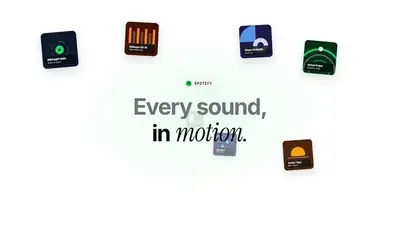</a><br><a href="https://www.sandbase.ai/lab/ai-videos/gemini-4-neon/2125274028550373760?lang=zh-CN&utm_source=github&utm_medium=readme&utm_campaign=awesome-gemini-4-neon&utm_content=card"><b>基于提示词生成的发布会演示视频</b></a><br><sub><a href="https://x.com/TimJayas/status/2125274028550373760">@TimJayas</a></sub></td></tr>
</table>

<a id="comparison"></a>

## 测试对比

<table>
<tr><td width="33%" valign="top"><a href="https://www.sandbase.ai/lab/media/x/gemini-4-neon/2123164032882659819/video.mp4">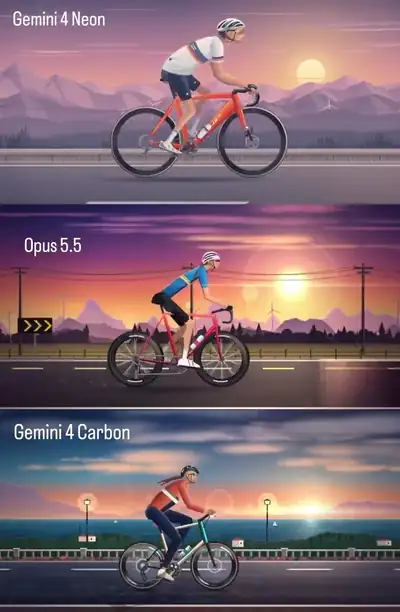</a><br><a href="https://www.sandbase.ai/lab/ai-videos/gemini-4-neon/2123164032882659819?lang=zh-CN&utm_source=github&utm_medium=readme&utm_campaign=awesome-gemini-4-neon&utm_content=card"><b>多款 AI 模型的 Three.js 测试对比</b></a><br><sub><a href="https://x.com/AI_Screening/status/2123164032882659819">@AI_Screening</a></sub></td><td width="33%" valign="top"><a href="https://www.sandbase.ai/lab/media/x/gemini-4-neon/2123183353436475636/video.mp4">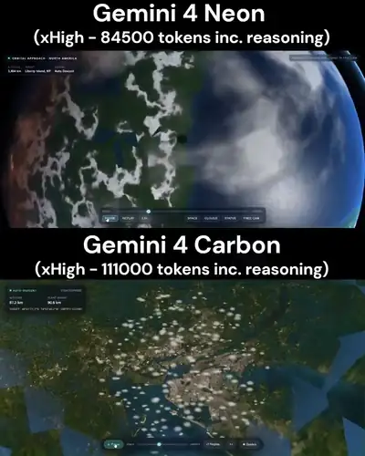</a><br><a href="https://www.sandbase.ai/lab/ai-videos/gemini-4-neon/2123183353436475636?lang=zh-CN&utm_source=github&utm_medium=readme&utm_campaign=awesome-gemini-4-neon&utm_content=card"><b>Three.js地球可视化模型对比</b></a><br><sub><a href="https://x.com/analogalok/status/2123183353436475636">@analogalok</a> · 0:45 · <a href="https://www.sandbase.ai/lab/ai-videos/gemini-4-neon/2123183353436475636?lang=zh-CN&utm_source=github&utm_medium=readme&utm_campaign=awesome-gemini-4-neon&utm_content=card">提示词</a></sub></td><td width="33%" valign="top"><a href="https://www.sandbase.ai/lab/media/x/gemini-4-neon/2123187613230370937/video.mp4"></a><br><a href="https://www.sandbase.ai/lab/ai-videos/gemini-4-neon/2123187613230370937?lang=zh-CN&utm_source=github&utm_medium=readme&utm_campaign=awesome-gemini-4-neon&utm_content=card"><b>Gemini 4 Neon与Fable 5.2全维度对比评测</b></a><br><sub><a href="https://x.com/xiax0603/status/2123187613230370937">@xiax0603</a> · 1:20</sub></td></tr>
<tr><td width="33%" valign="top"><a href="https://www.sandbase.ai/lab/media/x/gemini-4-neon/2123187817899766190/video.mp4"></a><br><a href="https://www.sandbase.ai/lab/ai-videos/gemini-4-neon/2123187817899766190?lang=zh-CN&utm_source=github&utm_medium=readme&utm_campaign=awesome-gemini-4-neon&utm_content=card"><b>四款模型宝塔桥门生成效果对比</b></a><br><sub><a href="https://x.com/srikanthvaluri/status/2123187817899766190">@srikanthvaluri</a> · 0:28</sub></td><td width="33%" valign="top"><a href="https://www.sandbase.ai/lab/media/x/gemini-4-neon/2123198294528811087/video.mp4"></a><br><a href="https://www.sandbase.ai/lab/ai-videos/gemini-4-neon/2123198294528811087?lang=zh-CN&utm_source=github&utm_medium=readme&utm_campaign=awesome-gemini-4-neon&utm_content=card"><b>火柴人打斗动画多模型实测对比</b></a><br><sub><a href="https://x.com/xiax0603/status/2123198294528811087">@xiax0603</a> · 0:15</sub></td><td width="33%" valign="top"><a href="https://www.sandbase.ai/lab/media/x/gemini-4-neon/2123205954649100424/video.mp4"></a><br><a href="https://www.sandbase.ai/lab/ai-videos/gemini-4-neon/2123205954649100424?lang=zh-CN&utm_source=github&utm_medium=readme&utm_campaign=awesome-gemini-4-neon&utm_content=card"><b>闹鬼吸血鬼大教堂模型对比</b></a><br><sub><a href="https://x.com/jan_volad/status/2123205954649100424">@jan_volad</a> · 0:42 · <a href="https://www.sandbase.ai/lab/ai-videos/gemini-4-neon/2123205954649100424?lang=zh-CN&utm_source=github&utm_medium=readme&utm_campaign=awesome-gemini-4-neon&utm_content=card">提示词</a></sub></td></tr>
</table>

<details>
<summary><b>展开全部 18 条</b></summary>

<table>
<tr><td width="33%" valign="top"><a href="https://www.sandbase.ai/lab/media/x/gemini-4-neon/2123220446074253768/video.mp4"></a><br><a href="https://www.sandbase.ai/lab/ai-videos/gemini-4-neon/2123220446074253768?lang=zh-CN&utm_source=github&utm_medium=readme&utm_campaign=awesome-gemini-4-neon&utm_content=card"><b>阿尔卑斯雪山木屋场景模型对比</b></a><br><sub><a href="https://x.com/DesignArena/status/2123220446074253768">@DesignArena</a> · 0:22 · <a href="https://www.sandbase.ai/lab/ai-videos/gemini-4-neon/2123220446074253768?lang=zh-CN&utm_source=github&utm_medium=readme&utm_campaign=awesome-gemini-4-neon&utm_content=card">提示词</a></sub></td><td width="33%" valign="top"><a href="https://www.sandbase.ai/lab/media/x/gemini-4-neon/2123416610794848660/video.mp4"></a><br><a href="https://www.sandbase.ai/lab/ai-videos/gemini-4-neon/2123416610794848660?lang=zh-CN&utm_source=github&utm_medium=readme&utm_campaign=awesome-gemini-4-neon&utm_content=card"><b>机械手表模型生成效果对比</b></a><br><sub><a href="https://x.com/remoteugur/status/2123416610794848660">@remoteugur</a></sub></td><td width="33%" valign="top"><a href="https://www.sandbase.ai/lab/media/x/gemini-4-argon/2123488006665363654/video.mp4"></a><br><a href="https://www.sandbase.ai/lab/ai-videos/gemini-4-neon/2123488006665363654?lang=zh-CN&utm_source=github&utm_medium=readme&utm_campaign=awesome-gemini-4-neon&utm_content=card"><b>模型间动画角色生成效果对比</b></a><br><sub><a href="https://x.com/IndependentEco/status/2123488006665363654">@IndependentEco</a></sub></td></tr>
<tr><td width="33%" valign="top"><a href="https://www.sandbase.ai/lab/media/x/gemini-4-argon/2123554016663834933/video.mp4"></a><br><a href="https://www.sandbase.ai/lab/ai-videos/gemini-4-neon/2123554016663834933?lang=zh-CN&utm_source=github&utm_medium=readme&utm_campaign=awesome-gemini-4-neon&utm_content=card"><b>多款AI模型视频剪辑效果对比</b></a><br><sub><a href="https://x.com/motion_so/status/2123554016663834933">@motion_so</a></sub></td><td width="33%" valign="top"><a href="https://www.sandbase.ai/lab/media/x/gemini-4-carbon/2123816445180088544/video.mp4"></a><br><a href="https://www.sandbase.ai/lab/ai-videos/gemini-4-neon/2123816445180088544?lang=zh-CN&utm_source=github&utm_medium=readme&utm_campaign=awesome-gemini-4-neon&utm_content=card"><b>Claude与Gemini模型绘制水果对比</b></a><br><sub><a href="https://x.com/AIMind_Ai/status/2123816445180088544">@AIMind_Ai</a></sub></td><td width="33%" valign="top"><a href="https://www.sandbase.ai/lab/media/x/gemini-4-neon/2123832990598045903/video.mp4"></a><br><a href="https://www.sandbase.ai/lab/ai-videos/gemini-4-neon/2123832990598045903?lang=zh-CN&utm_source=github&utm_medium=readme&utm_campaign=awesome-gemini-4-neon&utm_content=card"><b>松鼠视角下的世界创意动画对比</b></a><br><sub><a href="https://x.com/DanielZambrini/status/2123832990598045903">@DanielZambrini</a></sub></td></tr>
<tr><td width="33%" valign="top"><a href="https://www.sandbase.ai/lab/media/x/gemini-4-argon/2124662479863050377/video.mp4"></a><br><a href="https://www.sandbase.ai/lab/ai-videos/gemini-4-neon/2124662479863050377?lang=zh-CN&utm_source=github&utm_medium=readme&utm_campaign=awesome-gemini-4-neon&utm_content=card"><b>Gemini 4 Neon 平台性能对比</b></a><br><sub><a href="https://x.com/remoteugur/status/2124662479863050377">@remoteugur</a></sub></td><td width="33%" valign="top"><a href="https://www.sandbase.ai/lab/media/x/gemini-4-carbon/2125190276646043899/video.mp4"></a><br><a href="https://www.sandbase.ai/lab/ai-videos/gemini-4-neon/2125190276646043899?lang=zh-CN&utm_source=github&utm_medium=readme&utm_campaign=awesome-gemini-4-neon&utm_content=card"><b>双模型构建白宫的耗时与成本对比</b></a><br><sub><a href="https://x.com/charliejhills/status/2125190276646043899">@charliejhills</a></sub></td><td width="33%" valign="top"><a href="https://www.sandbase.ai/lab/media/x/gemini-4-neon/2125247620667105761/video.mp4"></a><br><a href="https://www.sandbase.ai/lab/ai-videos/gemini-4-neon/2125247620667105761?lang=zh-CN&utm_source=github&utm_medium=readme&utm_campaign=awesome-gemini-4-neon&utm_content=card"><b>两款模型生成 3D 追逐游戏的对比</b></a><br><sub><a href="https://x.com/fekdaoui/status/2125247620667105761">@fekdaoui</a> · <a href="https://www.sandbase.ai/lab/ai-videos/gemini-4-neon/2125247620667105761?lang=zh-CN&utm_source=github&utm_medium=readme&utm_campaign=awesome-gemini-4-neon&utm_content=card">提示词</a></sub></td></tr>
<tr><td width="33%" valign="top"><a href="https://www.sandbase.ai/lab/media/x/gemini-4-neon/2125260781176709333/video.mp4"></a><br><a href="https://www.sandbase.ai/lab/ai-videos/gemini-4-neon/2125260781176709333?lang=zh-CN&utm_source=github&utm_medium=readme&utm_campaign=awesome-gemini-4-neon&utm_content=card"><b>Three.js 渲染伊斯坦布尔地下水宫对比</b></a><br><sub><a href="https://x.com/teddyaisi/status/2125260781176709333">@teddyaisi</a></sub></td><td width="33%" valign="top"><a href="https://www.sandbase.ai/lab/media/x/gemini-4-neon/2125277048528879634/video.mp4"></a><br><a href="https://www.sandbase.ai/lab/ai-videos/gemini-4-neon/2125277048528879634?lang=zh-CN&utm_source=github&utm_medium=readme&utm_campaign=awesome-gemini-4-neon&utm_content=card"><b>三款不同模型的动态设计效果对比</b></a><br><sub><a href="https://x.com/hsprafrique/status/2125277048528879634">@hsprafrique</a> · <a href="https://www.sandbase.ai/lab/ai-videos/gemini-4-neon/2125277048528879634?lang=zh-CN&utm_source=github&utm_medium=readme&utm_campaign=awesome-gemini-4-neon&utm_content=card">提示词</a></sub></td><td width="33%" valign="top"><a href="https://www.sandbase.ai/lab/media/x/gemini-4-neon/2125278509849571596/video.mp4"></a><br><a href="https://www.sandbase.ai/lab/ai-videos/gemini-4-neon/2125278509849571596?lang=zh-CN&utm_source=github&utm_medium=readme&utm_campaign=awesome-gemini-4-neon&utm_content=card"><b>Blender 风车岛场景生成模型对比</b></a><br><sub><a href="https://x.com/MrTacticalX/status/2125278509849571596">@MrTacticalX</a></sub></td></tr>
</table>

</details>

**[在 SandBase Lab 查看全部 86 条 →](https://www.sandbase.ai/lab/ai-videos/gemini-4-neon?lang=zh-CN&utm_source=github&utm_medium=readme&utm_campaign=awesome-gemini-4-neon&utm_content=section)**

<a id="recreate"></a>

## 用 Gemini 4 Neon 复刻视频

[SandBase Lab](https://www.sandbase.ai/lab/ai-videos/gemini-4-neon?lang=zh-CN&utm_source=github&utm_medium=readme&utm_campaign=awesome-gemini-4-neon&utm_content=recreate) 的每个视频页都有 **复刻** 按钮：在 Lab 文本竞技场把帖子内容发给 Gemini 4 Neon，返回可在浏览器直接播放的代码。

用 API 的话，Gemini 4 Neon 在 SandBase 上的模型 ID 是 `google/gemini-4-neon`（兼容 OpenAI）。把提示词写进 `prompt.txt`，在 [控制台](https://www.sandbase.ai/console/keys?utm_source=github&utm_medium=readme&utm_campaign=awesome-gemini-4-neon) 创建 Key，然后运行：

```bash
jq -n --rawfile prompt prompt.txt \
  '{model: "google/gemini-4-neon", max_tokens: 128000, messages: [{role: "user", content: $prompt}]}' |
curl -sS --max-time 900 https://api.sandbase.ai/v1/chat/completions \
  -H "Authorization: Bearer $SANDBASE_API_KEY" \
  -H "Content-Type: application/json" \
  -d @- | jq -r '.choices[0].message.content' | sed '/^```/d' > gemini-4-neon.html
```

用浏览器打开 `gemini-4-neon.html`，或在 [SandBase Sandbox](https://www.sandbase.ai/landing/sandbox?utm_source=github&utm_medium=readme&utm_campaign=awesome-gemini-4-neon) 中运行，让生成的代码保持隔离。示例请求最多输出 128,000 token，输出按每百万 $15 计费。完整步骤见 [教程](docs/zh-CN/tutorial.md)，价格见 [模型页](https://www.sandbase.ai/model/google/gemini-4-neon?utm_source=github&utm_medium=readme&utm_campaign=awesome-gemini-4-neon)。

<a id="faq"></a>

## 常见问题

### Gemini 4 Neon 是什么？

Gemini 4 Neon 是 Google DeepMind 的模型，2026 年 11 月 18 日宣布。它的上下文窗口为 1,048,576 token。在 SandBase 上它是 `google/gemini-4-neon`；输出上限可运行 `sandbase inspect google/gemini-4-neon` 查看。供应商与标价也可见 [DesignArena 的帖子](https://x.com/DesignArena/status/2123220446074253768)。

### 这些 Gemini 4 Neon 视频是怎么做出来的？

模型不直接渲染视频。这里的例子大多是它写出的一个独立网页（通常是一个用 Three.js 或 GLSL 的单文件 HTML）；页面在浏览器里运行，作者再把结果分享成视频。见 [教程](docs/zh-CN/tutorial.md)。

### 在哪里找到视频的提示词？

标有 **提示词** 的视频，其 Lab 页面上有作者的提示词。[提示词索引](docs/zh-CN/prompts.md) 列出了全部。

### 怎么写好 Gemini 4 Neon 提示词？

指定一个独立运行的 HTML 文件和渲染方式（Three.js 或 GLSL），描述场景和需要动起来的部分，并要求返回完整的 HTML。详细写法和模板见 [提示词写法](docs/zh-CN/prompt-guide.md)。

### 怎么调用 Gemini 4 Neon API？

在 SandBase 上模型 ID 是 `google/gemini-4-neon`，使用兼容 OpenAI 的 `https://api.sandbase.ai/v1/chat/completions` 接口，一个 Key 调用所有模型。见 [复刻](#recreate) 和 [模型页](https://www.sandbase.ai/model/google/gemini-4-neon?utm_source=github&utm_medium=readme&utm_campaign=awesome-gemini-4-neon)。

### Gemini 4 Neon 比 GPT-6.2 Sol、Gemini 4 Carbon、Gemini 4 Argon 或 Claude Opus 5.5 更强吗？

实测方面：本列表的数据里没有 Gemini 4 Neon 的 Lab Evals 或 Pelican Test 记录，因此这里没有任何实测结果能把它和其他模型比较。创作者报告方面：一位作者用同一提示词对比了 GPT-6.2 Sol，说分不出谁赢；另一位作者发布的 Artificial Analysis 智能指数为 Neon 61、Gemini 4 Carbon 60、Claude Opus 5.5 59、GPT-6.2 Astra 62，本列表未核实这些数字。详见 [模型对比](docs/zh-CN/model-comparison.md)。

### 做一个视频要花多少钱？

有作者报告：同一个提示词（哥特吸血鬼大教堂场景），Gemini 4 Neon 花费 $2.67，GPT-6.2 Sol 为 $1.69。SandBase 标价为每百万输入 token $3、每百万输出 token $15，缓存的输入 token 每百万 $0.15。一次调用的费用为（输入 token × $3 + 输出 token × $15）÷ 1,000,000 美元。

### 可以转用这些视频吗？

默认不可以，视频归作者所有。见 [MEDIA-RIGHTS](MEDIA-RIGHTS.md)。

<a id="contribute"></a>

## 推荐作品

发现了应该收录的 Gemini 4 Neon 作品？附上 X 原帖 [提交给我们](https://github.com/sandbase-lab/awesome-gemini-4-neon/issues/new?template=submit-video.yml)。通过后会先加入 SandBase Lab，下一次每日同步时出现在这里。觉得有用的话，点个 ⭐ 能让更多人看到。

## 致谢与权利

所有视频、提示词和帖子归作者所有。每张卡片都注明作者并链接原帖。MIT 许可证只覆盖本仓库的脚本。更正署名或下架视频请见 [MEDIA-RIGHTS](MEDIA-RIGHTS.md)。

与 Google 无隶属或背书关系。

---

由 [SandBase Lab](https://www.sandbase.ai/lab/?lang=zh-CN&utm_source=github&utm_medium=readme&utm_campaign=awesome-gemini-4-neon) 维护 · [全部 AI 视频合集](https://www.sandbase.ai/lab/ai-videos?lang=zh-CN&utm_source=github&utm_medium=readme&utm_campaign=awesome-gemini-4-neon)
