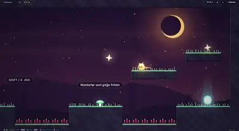
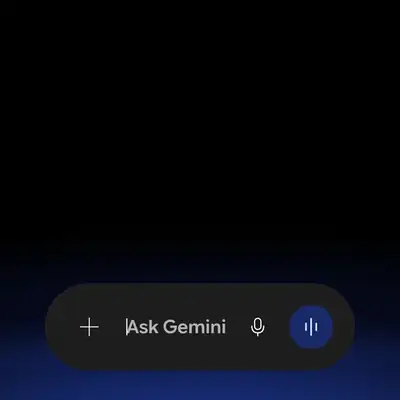
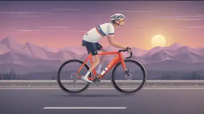
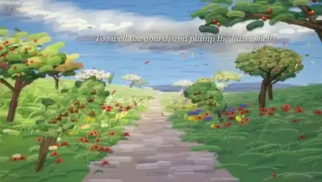
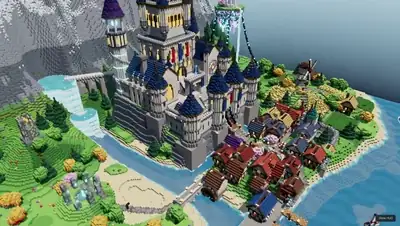
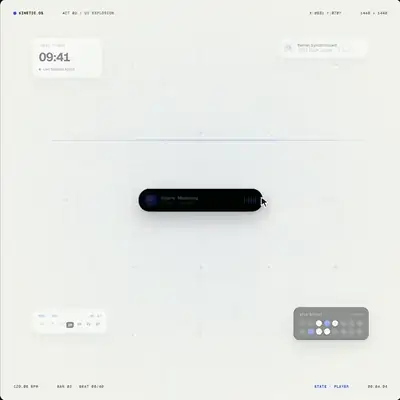
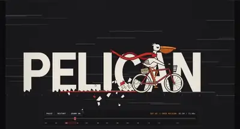
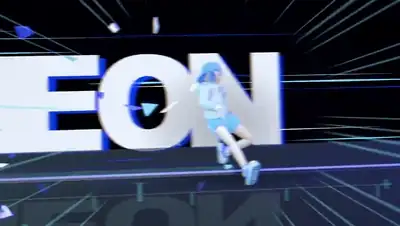
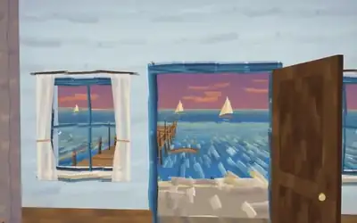

# Awesome Gemini 4 Neon

[English](README.md) · 简体中文

[](https://awesome.re) [](#contents) [](docs/zh-CN/prompts.md) [](https://github.com/sandbase-lab/awesome-gemini-4-neon/actions/workflows/sync.yml) [](https://www.sandbase.ai/model/google/gemini-4-neon?utm_source=github&utm_medium=readme&utm_campaign=awesome-gemini-4-neon)

[](https://www.sandbase.ai/lab/ai-videos/gemini-4-neon?lang=zh-CN&utm_source=github&utm_medium=readme&utm_campaign=awesome-gemini-4-neon&utm_content=banner)

精选 **Gemini 4 Neon 案例**合集：用 Gemini 4 Neon（Google DeepMind 的模型，2026 年 11 月 18 日宣布）做出的视频、提示词和演示。包括 Three.js 与 GLSL 3D 场景、游戏、动效和同提示词对比，许多是模型根据提示词写成的单文件网页，均注明作者并链接原帖。

共 **35 条视频**，来自 **25 位创作者** · **6 条**附作者提示词 · 每天从 [SandBase Lab](https://www.sandbase.ai/lab/ai-videos/gemini-4-neon?lang=zh-CN&utm_source=github&utm_medium=readme&utm_campaign=awesome-gemini-4-neon&utm_content=stats) 同步

## 从这里开始

| 我想… | 去这里 |
|---|---|
| 看视频 | 在下方 [按分类浏览](#contents)，或 [在 SandBase Lab 大屏播放](https://www.sandbase.ai/lab/ai-videos/gemini-4-neon?lang=zh-CN&utm_source=github&utm_medium=readme&utm_campaign=awesome-gemini-4-neon&utm_content=quickstart) |
| 复制提示词 | [提示词索引](docs/zh-CN/prompts.md)：所有附带提示词的视频 |
| 自己写提示词 | [提示词写法](docs/zh-CN/prompt-guide.md)：4 条写法和一个填空模板 |
| 做一个视频 | [教程](docs/zh-CN/tutorial.md)：提示词 → HTML → MP4，含 API 和录屏脚本 |
| 选模型 | [Gemini 4 Neon 对比 GPT-6.2 Sol、Gemini 4 Carbon、Gemini 4 Argon 和 Claude Opus 5.5](docs/zh-CN/model-comparison.md) |
| 马上试试 | [在 Lab 竞技场运行 Gemini 4 Neon](https://www.sandbase.ai/arena/text?models=google%2Fgemini-4-neon&lang=zh-CN&utm_source=github&utm_medium=readme&utm_campaign=awesome-gemini-4-neon&utm_content=quickstart)，和其他模型并排对比 |

<a id="contents"></a>

## 目录

- [精选](#featured) (7)
- [3D 场景](#3d-scene) (10)
- [动效](#motion-graphics) (13)
- [游戏](#game) (4)
- [发布片](#launch-film) (1)
- [测试对比](#comparison) (7)
- [用 Gemini 4 Neon 复刻视频](#recreate)
- [常见问题](#faq)
- [推荐作品](#contribute)

点击预览图播放视频；点击标题前往 SandBase Lab 查看原帖、提示词，并一键 **复刻**；**@作者** 链接到 X 原帖。

<a id="featured"></a>

## 精选

<table>
<tr><td width="33%" valign="top"><a href="https://www.sandbase.ai/lab/media/x/gemini-4-neon/2123162154132242885/video.mp4"></a><br><a href="https://www.sandbase.ai/lab/ai-videos/gemini-4-neon/2123162154132242885?lang=zh-CN&utm_source=github&utm_medium=readme&utm_campaign=awesome-gemini-4-neon&utm_content=card"><b>Three.js与GLSL生成的场景</b></a><br><sub><a href="https://x.com/cfenghub/status/2123162154132242885">@cfenghub</a> · 0:44 · <a href="https://www.sandbase.ai/lab/ai-videos/gemini-4-neon/2123162154132242885?lang=zh-CN&utm_source=github&utm_medium=readme&utm_campaign=awesome-gemini-4-neon&utm_content=card">提示词</a></sub></td><td width="33%" valign="top"><a href="https://www.sandbase.ai/lab/media/x/gemini-4-neon/2123189427249742292/video.mp4"></a><br><a href="https://www.sandbase.ai/lab/ai-videos/gemini-4-neon/2123189427249742292?lang=zh-CN&utm_source=github&utm_medium=readme&utm_campaign=awesome-gemini-4-neon&utm_content=card"><b>一款游戏测试演示</b></a><br><sub><a href="https://x.com/AdamHoltererer/status/2123189427249742292">@AdamHoltererer</a> · 0:25</sub></td><td width="33%" valign="top"><a href="https://www.sandbase.ai/lab/media/x/gemini-4-neon/2123169783038235033/video.mp4"></a><br><a href="https://www.sandbase.ai/lab/ai-videos/gemini-4-neon/2123169783038235033?lang=zh-CN&utm_source=github&utm_medium=readme&utm_campaign=awesome-gemini-4-neon&utm_content=card"><b>在日月世界切换的平台跳跃游戏</b></a><br><sub><a href="https://x.com/OzanTRAI/status/2123169783038235033">@OzanTRAI</a> · 0:51</sub></td></tr>
<tr><td width="33%" valign="top"><a href="https://www.sandbase.ai/lab/media/x/gemini-4-neon/2123159335635456318/video.mp4"></a><br><a href="https://www.sandbase.ai/lab/ai-videos/gemini-4-neon/2123159335635456318?lang=zh-CN&utm_source=github&utm_medium=readme&utm_campaign=awesome-gemini-4-neon&utm_content=card"><b>SVG鹈鹕矢量图形</b></a><br><sub><a href="https://x.com/Inmerson/status/2123159335635456318">@Inmerson</a> · 0:26</sub></td><td width="33%" valign="top"><a href="https://www.sandbase.ai/lab/media/x/gemini-4-neon/2123181843835207955/video.mp4"></a><br><a href="https://www.sandbase.ai/lab/ai-videos/gemini-4-neon/2123181843835207955?lang=zh-CN&utm_source=github&utm_medium=readme&utm_campaign=awesome-gemini-4-neon&utm_content=card"><b>骑自行车的红狐狸矢量动画</b></a><br><sub><a href="https://x.com/srikanthvaluri/status/2123181843835207955">@srikanthvaluri</a> · 0:05</sub></td><td width="33%" valign="top"><a href="https://www.sandbase.ai/lab/media/x/gemini-4-neon/2123173513502822864/video.mp4"></a><br><a href="https://www.sandbase.ai/lab/ai-videos/gemini-4-neon/2123173513502822864?lang=zh-CN&utm_source=github&utm_medium=readme&utm_campaign=awesome-gemini-4-neon&utm_content=card"><b>生成的快速发布宣传视频</b></a><br><sub><a href="https://x.com/BreezeOg1/status/2123173513502822864">@BreezeOg1</a> · 0:12</sub></td></tr>
<tr><td width="33%" valign="top"><a href="https://www.sandbase.ai/lab/media/x/gemini-4-neon/2123165046276760028/video.mp4"></a><br><a href="https://www.sandbase.ai/lab/ai-videos/gemini-4-neon/2123165046276760028?lang=zh-CN&utm_source=github&utm_medium=readme&utm_campaign=awesome-gemini-4-neon&utm_content=card"><b>Three.js实现的鹈鹕骑自行车</b></a><br><sub><a href="https://x.com/zhang_baoqing/status/2123165046276760028">@zhang_baoqing</a> · 0:32</sub></td></tr>
</table>

<a id="3d-scene"></a>

## 3D 场景

<table>
<tr><td width="33%" valign="top"><a href="https://www.sandbase.ai/lab/media/x/gemini-4-neon/2123120305648619534/video.mp4"></a><br><a href="https://www.sandbase.ai/lab/ai-videos/gemini-4-neon/2123120305648619534?lang=zh-CN&utm_source=github&utm_medium=readme&utm_campaign=awesome-gemini-4-neon&utm_content=card"><b>在海上航行的 3D 集装箱货船</b></a><br><sub><a href="https://x.com/AfnadX/status/2123120305648619534">@AfnadX</a> · 0:22</sub></td><td width="33%" valign="top"><a href="https://www.sandbase.ai/lab/media/x/gemini-4-neon/2123160092657021432/video.mp4"></a><br><a href="https://www.sandbase.ai/lab/ai-videos/gemini-4-neon/2123160092657021432?lang=zh-CN&utm_source=github&utm_medium=readme&utm_campaign=awesome-gemini-4-neon&utm_content=card"><b>在 Three.js 中骑自行车的骑手</b></a><br><sub><a href="https://x.com/AI_Screening/status/2123160092657021432">@AI_Screening</a> · 0:14</sub></td><td width="33%" valign="top"><a href="https://www.sandbase.ai/lab/media/x/gemini-4-neon/2123162154132242885/video.mp4"></a><br><a href="https://www.sandbase.ai/lab/ai-videos/gemini-4-neon/2123162154132242885?lang=zh-CN&utm_source=github&utm_medium=readme&utm_campaign=awesome-gemini-4-neon&utm_content=card"><b>Three.js与GLSL生成的场景</b></a><br><sub><a href="https://x.com/cfenghub/status/2123162154132242885">@cfenghub</a> · 0:44 · <a href="https://www.sandbase.ai/lab/ai-videos/gemini-4-neon/2123162154132242885?lang=zh-CN&utm_source=github&utm_medium=readme&utm_campaign=awesome-gemini-4-neon&utm_content=card">提示词</a></sub></td></tr>
<tr><td width="33%" valign="top"><a href="https://www.sandbase.ai/lab/media/x/gemini-4-neon/2123165046276760028/video.mp4"></a><br><a href="https://www.sandbase.ai/lab/ai-videos/gemini-4-neon/2123165046276760028?lang=zh-CN&utm_source=github&utm_medium=readme&utm_campaign=awesome-gemini-4-neon&utm_content=card"><b>Three.js实现的鹈鹕骑自行车</b></a><br><sub><a href="https://x.com/zhang_baoqing/status/2123165046276760028">@zhang_baoqing</a> · 0:32</sub></td><td width="33%" valign="top"><a href="https://www.sandbase.ai/lab/media/x/gemini-4-neon/2123170948568535488/video.mp4"></a><br><a href="https://www.sandbase.ai/lab/ai-videos/gemini-4-neon/2123170948568535488?lang=zh-CN&utm_source=github&utm_medium=readme&utm_campaign=awesome-gemini-4-neon&utm_content=card"><b>基于济慈诗作秋颂的绘画风 3D 动画</b></a><br><sub><a href="https://x.com/vamsibatchuk/status/2123170948568535488">@vamsibatchuk</a> · 2:49</sub></td><td width="33%" valign="top"><a href="https://www.sandbase.ai/lab/media/x/gemini-4-neon/2123171135437382083/video.mp4"></a><br><a href="https://www.sandbase.ai/lab/ai-videos/gemini-4-neon/2123171135437382083?lang=zh-CN&utm_source=github&utm_medium=readme&utm_campaign=awesome-gemini-4-neon&utm_content=card"><b>Three.js实时超大质量黑洞模拟</b></a><br><sub><a href="https://x.com/srikanthvaluri/status/2123171135437382083">@srikanthvaluri</a> · 0:31</sub></td></tr>
</table>

<details>
<summary><b>展开全部 10 条</b></summary>

<table>
<tr><td width="33%" valign="top"><a href="https://www.sandbase.ai/lab/media/x/gemini-4-neon/2123190272527860173/video.mp4"></a><br><a href="https://www.sandbase.ai/lab/ai-videos/gemini-4-neon/2123190272527860173?lang=zh-CN&utm_source=github&utm_medium=readme&utm_campaign=awesome-gemini-4-neon&utm_content=card"><b>无缝循环奔跑的3D马动画</b></a><br><sub><a href="https://x.com/Frtnel/status/2123190272527860173">@Frtnel</a> · 0:29</sub></td><td width="33%" valign="top"><a href="https://www.sandbase.ai/lab/media/x/gemini-4-neon/2123212198663323848/video.mp4"></a><br><a href="https://www.sandbase.ai/lab/ai-videos/gemini-4-neon/2123212198663323848?lang=zh-CN&utm_source=github&utm_medium=readme&utm_campaign=awesome-gemini-4-neon&utm_content=card"><b>交互式3D历史帆船</b></a><br><sub><a href="https://x.com/abhinavflac/status/2123212198663323848">@abhinavflac</a> · 0:37</sub></td><td width="33%" valign="top"><a href="https://www.sandbase.ai/lab/media/x/gemini-4-neon/2123222507977375770/video.mp4"></a><br><a href="https://www.sandbase.ai/lab/ai-videos/gemini-4-neon/2123222507977375770?lang=zh-CN&utm_source=github&utm_medium=readme&utm_campaign=awesome-gemini-4-neon&utm_content=card"><b>Three.js 制作的鹈鹕骑自行车场景</b></a><br><sub><a href="https://x.com/tspy/status/2123222507977375770">@tspy</a> · 0:53 · <a href="https://www.sandbase.ai/lab/ai-videos/gemini-4-neon/2123222507977375770?lang=zh-CN&utm_source=github&utm_medium=readme&utm_campaign=awesome-gemini-4-neon&utm_content=card">提示词</a></sub></td></tr>
<tr><td width="33%" valign="top"><a href="https://www.sandbase.ai/lab/media/x/gemini-4-neon/2123226306351661099/video.mp4"></a><br><a href="https://www.sandbase.ai/lab/ai-videos/gemini-4-neon/2123226306351661099?lang=zh-CN&utm_source=github&utm_medium=readme&utm_campaign=awesome-gemini-4-neon&utm_content=card"><b>体素奇幻城堡场景</b></a><br><sub><a href="https://x.com/Lentils80/status/2123226306351661099">@Lentils80</a> · 0:38</sub></td></tr>
</table>

</details>

<a id="motion-graphics"></a>

## 动效

<table>
<tr><td width="33%" valign="top"><a href="https://www.sandbase.ai/lab/media/x/gemini-4-neon/2122954421050933355/video.mp4"></a><br><a href="https://www.sandbase.ai/lab/ai-videos/gemini-4-neon/2122954421050933355?lang=zh-CN&utm_source=github&utm_medium=readme&utm_campaign=awesome-gemini-4-neon&utm_content=card"><b>鹈鹕SVG矢量图</b></a><br><sub><a href="https://x.com/Inmerson/status/2122954421050933355">@Inmerson</a> · 0:09 · <a href="https://www.sandbase.ai/lab/ai-videos/gemini-4-neon/2122954421050933355?lang=zh-CN&utm_source=github&utm_medium=readme&utm_campaign=awesome-gemini-4-neon&utm_content=card">提示词</a></sub></td><td width="33%" valign="top"><a href="https://www.sandbase.ai/lab/media/x/gemini-4-neon/2123135691085472139/video.mp4"></a><br><a href="https://www.sandbase.ai/lab/ai-videos/gemini-4-neon/2123135691085472139?lang=zh-CN&utm_source=github&utm_medium=readme&utm_campaign=awesome-gemini-4-neon&utm_content=card"><b>单HTML文件呈现的动态设计</b></a><br><sub><a href="https://x.com/AfnadX/status/2123135691085472139">@AfnadX</a> · 0:19</sub></td><td width="33%" valign="top"><a href="https://www.sandbase.ai/lab/media/x/gemini-4-neon/2123157977045852382/video.mp4"></a><br><a href="https://www.sandbase.ai/lab/ai-videos/gemini-4-neon/2123157977045852382?lang=zh-CN&utm_source=github&utm_medium=readme&utm_campaign=awesome-gemini-4-neon&utm_content=card"><b>HTML 代码实现的鹈鹕骑自行车效果</b></a><br><sub><a href="https://x.com/zhang_baoqing/status/2123157977045852382">@zhang_baoqing</a> · 0:19</sub></td></tr>
<tr><td width="33%" valign="top"><a href="https://www.sandbase.ai/lab/media/x/gemini-4-neon/2123159335635456318/video.mp4"></a><br><a href="https://www.sandbase.ai/lab/ai-videos/gemini-4-neon/2123159335635456318?lang=zh-CN&utm_source=github&utm_medium=readme&utm_campaign=awesome-gemini-4-neon&utm_content=card"><b>SVG鹈鹕矢量图形</b></a><br><sub><a href="https://x.com/Inmerson/status/2123159335635456318">@Inmerson</a> · 0:26</sub></td><td width="33%" valign="top"><a href="https://www.sandbase.ai/lab/media/x/gemini-4-neon/2123165824576114932/video.mp4"></a><br><a href="https://www.sandbase.ai/lab/ai-videos/gemini-4-neon/2123165824576114932?lang=zh-CN&utm_source=github&utm_medium=readme&utm_campaign=awesome-gemini-4-neon&utm_content=card"><b>骑自行车的沮丧鹈鹕 SVG 动画</b></a><br><sub><a href="https://x.com/HarshithLucky3/status/2123165824576114932">@HarshithLucky3</a> · 0:13</sub></td><td width="33%" valign="top"><a href="https://www.sandbase.ai/lab/media/x/gemini-4-neon/2123168004175462796/video.mp4"></a><br><a href="https://www.sandbase.ai/lab/ai-videos/gemini-4-neon/2123168004175462796?lang=zh-CN&utm_source=github&utm_medium=readme&utm_campaign=awesome-gemini-4-neon&utm_content=card"><b>反重力飞船SVG动画</b></a><br><sub><a href="https://x.com/srikanthvaluri/status/2123168004175462796">@srikanthvaluri</a> · 0:07</sub></td></tr>
</table>

<details>
<summary><b>展开全部 13 条</b></summary>

<table>
<tr><td width="33%" valign="top"><a href="https://www.sandbase.ai/lab/media/x/gemini-4-neon/2123180572784640063/video.mp4"></a><br><a href="https://www.sandbase.ai/lab/ai-videos/gemini-4-neon/2123180572784640063?lang=zh-CN&utm_source=github&utm_medium=readme&utm_campaign=awesome-gemini-4-neon&utm_content=card"><b>罪恶都市风格 SVG 矢量动画</b></a><br><sub><a href="https://x.com/Inmerson/status/2123180572784640063">@Inmerson</a> · 0:07</sub></td><td width="33%" valign="top"><a href="https://www.sandbase.ai/lab/media/x/gemini-4-neon/2123181538544374002/video.mp4"></a><br><a href="https://www.sandbase.ai/lab/ai-videos/gemini-4-neon/2123181538544374002?lang=zh-CN&utm_source=github&utm_medium=readme&utm_campaign=awesome-gemini-4-neon&utm_content=card"><b>暹罗猫SVG矢量图动画</b></a><br><sub><a href="https://x.com/Inmerson/status/2123181538544374002">@Inmerson</a> · 0:13</sub></td><td width="33%" valign="top"><a href="https://www.sandbase.ai/lab/media/x/gemini-4-neon/2123181843835207955/video.mp4"></a><br><a href="https://www.sandbase.ai/lab/ai-videos/gemini-4-neon/2123181843835207955?lang=zh-CN&utm_source=github&utm_medium=readme&utm_campaign=awesome-gemini-4-neon&utm_content=card"><b>骑自行车的红狐狸矢量动画</b></a><br><sub><a href="https://x.com/srikanthvaluri/status/2123181843835207955">@srikanthvaluri</a> · 0:05</sub></td></tr>
<tr><td width="33%" valign="top"><a href="https://www.sandbase.ai/lab/media/x/gemini-4-neon/2123183419442205140/video.mp4"></a><br><a href="https://www.sandbase.ai/lab/ai-videos/gemini-4-neon/2123183419442205140?lang=zh-CN&utm_source=github&utm_medium=readme&utm_campaign=awesome-gemini-4-neon&utm_content=card"><b>雨夜东京霓虹街景</b></a><br><sub><a href="https://x.com/PokeBenchTV/status/2123183419442205140">@PokeBenchTV</a> · 0:25</sub></td><td width="33%" valign="top"><a href="https://www.sandbase.ai/lab/media/x/gemini-4-neon/2123184113561817370/video.mp4"></a><br><a href="https://www.sandbase.ai/lab/ai-videos/gemini-4-neon/2123184113561817370?lang=zh-CN&utm_source=github&utm_medium=readme&utm_campaign=awesome-gemini-4-neon&utm_content=card"><b>鹈鹕产品动态设计展示</b></a><br><sub><a href="https://x.com/chetaslua/status/2123184113561817370">@chetaslua</a> · 0:14</sub></td><td width="33%" valign="top"><a href="https://www.sandbase.ai/lab/media/x/gemini-4-neon/2123185466417746256/video.mp4"></a><br><a href="https://www.sandbase.ai/lab/ai-videos/gemini-4-neon/2123185466417746256?lang=zh-CN&utm_source=github&utm_medium=readme&utm_campaign=awesome-gemini-4-neon&utm_content=card"><b>一只瞌睡刺猬的动画演示</b></a><br><sub><a href="https://x.com/doe_naps/status/2123185466417746256">@doe_naps</a> · 0:31</sub></td></tr>
<tr><td width="33%" valign="top"><a href="https://www.sandbase.ai/lab/media/x/gemini-4-neon/2123222816325869685/video.mp4"></a><br><a href="https://www.sandbase.ai/lab/ai-videos/gemini-4-neon/2123222816325869685?lang=zh-CN&utm_source=github&utm_medium=readme&utm_campaign=awesome-gemini-4-neon&utm_content=card"><b>纯 JavaScript 代码实现的动态图形设计</b></a><br><sub><a href="https://x.com/karanC_12/status/2123222816325869685">@karanC_12</a> · 0:15</sub></td></tr>
</table>

</details>

<a id="game"></a>

## 游戏

<table>
<tr><td width="33%" valign="top"><a href="https://www.sandbase.ai/lab/media/x/gemini-4-neon/2123169783038235033/video.mp4"></a><br><a href="https://www.sandbase.ai/lab/ai-videos/gemini-4-neon/2123169783038235033?lang=zh-CN&utm_source=github&utm_medium=readme&utm_campaign=awesome-gemini-4-neon&utm_content=card"><b>在日月世界切换的平台跳跃游戏</b></a><br><sub><a href="https://x.com/OzanTRAI/status/2123169783038235033">@OzanTRAI</a> · 0:51</sub></td><td width="33%" valign="top"><a href="https://www.sandbase.ai/lab/media/x/gemini-4-neon/2123178088439959750/video.mp4"></a><br><a href="https://www.sandbase.ai/lab/ai-videos/gemini-4-neon/2123178088439959750?lang=zh-CN&utm_source=github&utm_medium=readme&utm_campaign=awesome-gemini-4-neon&utm_content=card"><b>表现主义风格艺术小游戏</b></a><br><sub><a href="https://x.com/GeokenAI/status/2123178088439959750">@GeokenAI</a> · 0:04</sub></td><td width="33%" valign="top"><a href="https://www.sandbase.ai/lab/media/x/gemini-4-neon/2123189427249742292/video.mp4"></a><br><a href="https://www.sandbase.ai/lab/ai-videos/gemini-4-neon/2123189427249742292?lang=zh-CN&utm_source=github&utm_medium=readme&utm_campaign=awesome-gemini-4-neon&utm_content=card"><b>一款游戏测试演示</b></a><br><sub><a href="https://x.com/AdamHoltererer/status/2123189427249742292">@AdamHoltererer</a> · 0:25</sub></td></tr>
<tr><td width="33%" valign="top"><a href="https://www.sandbase.ai/lab/media/x/gemini-4-neon/2123189826585243883/video.mp4"></a><br><a href="https://www.sandbase.ai/lab/ai-videos/gemini-4-neon/2123189826585243883?lang=zh-CN&utm_source=github&utm_medium=readme&utm_campaign=awesome-gemini-4-neon&utm_content=card"><b>代码生成的跑酷游戏演示</b></a><br><sub><a href="https://x.com/eandualem/status/2123189826585243883">@eandualem</a> · 0:44</sub></td></tr>
</table>

<a id="launch-film"></a>

## 发布片

<table>
<tr><td width="33%" valign="top"><a href="https://www.sandbase.ai/lab/media/x/gemini-4-neon/2123173513502822864/video.mp4"></a><br><a href="https://www.sandbase.ai/lab/ai-videos/gemini-4-neon/2123173513502822864?lang=zh-CN&utm_source=github&utm_medium=readme&utm_campaign=awesome-gemini-4-neon&utm_content=card"><b>生成的快速发布宣传视频</b></a><br><sub><a href="https://x.com/BreezeOg1/status/2123173513502822864">@BreezeOg1</a> · 0:12</sub></td></tr>
</table>

<a id="comparison"></a>

## 测试对比

<table>
<tr><td width="33%" valign="top"><a href="https://www.sandbase.ai/lab/media/x/gemini-4-neon/2123164032882659819/video.mp4"></a><br><a href="https://www.sandbase.ai/lab/ai-videos/gemini-4-neon/2123164032882659819?lang=zh-CN&utm_source=github&utm_medium=readme&utm_campaign=awesome-gemini-4-neon&utm_content=card"><b>多款 AI 模型的 Three.js 测试对比</b></a><br><sub><a href="https://x.com/AI_Screening/status/2123164032882659819">@AI_Screening</a> · 0:14</sub></td><td width="33%" valign="top"><a href="https://www.sandbase.ai/lab/media/x/gemini-4-neon/2123183353436475636/video.mp4"></a><br><a href="https://www.sandbase.ai/lab/ai-videos/gemini-4-neon/2123183353436475636?lang=zh-CN&utm_source=github&utm_medium=readme&utm_campaign=awesome-gemini-4-neon&utm_content=card"><b>Three.js地球可视化模型对比</b></a><br><sub><a href="https://x.com/analogalok/status/2123183353436475636">@analogalok</a> · 0:45 · <a href="https://www.sandbase.ai/lab/ai-videos/gemini-4-neon/2123183353436475636?lang=zh-CN&utm_source=github&utm_medium=readme&utm_campaign=awesome-gemini-4-neon&utm_content=card">提示词</a></sub></td><td width="33%" valign="top"><a href="https://www.sandbase.ai/lab/media/x/gemini-4-neon/2123187613230370937/video.mp4"></a><br><a href="https://www.sandbase.ai/lab/ai-videos/gemini-4-neon/2123187613230370937?lang=zh-CN&utm_source=github&utm_medium=readme&utm_campaign=awesome-gemini-4-neon&utm_content=card"><b>Gemini 4 Neon与Fable 5.2全维度对比评测</b></a><br><sub><a href="https://x.com/xiax0603/status/2123187613230370937">@xiax0603</a> · 1:20</sub></td></tr>
<tr><td width="33%" valign="top"><a href="https://www.sandbase.ai/lab/media/x/gemini-4-neon/2123187817899766190/video.mp4"></a><br><a href="https://www.sandbase.ai/lab/ai-videos/gemini-4-neon/2123187817899766190?lang=zh-CN&utm_source=github&utm_medium=readme&utm_campaign=awesome-gemini-4-neon&utm_content=card"><b>四款模型宝塔桥门生成效果对比</b></a><br><sub><a href="https://x.com/srikanthvaluri/status/2123187817899766190">@srikanthvaluri</a> · 0:28</sub></td><td width="33%" valign="top"><a href="https://www.sandbase.ai/lab/media/x/gemini-4-neon/2123198294528811087/video.mp4"></a><br><a href="https://www.sandbase.ai/lab/ai-videos/gemini-4-neon/2123198294528811087?lang=zh-CN&utm_source=github&utm_medium=readme&utm_campaign=awesome-gemini-4-neon&utm_content=card"><b>火柴人打斗动画多模型实测对比</b></a><br><sub><a href="https://x.com/xiax0603/status/2123198294528811087">@xiax0603</a> · 0:15</sub></td><td width="33%" valign="top"><a href="https://www.sandbase.ai/lab/media/x/gemini-4-neon/2123205954649100424/video.mp4"></a><br><a href="https://www.sandbase.ai/lab/ai-videos/gemini-4-neon/2123205954649100424?lang=zh-CN&utm_source=github&utm_medium=readme&utm_campaign=awesome-gemini-4-neon&utm_content=card"><b>闹鬼吸血鬼大教堂模型对比</b></a><br><sub><a href="https://x.com/jan_volad/status/2123205954649100424">@jan_volad</a> · 0:42 · <a href="https://www.sandbase.ai/lab/ai-videos/gemini-4-neon/2123205954649100424?lang=zh-CN&utm_source=github&utm_medium=readme&utm_campaign=awesome-gemini-4-neon&utm_content=card">提示词</a></sub></td></tr>
</table>

<details>
<summary><b>展开全部 7 条</b></summary>

<table>
<tr><td width="33%" valign="top"><a href="https://www.sandbase.ai/lab/media/x/gemini-4-neon/2123220446074253768/video.mp4"></a><br><a href="https://www.sandbase.ai/lab/ai-videos/gemini-4-neon/2123220446074253768?lang=zh-CN&utm_source=github&utm_medium=readme&utm_campaign=awesome-gemini-4-neon&utm_content=card"><b>阿尔卑斯雪山木屋场景模型对比</b></a><br><sub><a href="https://x.com/DesignArena/status/2123220446074253768">@DesignArena</a> · 0:22 · <a href="https://www.sandbase.ai/lab/ai-videos/gemini-4-neon/2123220446074253768?lang=zh-CN&utm_source=github&utm_medium=readme&utm_campaign=awesome-gemini-4-neon&utm_content=card">提示词</a></sub></td></tr>
</table>

</details>

**[在 SandBase Lab 查看全部 35 条 →](https://www.sandbase.ai/lab/ai-videos/gemini-4-neon?lang=zh-CN&utm_source=github&utm_medium=readme&utm_campaign=awesome-gemini-4-neon&utm_content=section)**

<a id="recreate"></a>

## 用 Gemini 4 Neon 复刻视频

[SandBase Lab](https://www.sandbase.ai/lab/ai-videos/gemini-4-neon?lang=zh-CN&utm_source=github&utm_medium=readme&utm_campaign=awesome-gemini-4-neon&utm_content=recreate) 的每个视频页都有 **复刻** 按钮：在 Lab 文本竞技场把帖子内容发给 Gemini 4 Neon，返回可在浏览器直接播放的代码。

用 API 的话，Gemini 4 Neon 在 SandBase 上的模型 ID 是 `google/gemini-4-neon`（兼容 OpenAI）。把提示词写进 `prompt.txt`，在 [控制台](https://www.sandbase.ai/console/keys?utm_source=github&utm_medium=readme&utm_campaign=awesome-gemini-4-neon) 创建 Key，然后运行：

```bash
jq -n --rawfile prompt prompt.txt \
  '{model: "google/gemini-4-neon", max_tokens: 128000, messages: [{role: "user", content: $prompt}]}' |
curl -sS --max-time 900 https://api.sandbase.ai/v1/chat/completions \
  -H "Authorization: Bearer $SANDBASE_API_KEY" \
  -H "Content-Type: application/json" \
  -d @- | jq -r '.choices[0].message.content' | sed '/^```/d' > gemini-4-neon.html
```

用浏览器打开 `gemini-4-neon.html`，或在 [SandBase Sandbox](https://www.sandbase.ai/landing/sandbox?utm_source=github&utm_medium=readme&utm_campaign=awesome-gemini-4-neon) 中运行，让生成的代码保持隔离。示例请求最多输出 128,000 token，输出按每百万 $15 计费。完整步骤见 [教程](docs/zh-CN/tutorial.md)，价格见 [模型页](https://www.sandbase.ai/model/google/gemini-4-neon?utm_source=github&utm_medium=readme&utm_campaign=awesome-gemini-4-neon)。

<a id="faq"></a>

## 常见问题

### Gemini 4 Neon 是什么？

Gemini 4 Neon 是 Google DeepMind 的模型，2026 年 11 月 18 日宣布。它的上下文窗口为 1,048,576 token。在 SandBase 上它是 `google/gemini-4-neon`；输出上限可运行 `sandbase inspect google/gemini-4-neon` 查看。供应商与标价也可见 [DesignArena 的帖子](https://x.com/DesignArena/status/2123220446074253768)。

### 这些 Gemini 4 Neon 视频是怎么做出来的？

模型不直接渲染视频。这里的例子大多是它写出的一个独立网页（通常是一个用 Three.js 或 GLSL 的单文件 HTML）；页面在浏览器里运行，作者再把结果分享成视频。见 [教程](docs/zh-CN/tutorial.md)。

### 在哪里找到视频的提示词？

标有 **提示词** 的视频，其 Lab 页面上有作者的提示词。[提示词索引](docs/zh-CN/prompts.md) 列出了全部。

### 怎么写好 Gemini 4 Neon 提示词？

指定一个独立运行的 HTML 文件和渲染方式（Three.js 或 GLSL），描述场景和需要动起来的部分，并要求返回完整的 HTML。详细写法和模板见 [提示词写法](docs/zh-CN/prompt-guide.md)。

### 怎么调用 Gemini 4 Neon API？

在 SandBase 上模型 ID 是 `google/gemini-4-neon`，使用兼容 OpenAI 的 `https://api.sandbase.ai/v1/chat/completions` 接口，一个 Key 调用所有模型。见 [复刻](#recreate) 和 [模型页](https://www.sandbase.ai/model/google/gemini-4-neon?utm_source=github&utm_medium=readme&utm_campaign=awesome-gemini-4-neon)。

### Gemini 4 Neon 比 GPT-6.2 Sol、Gemini 4 Carbon、Gemini 4 Argon 或 Claude Opus 5.5 更强吗？

实测方面：本列表的数据里没有 Gemini 4 Neon 的 Lab Evals 或 Pelican Test 记录，因此这里没有任何实测结果能把它和其他模型比较。创作者报告方面：一位作者用同一提示词对比了 GPT-6.2 Sol，说分不出谁赢；另一位作者发布的 Artificial Analysis 智能指数为 Neon 61、Gemini 4 Carbon 60、Claude Opus 5.5 59、GPT-6.2 Astra 62，本列表未核实这些数字。详见 [模型对比](docs/zh-CN/model-comparison.md)。

### 做一个视频要花多少钱？

有作者报告：同一个提示词（哥特吸血鬼大教堂场景），Gemini 4 Neon 花费 $2.67，GPT-6.2 Sol 为 $1.69。SandBase 标价为每百万输入 token $3、每百万输出 token $15，缓存的输入 token 每百万 $0.15。一次调用的费用为（输入 token × $3 + 输出 token × $15）÷ 1,000,000 美元。

### 可以转用这些视频吗？

默认不可以，视频归作者所有。见 [MEDIA-RIGHTS](MEDIA-RIGHTS.md)。

<a id="contribute"></a>

## 推荐作品

发现了应该收录的 Gemini 4 Neon 作品？附上 X 原帖 [提交给我们](https://github.com/sandbase-lab/awesome-gemini-4-neon/issues/new?template=submit-video.yml)。通过后会先加入 SandBase Lab，下一次每日同步时出现在这里。觉得有用的话，点个 ⭐ 能让更多人看到。

## 致谢与权利

所有视频、提示词和帖子归作者所有。每张卡片都注明作者并链接原帖。MIT 许可证只覆盖本仓库的脚本。更正署名或下架视频请见 [MEDIA-RIGHTS](MEDIA-RIGHTS.md)。

与 Google 无隶属或背书关系。

---

由 [SandBase Lab](https://www.sandbase.ai/lab/?lang=zh-CN&utm_source=github&utm_medium=readme&utm_campaign=awesome-gemini-4-neon) 维护 · [全部 AI 视频合集](https://www.sandbase.ai/lab/ai-videos?lang=zh-CN&utm_source=github&utm_medium=readme&utm_campaign=awesome-gemini-4-neon)
